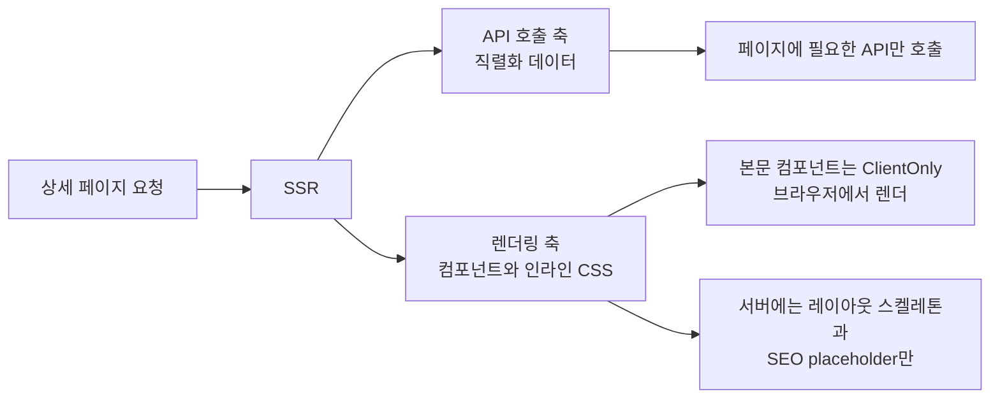

상세 페이지의 SSR 응답을 가볍게 하는 작업을 다른 상세 페이지로 넓히던 중이었습니다. 앞선 작업에서는 SSR 시점에 부르는 API를 페이지 API 하나로 줄였고, 같은 방식을 나머지 상세 페이지에도 적용하려 했습니다. 시작 전에 네 페이지의 응답 크기를 재 보니, 호출을 이미 줄인 페이지와 아직 줄이지 않은 페이지의 크기가 거의 같았습니다. 응답의 85~90%는 **인라인 CSS**{: .key}였습니다.

이 글에서는 SSR 응답을 줄일 때 호출 수와 응답 바이트를 나눠 재고, 실제로 큰 부분인 렌더링 쪽을 줄인 과정과 전후 값을 다룹니다.

## 작업 배경: 상세 페이지 SSR 부하 줄이기

Nuxt로 그리는 상세 페이지 네 곳이 대상이었습니다. 두 곳(아래 상세 C·D)은 앞선 작업에서 SSR 시점 API 호출을 페이지 API 하나로 줄여 둔 상태였습니다. 나머지 두 곳(상세 A·B)은 부모 레이아웃이 공통 정보 전체와 로그인 후속 조회를 서버에서 모두 부르고 있었습니다. 이번 작업은 A·B에도 같은 방식을 적용하는 것이었습니다.

## 해결하려던 문제: SSR 응답 HTML의 크기

SSR은 요청마다 서버가 페이지를 그려 HTML 한 벌을 만듭니다. 서버가 그리는 양이 많을수록 CPU를 더 쓰고, 내려 보내는 HTML도 커집니다. 목표는 상세 페이지 요청 한 번에 서버가 만드는 HTML을 가볍게 하는 것이었습니다.

## 처음 가정: SSR 시점 API 호출 줄이기

SSR 시점에 API를 덜 부르면, 응답에 직렬화되어 실리는 데이터도 줄고 HTML도 작아질 거라고 가정했습니다. 그래서 앞선 작업에서는 호출 수를 줄이는 일부터 했고, A·B에도 같은 작업을 이어서 하려 했습니다.

## 기준선 측정: 응답의 85~90%를 차지한 인라인 CSS

넓히기 전에 네 페이지의 기준선을 같은 조건으로 쟀습니다. 비로그인으로 같은 주소를 `Accept: text/html`로 요청하고, 응답 전체 바이트와 `<style>` 태그 안 내용의 바이트 합을 같이 적었습니다. 사용한 스크립트는 아래와 같습니다.

```js
// 사용: node measure-ssr.mjs <URL>
const url = process.argv[2]
const res = await fetch(url, { headers: { Accept: 'text/html' } })
const html = await res.text()

const total = Buffer.byteLength(html)
const inlineCss = [...html.matchAll(/<style[^>]*>([\s\S]*?)<\/style>/g)]
  .reduce((sum, m) => sum + Buffer.byteLength(m[1]), 0)

const kb = (n) => +(n / 1024).toFixed(1)
console.log({
  status: res.status,
  totalKB: kb(total),
  inlineCssKB: kb(inlineCss),
  restKB: kb(total - inlineCss),
  cssShare: `${((inlineCss / total) * 100).toFixed(1)}%`,
})
```

결과는 아래와 같습니다.

| 페이지 | SSR API 호출 | 응답 크기 | 인라인 CSS | 비중 |
|---|---|---|---|---|
| 상세 A | 줄이기 전 | 395.8 KB | 353.8 KB | 89% |
| 상세 B | 줄이기 전 | 401.3 KB | 354.8 KB | 88% |
| 상세 C | 줄인 뒤 | 383.8 KB | 345.6 KB | 90% |
| 상세 D | 줄인 뒤 | 396.3 KB | 337.3 KB | 85% |

호출을 줄인 C·D와 줄이지 않은 A·B의 응답 크기는 380~400 KB로 거의 같았습니다. 직렬화 데이터가 줄었더라도 응답 전체에서 차지하는 몫이 작아서, 전체 크기에는 거의 드러나지 않았습니다. 이 프로젝트의 Nuxt 빌드는 CSS를 별도 파일로 추출하지 않아서, 서버가 그린 컴포넌트의 CSS가 모두 응답 HTML에 인라인으로 들어갔습니다. **응답 크기를 좌우하는 것은 서버가 그리는 컴포넌트의 양이었습니다.**

## 렌더링 줄이기: ClientOnly와 레이아웃 스켈레톤

그래서 API 호출과 별개로 **렌더링 축**{: .key}을 줄이기로 했습니다. 서버가 그리는 컴포넌트가 줄면 그 컴포넌트의 CSS도 응답에서 빠집니다.



바꾼 것은 세 가지입니다.

- 본문 컴포넌트를 `<ClientOnly>`로 감싸 브라우저에서만 그립니다.
- 서버 HTML에는 placeholder로 제목, 본문 텍스트, 대표 이미지를 가벼운 시맨틱 태그(`h1`, `p`, `img`)로 넣습니다. 숨긴 텍스트가 아니라 화면에 보이는 내용이라, 사용자와 크롤러가 같은 내용을 봅니다. 무거운 컴포넌트를 쓰면 그 CSS가 다시 인라인되므로 placeholder에는 쓰지 않습니다.
- placeholder를 실제 레이아웃 뼈대(헤더 높이, 2단 컨테이너, 썸네일 크기)에 맞춘 스켈레톤으로 그립니다. 처음에는 placeholder가 레이아웃을 따르지 않아 서버 렌더 시점에 이미지만 크게 보이다가 하이드레이션 뒤에 원래 레이아웃으로 돌아왔습니다. 모바일(400px)과 데스크톱(1440px) 두 폭에서 JS를 끈 화면과 켠 화면의 썸네일·제목 위치를 Playwright로 재서 같아질 때까지 맞췄습니다.

A·B에는 원래 하려던 API 호출 줄이기도 같이 적용했습니다. 비로그인 기준 SSR 시점 호출은 4건에서 3건과 2건으로 줄었습니다. 호출 수는 바이트와 섞지 않고 따로 적었습니다.

## 전후 응답 크기 비교


| 페이지 | 전 응답 / 인라인 CSS | 후 응답 / 인라인 CSS | 전체 감소 |
|---|---|---|---|
| 상세 A | 395.8 / 353.8 KB | 317.8 KB (CSS 구분 없음) | -20% |
| 상세 B | 401.3 / 354.8 KB | 322.5 KB (CSS 구분 없음) | -20% |
| 상세 C | 383.8 / 345.6 KB | 315.6 / 297.4 KB | -18% |
| 상세 D | 396.3 / 337.3 KB | 311.6 / 294.6 KB | -21% |

**네 페이지 모두 응답이 18~21% 줄었습니다.** CSS를 나눠 잰 C·D를 보면 줄어든 양의 절반 이상이 인라인 CSS였습니다. 상세 C는 68.2 KB가 줄었고, 그중 48.2 KB가 인라인 CSS였습니다. 상세 D는 84.7 KB 가운데 42.7 KB였습니다. A·B의 개선 후 값은 헤더를 스켈레톤으로 확정한 뒤의 최종 측정이라 응답 총량만 있습니다. API 호출을 이미 줄여 두었던 C·D도 렌더링 축만 바꿔 A·B와 비슷한 폭으로 줄었습니다.

## 남은 트레이드오프: 전역 CSS와 서버 렌더 헤더

줄인 뒤에도 C·D 응답에는 인라인 CSS가 294.6~297.4 KB 남았습니다. 남은 부분은 전역 레이아웃과 공통 컴포넌트의 CSS라서, 페이지 단위 ClientOnly로는 더 줄일 수 없습니다. 빌드에서 CSS를 별도 파일로 추출하면 첫 HTML이 작아지고 스타일도 캐시할 수 있습니다. 다만 모든 화면의 스타일 적용 순서가 바뀔 수 있어 전체 화면 QA가 필요하므로, 이번 작업 범위에서는 뺐습니다.

헤더도 같은 방식으로 쟀습니다. 스켈레톤 헤더 대신 실제 헤더를 서버에서 그리면 응답이 25.6 KB(그중 CSS 23.1 KB) 늘어, 전체 감소 폭이 약 20%에서 약 13%로 줄었습니다. 헤더 컴포넌트 소스의 style 블록만 더하면 5.5 KB 정도였는데, 실제로는 헤더가 끌고 오는 공통 버튼·아이콘 CSS까지 같이 실렸습니다. **헤더는 스켈레톤으로 확정했습니다.** 스켈레톤 자체의 CSS는 페이지당 약 4 KB였습니다.

## 정리

- SSR 응답을 줄이기 전에 응답 전체 바이트와 인라인 CSS 바이트를 같이 잽니다.
- 호출 수는 서버가 하는 일의 지표로, 응답 바이트는 내려 보내는 양의 지표로 따로 적습니다.
- 인라인 CSS가 응답의 대부분이면, 서버가 그리는 컴포넌트를 줄이는 쪽이 응답 크기에 바로 드러납니다.
