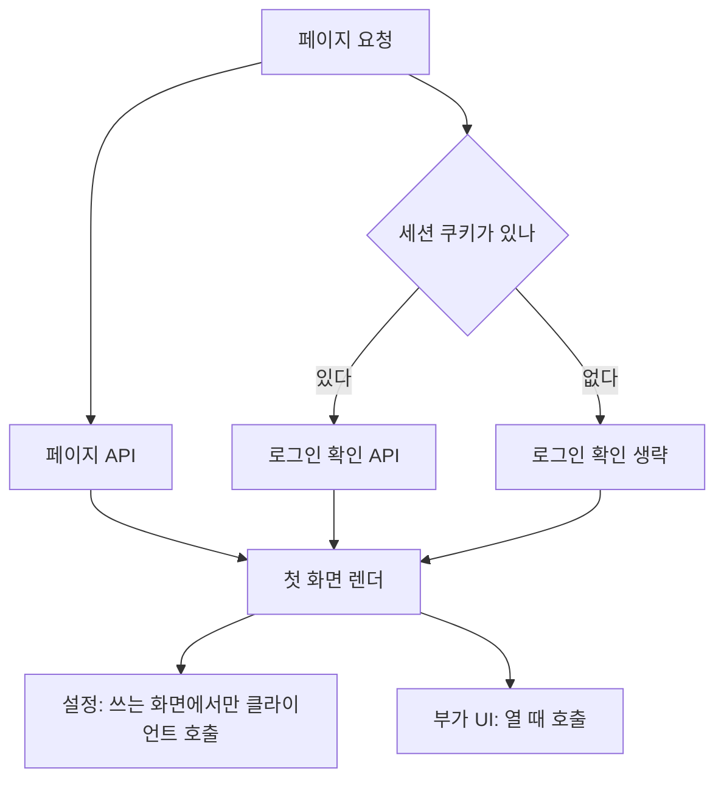

서버가 페이지를 그리는 시점에 부르는 API를, 봇 요청과 사람 요청에 똑같이 붙여 두었습니다. 페이지 하나를 열면 로그인 확인과 채널·설정 API가 같이 나갔고, 크롤러가 그 페이지를 열 때마다 그 호출이 그대로 붙었습니다. 그래서 요청에 **세션 쿠키**{: .key}가 있는지, 그 값이 첫 화면에 꼭 필요한지로 호출을 나누기로 했습니다.

이 글에서는 서버가 페이지를 그릴 때 부르는 API를, 세션 유무와 첫 화면 필요 여부로 나누는 방법을 다룹니다.

## 한눈에 보는 결론

- 제약: 첫 화면에 필요한 내용은 서버에서 그려야 하고, 사람이 보는 화면은 그대로여야 합니다. 다만 세션이 없거나 첫 화면에 없는 값은, 페이지를 여는 모든 요청에 붙여 둘 필요가 없습니다.
- 결정: 쿠키가 없으면 로그인 확인을 생략하고, 설정은 쓰는 화면에서만 클라이언트에서 부르며, 부가 UI API는 그 UI를 열 때 호출합니다.

## 과제와 제약

목표는 서버가 그리는 첫 화면은 유지하면서, 페이지를 열 때마다 같이 나가던 호출을 나누는 것이었습니다. 기존 서버 렌더링은 들어온 요청을 사람 페이지처럼 다루어, 봇이 페이지 하나를 열어도 로그인 확인과 페이지 API가 나갔고, 채널 페이지면 채널·설정 API까지 같이 나갔습니다. 자바스크립트를 실행하는 봇은 본문 아래 부가 UI용 호출까지 만들 수 있었습니다. 첫 화면을 비우면 사람이 보는 내용이 빠지므로, 호출을 통째로 빼는 방법은 쓸 수 없었습니다.

## 제약에 맞춰 고른 방법

선택지는 세 가지였습니다. User-Agent로 봇을 막아 호출 자체를 줄이는 방법, 서버에서 설정 응답을 캐시하는 방법, 그리고 호출을 세션 유무와 첫 화면 필요 여부로 나누는 방법입니다. User-Agent 차단은 우회가 쉬워, 그것만으로는 부족하고 보조 수단에 가깝습니다. 서버 캐시는 같은 설정을 반복해서 읽는 비용을 줄이지만, 쿠키가 없는데도 로그인 확인을 부르는 구조 자체는 남습니다. 그래서 **호출을 나누는 쪽을 택하고, 서버 캐시는 같이 쓰기로 했습니다**.

로그인 확인은 세션 쿠키가 있을 때만 서버에서 부릅니다. 설정은 그 값을 쓰는 화면의 클라이언트에서만 부르고, 부가 UI는 패널을 여는 시점에 호출합니다. 자바스크립트를 실행하지 않는 봇에는 클라이언트 호출이 나가지 않고, 설정 장치를 두지 않은 화면에도 설정 API가 나가지 않습니다.

## 기본 구조

아래는 그 구분을 Nuxt 3의 useCookie와 useFetch로 옮긴 일반 예시입니다. useCookie는 서버와 클라이언트에서 쿠키를 읽을 수 있고, useFetch는 기본이 서버에서도 호출이며, `server: false`와 `immediate: false`로 그 시점을 옮길 수 있습니다.



```vue
<script setup lang="ts">
const sessionCookie = useCookie('session')

const { data: page } = await useFetch('/api/page')

const { data: session } = await useFetch('/api/session', {
  immediate: Boolean(sessionCookie.value),
})

const { data: settings } = await useFetch('/api/settings', {
  server: false,
})

const { execute: loadExtras } = await useFetch('/api/extras', {
  server: false,
  immediate: false,
})

function openExtraPanel() {
  loadExtras()
}
</script>
```

페이지 API는 첫 화면에 필요하므로 서버에서 그대로 부릅니다. 로그인 확인은 쿠키가 있을 때만 `immediate`를 켜서, 세션이 없는 요청에서는 호출이 나가지 않게 했습니다. 설정은 그 값을 쓰는 화면에만 이 호출을 두고, 서버에서는 부르지 않습니다. 부가 UI는 `immediate: false`로 두었다가, 패널을 여는 함수에서 `execute`를 호출합니다.

## 정리

- 서버 렌더 시점의 호출은 세션 유무와 첫 화면 필요로 나눕니다.
- 쿠키가 없으면 로그인 확인을 생략합니다.
- 설정은 쓰는 화면의 클라이언트에서만, 부가 UI는 열 때 부릅니다.
- User-Agent 차단만으로는 부족하고, 서버 캐시는 호출을 나누는 일과 같이 씁니다.

서버가 페이지를 그리는 시점의 API는, **세션 유무와 첫 화면 필요로 나누려고 합니다**.

## 참고

- [Nuxt useCookie](https://nuxt.com/docs/3.x/api/composables/use-cookie)
- [Nuxt useFetch](https://nuxt.com/docs/3.x/api/composables/use-fetch)
