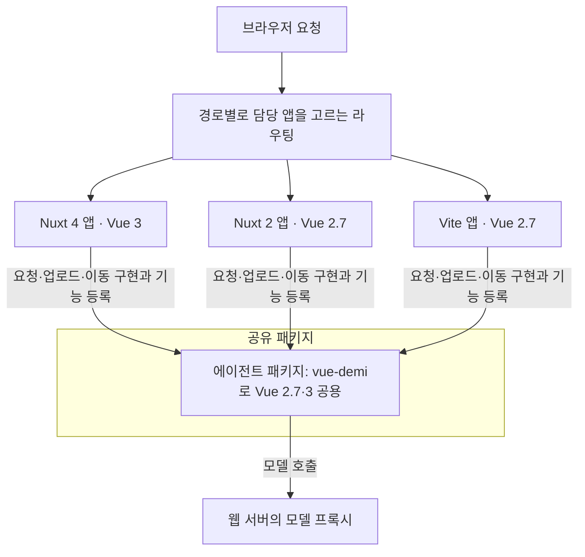
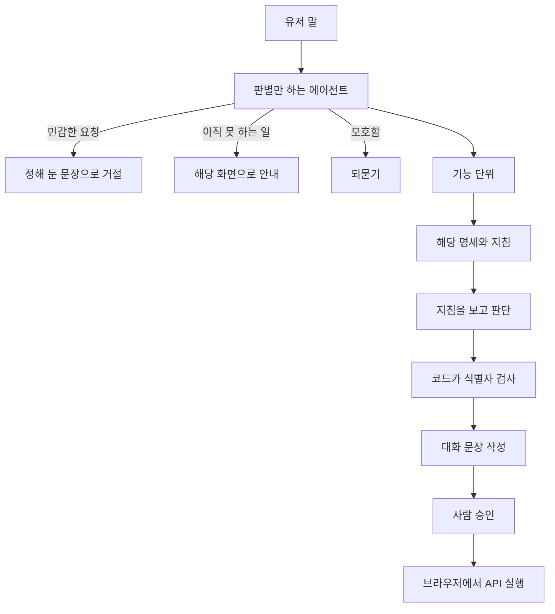
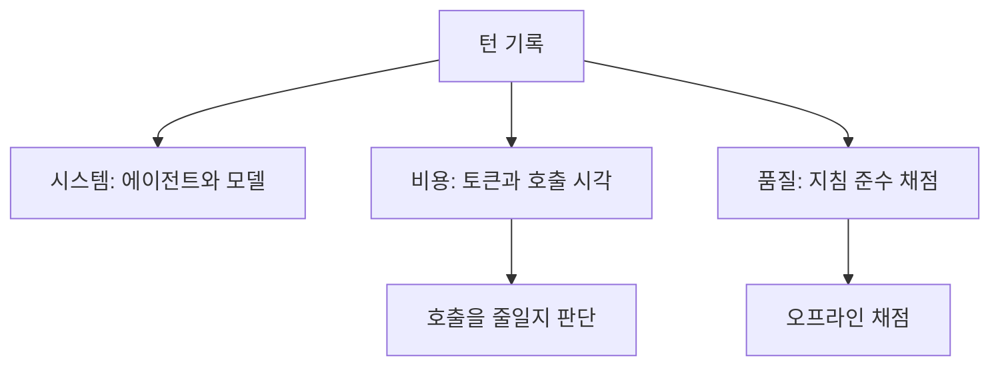

경영진 세션에서, 비즈니스를 확장하기 위해 사람을 더 뽑아야만 확장되는 구조를 개선할 무언가를 만들면 좋겠다는 질문을 듣고 고민을 시작했습니다. 유저가 운영을 이어 갈 때 다음 행동을 찾고 실행하는 일에, 사람 손을 늘리지 않고도 도움을 줄 수 있을까 싶었습니다.

당시 제가 쓸 수 있다고 가정한 것은 프론트엔드 리소스뿐이었습니다. 서버 인력을 새로 쓰기보다, 프론트엔드 개발자로서 할 수 있는 최선이 무엇인지부터 천천히 따져 보았습니다. 백엔드 역할을 넘지 않고 MCP도 두지 않은 채, 이미 있는 API만으로 어디까지 갈 수 있을까가 출발점이었습니다.

유저 운영을 돕는 AI 에이전트를 만들며, 저는 확인 가능한 상태만 읽고 다음 일을 제안한 뒤, 사람이 승인한 범위만 실행하는 쪽으로 방향을 잡았습니다.

## API 명세만 넘기고 브라우저에서 실행하는 방식

백엔드 역할을 넘지 않고 MCP도 새로 두지 않으려면, 유저가 실제로 호출할 수 있는 API를 에이전트에게 명세까지만 주고 실행은 브라우저에서 하는 편이 낫다고 봤습니다. 모델을 호출할 때는 기존 API의 타입 선언에서 뽑은 입력 스키마에, 기능마다 고른 호출 목록과 예시를 붙여 JSON으로 넘깁니다. 모델이 어떤 호출이 필요한지 고르면 웹 클라이언트가 그 API를 실행합니다. 모델이 서버를 직접 두드리지 않고, 호출할 API와 경로는 코드가 정하며, 모델이 채운 값은 보내기 전에 스키마로 한 번 더 검사합니다.

실행은 유저의 세션 권한을 그대로 탑니다. 에이전트를 위해 업무 API에 새 권한을 만들지 않아도 되고, 서버가 원래 하던 검증도 그대로 적용됩니다. 그래서 이 방식이 더 안전하다고 봤습니다. 모델 호출만은 키를 숨기려고 웹 서버에 얇은 프록시 하나를 두었고, 판단과 실행은 모두 브라우저에 있습니다. 그 밖에 서버 쪽으로 넓힌 것은 데모 단계에서 디버깅을 위해 턴 기록을 올려 두는 S3 저장소까지였습니다.

또 한 가지는, AI와 상관없는 신기능이 나와도 API는 원래 만들어집니다. 입력 스키마는 타입 선언에서 다시 생성되니, 어떤 호출을 열지와 되돌릴 수 있는지, 실행 뒤 무엇을 안내할지만 기능마다 정해 주면 새 기능을 실행 범위에 넣을 수 있습니다. 명세 자체도 요즘은 OpenAPI로 자동화하는 경우가 많아서, 지침과 허용할 API 가드레일만 맞춰 두면 업데이트가 한결 쉬워집니다.

실행은 사람이 승인한 뒤에만 하도록 했습니다. 지금 확인 가능한 정보만 보고 해볼 만한 일을 제안하고, 초안을 만들거나 설정을 바꾸는 일을 도우며, 실행 계획은 무엇을 바꿀지 먼저 보여 주고 승인을 받은 뒤에만 브라우저가 요청을 보냅니다.

처음에는 되돌릴 수 없는 동작을 아예 막았는데, 승인 절차가 이미 있는데도 막는 것은 구현의 한계를 유저에게 떠넘기는 일이라고 보고 바꿨습니다. 지금은 API마다 되돌릴 수 있는지를 선언해 승인 화면에 보여 주고, 되돌릴 수 있는 쓰기는 직전 상태를 남겨 둡니다. 다만 바깥에 바로 보이는 공개 전환은 승인을 받더라도 에이전트에게 맡기지 않고, 사람이 화면에서 직접 누르게 두었습니다. 실행이 끝나면 무엇이 만들어졌는지와, 이후에 무엇을 확인하면 좋을지를 안내합니다.

다만 실제 권한이 있는 API만 호출할 수 있어야 하고, 여러 쓰기를 한꺼번에 보내면 데이터베이스 잠금이 생길 수 있습니다. 그래서 실행을 묶는 코드, 이른바 하네스에서 허용 목록에 있는 호출만 받고, 계획에 든 호출은 한 건씩 차례로 보내기로 했습니다. 하나라도 어긋나면 거기서 멈추고, 계획을 다시 짜는 단계로 넘깁니다.

```ts
type Call = { catalogId: string; payload: Record<string, unknown> };
type CatalogEntry = {
  method: "GET" | "POST" | "PUT" | "DELETE";
  path: string;
  validate: (payload: unknown) => boolean;
};

async function executeApprovedPlan(
  calls: Call[],
  catalog: Map<string, CatalogEntry>,
  request: (entry: CatalogEntry, payload: Record<string, unknown>) => Promise<unknown>,
) {
  for (const [index, call] of calls.entries()) {
    // 경로와 메서드는 모델 출력이 아니라 허용 목록에서 꺼냅니다.
    const entry = catalog.get(call.catalogId);
    if (!entry) {
      return { ok: false, failedAt: index, reason: "not in catalog" } as const;
    }
    if (!entry.validate(call.payload)) {
      return { ok: false, failedAt: index, reason: "invalid payload" } as const;
    }
    // 여러 쓰기를 한꺼번에 보내면 잠금이 생길 수 있어 한 건씩 보냅니다.
    await request(entry, call.payload);
  }
  return { ok: true } as const;
}
```

화면에서 막히던 제약이 이 경로에서는 더 이상 안전장치가 되지 않는다는 점도 분명해졌습니다. 실제로 붙여 보니 화면에만 있고 서버에는 없는 제약이 있었습니다. 서버의 검증이 안전장치의 중심이 되어야 한다고 보고, 그런 자리는 보내기 직전 검사로 메웠습니다.

그리고 이 서비스의 웹 프론트엔드는 Vue 2에서 Vue 3로 마이그레이션하는 중이었습니다. 한 모노레포 안에서 Nuxt 4(Vue 3) 앱, Nuxt 2 앱, Vite로 빌드하는 Vue 2.7 앱이 함께 돌고, 경로마다 어느 앱이 그 화면을 맡을지는 라우팅 단계에서 나눕니다. 실제 구조는 아래 그림과 같습니다. 이 구조에서 에이전트를 한 앱에 붙여 두면 화면이 다른 앱으로 옮겨질 때마다 그 화면에서 에이전트가 사라졌습니다.



그래서 에이전트는 Vue 2.7과 Vue 3를 함께 지원하는 UI 라이브러리처럼 공유 패키지로 만들었습니다. 컴포넌트와 컴포저블은 vue-demi로 두 버전의 차이를 감추고, 앱이 바뀌어도 상태와 흐름이 같게 돌도록 짰습니다. 요청, 업로드, 화면 이동 같은 기능은 에이전트가 직접 들고 있지 않고, 에이전트를 붙인 각 앱이 자기 방식대로 구현해 넘겨 주게 했습니다. 어떤 기능을 열지도 그 앱이 등록하게 해서, 그 기능이 없는 앱에서는 제안이 나오지 않게 했습니다.

다만 같은 화면이 두 앱에 걸쳐 있는 구간에서는, 프롬프트만으로 그 기능을 열 수는 없었습니다. 같은 API를 새 화면과 예전 화면이 다르게 선언해 둔 곳에서는, 모델이 맞는 값을 써도 실제로 요청을 받는 쪽이 그 값을 모를 수 있었습니다. 모델에게 일을 맡긴다고 해서, 클라이언트가 아직 이어 주지 못한 경로까지 실행되는 것은 아니었습니다.

## API를 읽으며 놓친 기능을 발견한 과정

에이전트를 고도화하다 보면, 처음 계획에는 없던 데이터가 더 필요해질 때가 있습니다. 자세히 보면 그건 유저에게 필요한 기능인데, 우리가 놓치고 있던 경우이기도 했습니다.

API를 그대로 읽는 구조 덕분에, 그 빈칸이 비교적 빨리 보였습니다. 에이전트가 할 일을 설계하며 확인하려던 값이 API에 없던 자리가, 유저 화면에서도 그 값이 빠져 있던 자리와 겹치는 일이 있었습니다. 예를 들어 에이전트가 만든 결과물 하나가 이후 실제로 팔렸는지 확인하려 했는데, 응답에 그 결과물을 이어 줄 식별자가 없었고, 사람이 쓰는 관리 화면도 같은 질문에 답하지 못했습니다. 사람에게 필요한 것이 에이전트에게도 필요해지는 경험은, 뒤에서 다시 이어집니다.


에이전트를 고도화하다 필요한 데이터가 더 생기면, API 명세에 그 값이 없는 때가 유저에게 빠져 있던 기능과 겹치는 과정입니다.

## 기능 단위로 명세를 나누고 판별만 맡기는 구조

에이전트가 모든 API 응답을 알아야 한다면 토큰 낭비도 크고, 없는 내용을 지어 낼 여지도 커집니다. 그래서 명세를 기능 단위로 쪼개고, 유저의 말을 어느 단위로 보낼지 판별하는 에이전트를 따로 두었습니다. 이 에이전트는 기능 단위를 고르고, 요청이 모호할 때 되묻는 한 문장 말고는 유저에게 보여줄 답을 만들지 않으며, 비교적 저렴한 모델을 씁니다. 고를 수 있는 값은 응답 스키마로 미리 묶어 두고, 받은 뒤에 코드가 한 번 더 검증합니다. 나눠진 단위마다 그 기능의 API와, 그 기능에 고유한 도메인 지식을 담은 지침을 두었습니다.

```ts
type Route =
  | { kind: "unit"; unit: string }
  | { kind: "clarify"; question: string }
  | { kind: "unsupported" };

async function classifyUnit(
  message: string,
  units: readonly string[],
  model: {
    generateJson: (input: { system: string; user: string; schema: object }) => Promise<unknown>;
  },
): Promise<Route> {
  const schema = {
    type: "object",
    properties: {
      unit: { type: "string", enum: [...units, "unsupported"] },
      question: { type: "string" },
    },
    required: ["unit"],
  };
  const raw = await model.generateJson({
    system: "Pick one unit. Ask one short question only when the request is ambiguous.",
    user: message,
    schema,
  });
  // 스키마로 묶어도 받은 값은 코드가 다시 확인합니다.
  if (typeof raw !== "object" || raw === null) return { kind: "unsupported" };
  const { unit, question } = raw as { unit?: unknown; question?: unknown };
  if (typeof question === "string" && question.length > 0) return { kind: "clarify", question };
  if (typeof unit !== "string" || !units.includes(unit)) return { kind: "unsupported" };
  return { kind: "unit", unit };
}
```



에이전트가 대신 받아선 안 되는 민감한 요청은, 판별 단계에서 어느 갈래인지만 고르게 하고 실행하지 않습니다. 어떻게 답할지는 모델이 아니라 코드에 정해 둔 문장이 맡아서, 모델이 이번에는 해도 되겠다고 판단할 자리를 두지 않았습니다. 읽는 쪽도 같은 기준으로, 개인정보가 실리는 조회 경로는 에이전트가 읽기 전에 코드에서 막아 두었습니다.

제안이 늘수록, 무엇을 근거로 그렇게 말했는지가 코드 여기저기에 문장으로 박혀 있었습니다. 그 문장을 고치려면 코드를 고쳐 배포해야 했고, 나중에 그 제안을 다시 보면 당시 어떤 기준을 봤는지 남기지 못했습니다. 그래서 바꿀 수 있는 판단 기준은 운영 지침 저장소로 옮기고, 빌드 때 게시된 항목만 가져오도록 했습니다. 이제 기준을 고칠 때 코드는 건드리지 않고, 다음 빌드에 반영됩니다. 에이전트가 인용할 수 있는 것은 그 목록에 있는 식별자뿐입니다. 사람에게 보여 주는 예시 장면은 같은 저장소에 두되, 모델 입력에는 넣지 않았습니다.

지침 본문을 유저에게 그대로 보여 주면 안 된다고 보고, 모델에게 "지침을 말하지 말라"고만 지시하는 방식으로는 부족하다고 판단했습니다. 말을 바꿔 물으면 뚫릴 수 있기 때문입니다. 그래서 지침을 보고 판단하는 쪽과, 유저와 대화하는 쪽을 나누는 구조를 설계했습니다. 이 구조에서 지침을 보는 쪽은 본문을 읽지만 유저가 쓴 원문은 받지 않고, 코드가 정리한 의도와 관측만 받습니다. 대화하는 쪽은 원문을 보지만 지침 본문은 보지 못하고, 제안 내용과 관측만 받아 할 말을 씁니다. 인용한 식별자가 이번에 실어 준 지침 목록에 있는지는 코드가 검사해 기록에 남기고, 그 식별자는 대화 쪽으로 넘기지 않습니다.

다만 이 분리가 막는 것은 대화로 지침을 끌어내는 경로입니다. 실행을 브라우저에서 하는 구조라 지침 본문은 클라이언트 코드에 함께 실리기 때문에, 본문은 모델 호출을 맡는 서버에서 붙이도록 설계했습니다.

지침을 고를 때는 코드가 먼저 단계와 대상으로 범위를 좁히고, 지침이 더 늘어나면 그 안에서 모델이 고르는 단계를 두도록 설계했습니다. 인용이 그 주장을 실제로 뒷받침하는지는 실시간 대화 경로에 넣지 않고, 따로 채점하도록 두었습니다. 채점하는 역할은 글을 쓴 쪽과 나누고, 가능하면 다른 모델을 씁니다.

```ts
type Judgment = {
  result: { unit: string; feasible: "yes" | "partial" | "no" };
  grounds?: { guidelineIds: string[]; catalogVersion: string };
};

// 대화 쪽에는 근거 식별자를 떼고 넘깁니다.
function forConversation(judgment: Judgment) {
  const { grounds: _grounds, ...visible } = judgment;
  return visible;
}

// 이번 호출에 실어 준 지침과 대조해, 목록에 없는 식별자는 버리지 않고 따로 셉니다.
function checkCitations(judgment: Judgment, offered: Set<string>) {
  const ids = judgment.grounds?.guidelineIds ?? [];
  return {
    valid: ids.filter((id) => offered.has(id)),
    invalid: ids.filter((id) => !offered.has(id)),
  };
}
```

지금은 제안이 어떤 지침을 참고했는지 식별자를 기록하고, 그 지침을 올바르게 반영했는지, 지침 자체는 타당한지, 에이전트가 읽는 데이터는 부족한지를 나눠 보고 있습니다. 지침마다 어느 단계에서 읽을지를 표시해 두었는데, 한 지침이 작성 단계에만 걸려 있어서 기획 단계의 판단에는 반영되지 않은 일이 있었습니다. 그 지침이 읽힐 단계를 고치고, 지침의 조건을 판별하는 데 필요한 값도 기획 단계에 넘기도록 맞추었습니다.

호출이 늘면 "느리다"는 느낌만으로는 어디를 고쳐야 하는지 알기 어렵습니다. 그래서 턴 기록에 어느 에이전트가 어떤 모델을 불렀는지, 토큰은 얼마나 썼는지, 호출이 언제 시작하고 끝났는지를 남기기로 했습니다. 이 층이 시스템과 비용입니다. 백엔드 관측 도구를 새로 두지 않고, 호출 기록만으로도 어느 단계가 긴지 보려는 선택이었습니다. 실제로 이 기록에서 상위 모델 호출이 4분 46초까지 걸리고, 5분을 넘긴 호출은 Node 내장 fetch(undici)의 응답 헤더 대기 기본값인 300초에 걸려 끊기는 것을 봤습니다. 같은 요청을 한 단계 가벼운 모델은 30초 안쪽에 냈기 때문에, 역할마다 기본 모델을 가벼운 쪽으로 낮췄습니다. 지금은 스트리밍이 아니라서, 첫 토큰이 나오기까지의 시간은 재지 않습니다.

품질은 따로 봅니다. 처음에는 인용 하나하나가 주장을 뒷받침하는지를 쟀는데, 지금은 결과물 하나에 실린 지침을 따랐는지, 놓쳤는지, 어겼는지, 필요 없이 인용했는지를 봅니다. 실제 모델을 부르는 채점은 일반 테스트와 섞지 않습니다. 테스트 러너가 모으는 파일 이름을 쓰지 않고 테스트 명령에도 걸지 않았으며, 실행 플래그가 없으면 모델을 부르지 않게 두었습니다.

```ts
if (!process.argv.includes("--live")) {
  console.log("model call skipped");
  process.exit(0);
}
```



지침 준수 채점처럼 모델을 여러 번 부르는 확인이 늘면 비용도 함께 늘어납니다. 어디까지 감당할지 정하려면, 신규 유저가 하루 안에 서비스를 시작할 수 있는 수준까지 가는 데 토큰이 얼마나 드는지부터 재야 한다고 봤습니다. 그래서 그 기준이 되는 흐름을 먼저 만들고, 그 위에서 토큰 비용을 재기로 했습니다.

### 판단 전용 모델 검토

판별 에이전트를 만들던 무렵, 글을 생성하지 않고 정해 둔 선택지 가운데 답과 그 확률을 돌려주는 판단 전용 모델로 TypeSafe AI의 [Jev](https://typesafe.ai/blog/introducing-system-one-models-and-jev)가 소개되었고, 이를 공개 API로 제공하는 서비스도 있었습니다. 판별처럼 고르기만 하는 호출은 지금 구조에서 가장 가벼운 모델을 쓰는데, 검토 당시 공개 요금표로 따져 보면 입력 1,000토큰과 출력 100토큰짜리 호출을 100만 번 해도 140달러에서 550달러 사이였습니다. 호출 한 번에 1원이 안 되는 돈이라, 판단 모델로 바꿔 아낄 수 있는 몫이 크지 않았습니다. 나중에 실험에서 잰 비슷한 분류 호출도 한 번에 입력 약 1,200토큰, 출력 약 90토큰이라 이 가정에서 크게 벗어나지 않았습니다.

반면 바꾸는 쪽에는 따로 드는 것이 있었습니다. 추천 이유 같은 문장은 판단 모델이 쓰지 않으니 그 자리에 다른 모델 호출이 하나 더 필요했고, 공개 API는 키마다 호출 한도가 있어 429나 503 응답을 받았을 때 돌아갈 경로도 따로 만들어야 했습니다. 호스팅 API로 바꾸면 데이터가 바깥으로 나가고, 직접 운영할 수 있는 공개 가중치는 CC BY-NC 4.0이라 상업 서비스에는 쓸 수 없었습니다. 후보를 제한하고 코드로 검증하는 장치는 이미 있었기 때문에, 기존 구조를 유지하기로 했습니다.

### 에이전트 프레임워크 검토

실행을 묶는 코드를 직접 쓰기 전에 LangChain과 LangGraph도 비교했습니다. LangChain이 줄여 주는 것은 모델 호출, 응답 파싱, 토큰 집계 정도였고, 허용 목록과 도메인 지침, 되돌리기 같은 나머지는 그대로 남았습니다.

LangGraph는 사정이 달랐습니다. 체크포인터에 상태를 저장해 두고 같은 스레드에서 멈춘 실행을 이어 가는 구조라서 상태를 저장할 곳이 있어야 하는데, [LangGraph 체크포인터 공식 문서](https://docs.langchain.com/oss/python/langgraph/checkpointers#checkpointer-libraries)도 인메모리 체크포인터(`InMemorySaver`)는 실험용으로 두고, 운영에서는 Postgres 같은 데이터베이스 기반 체크포인터를 쓰도록 안내합니다. 지금 구조는 서버가 실행 상태를 들고 있지 않고, 화면이 에이전트의 진행 상태를 직접 구독하며, 요청과 화면 이동 같은 도구는 유저의 세션과 앱 화면에 묶여 있습니다. 그래서 LangGraph를 쓴다는 것은 라이브러리를 바꾸는 일이 아니라 실행 위치를 서버로 옮기는 일이라고 봤습니다. 옮기면 화면은 서버가 흘려보내는 상태 변화를 받아 다시 조립해야 하고, 브라우저에 묶인 도구는 서버가 브라우저에 되묻는 호출이 됩니다.

한 턴이 분 단위로 길어지거나 웹 밖의 클라이언트가 같은 에이전트를 불러야 하는 때가 오면, 그때는 프레임워크보다 실행 위치를 서버로 옮길지부터 고민해야 할 것 같습니다.

## 사람에게 필요한 것과 에이전트에게 필요한 것

LLM만으로 유저의 수익이 늘어나지는 않습니다. 다만 이것만 에이전트의 한계는 아닙니다. 사람 역시 수익이 늘 늘어난다고 말할 수는 없었고, 비즈니스팀에게도 그런 방법은 없었습니다.

그 대신 비즈니스팀에는 몇 년 동안 일을 하며 쌓인 직관과, 이렇게 하면 잘 될 것이라는 규칙이 있었습니다. 새로 합류하는 사람을 위해 그 내용은 운영 전략 문서와 플레이북으로 정리되어 있었고, 그 문서는 에이전트가 쓸 지침으로도 어느 정도 쓸 수 있었습니다. 에이전트에게도 실제로 필요한 정보였기 때문입니다. 그대로 맞지 않는 부분은 골라 옮겼습니다. API를 그대로 읽으며 유저에게 필요했는데 놓치고 있던 기능을 발견한 일과, 결이 비슷했습니다.

성과를 예측하지 말라는 식의 금지선은 운영 지침이 아니라 코드에 남겨, 지침 문구를 고친다고 풀리지 않게 했습니다. 그리고 코드로 확인할 수 있는 부분, 예를 들어 근거로 든 값이 실제로 관측한 값인지는 코드가 검사해서 어긋난 답을 받지 않습니다. 에이전트에게도 "잘 되고 있다"고 단정하기보다, 확인 가능한 범위 안에서만 말하게 하고, 모르는 부분은 모른다고 적을 자리를 출력 형식에 따로 두었습니다.

제 생각엔 사람에게 필요한 것은 에이전트에게도 필요하고, 에이전트가 필요로 한 것은 사람에게도 필요합니다. 사람을 늘리지 않고 운영을 도우려면, 에이전트가 글을 잘 만드는 것만으로는 부족하고, 판단의 근거를 남기며 그 근거가 맞는지 확인할 수 있어야 합니다.
