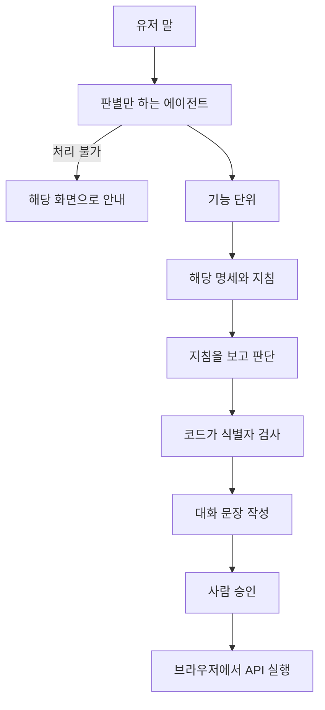
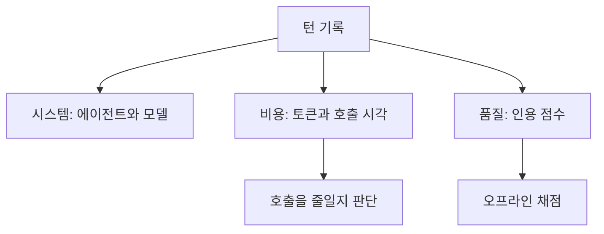

경영진 세션에서, 비즈니스를 확장하기 위해 사람을 더 뽑아야만 확장되는 구조를 개선할 무언가를 만들면 좋겠다는 질문을 듣고 고민을 시작했습니다. 유저가 운영을 이어 갈 때 다음 행동을 찾고 실행하는 일에, 사람 손을 늘리지 않고도 도움을 줄 수 있을까 싶었습니다.

당시 제가 쓸 수 있다고 가정한 것은 프론트엔드 리소스뿐이었습니다. 서버 인력을 새로 쓰기보다, 프론트엔드 개발자로서 할 수 있는 최선이 무엇인지부터 천천히 따져 보았습니다. 백엔드를 바꾸지 않고 MCP도 두지 않은 채, 이미 있는 API만으로 어디까지 갈 수 있을까가 출발점이었습니다.

유저 운영을 돕는 AI 에이전트를 만들며, 저는 확인 가능한 상태만 읽고 다음 일을 제안한 뒤, 사람이 승인한 범위만 실행하는 쪽으로 방향을 잡았습니다.

## API 명세만 넘기고 브라우저에서 실행하는 방식

백엔드를 변경하지 않고 MCP도 새로 두지 않으려면, 유저가 실제로 호출할 수 있는 API를 에이전트에게 명세까지만 주고 실행은 브라우저에서 하는 편이 낫다고 봤습니다. 모델을 호출할 때는 기존 API의 타입 명세와 OpenAPI 설명을 JSON으로 넘기고, 모델이 어떤 호출이 필요한지 고르면 웹 클라이언트가 그 API를 실행합니다. 모델이 서버를 직접 두드리지 않고, 호출할 수 있는 매개변수는 코드로 정해 두었습니다.

실행은 유저의 세션 권한을 그대로 탑니다. 에이전트를 위해 서버에 새 권한 표면을 만들지 않아도 되고, 서버가 원래 하던 검증도 그대로 적용됩니다. 그래서 이 방식이 더 안전하다고 봤습니다.

또 한 가지는, AI와 상관없는 신기능이 나와도 API는 원래 만들어집니다. 그 명세만 에이전트에게 넘기면 새 기능을 실행 범위에 넣을 수 있습니다. 명세 자체도 요즘은 OpenAPI로 자동화하는 경우가 많아서, 지침과 허용할 API 가드레일만 맞춰 두면 업데이트가 한결 쉬워집니다.

실행은 사람이 승인한 뒤에만 하도록 했습니다. 지금 확인 가능한 정보만 보고 해볼 만한 일을 제안하고, 초안을 만들거나 설정을 바꾸는 일을 도우며, 바깥에 보이는 내용이 바뀌는 작업은 무엇을 바꿀지 먼저 보여 주고 승인을 받은 뒤에만 브라우저가 요청을 보냅니다. 실행이 끝나면 무엇이 만들어졌는지와, 이후에 무엇을 확인하면 좋을지를 안내합니다.

다만 실제 권한이 있는 API만 호출할 수 있어야 하고, 한 번에 너무 많이 부르면 429 오류가 나거나 데이터베이스 잠금이 생길 수 있습니다. 그래서 실행을 묶는 코드, 이른바 하네스 위에서 허용 목록과 함께 호출 빈도를 막기로 했습니다.

```ts
async function executeApprovedPlan(
  plan: { calls: { id: string; payload: unknown }[] },
  opts: {
    approval: { covers: (plan: unknown) => boolean };
    allowlist: Set<string>;
    hasPermission: (id: string) => boolean;
    limiter: { tryTake: (id: string) => boolean };
    client: { request: (call: { id: string; payload: unknown }) => Promise<void> };
  },
) {
  if (!opts.approval.covers(plan)) {
    throw new Error("unapproved plan");
  }
  for (const call of plan.calls) {
    if (!opts.allowlist.has(call.id) || !opts.hasPermission(call.id)) {
      throw new Error(`not permitted: ${call.id}`);
    }
    if (!opts.limiter.tryTake(call.id)) {
      throw new Error("rate limited");
    }
    await opts.client.request(call);
  }
}
```

화면에서 막히던 제약이 이 경로에서는 더 이상 안전장치가 되지 않는다는 점도 분명해졌습니다. 클라이언트가 API를 부르는 흐름은 그대로 두되, 서버의 검증이 그 안전장치의 중심이 되어야 한다고 봤습니다. 또 서로 다른 프론트엔드 버전이 섞여 있는 구간이 있으면, 프롬프트만으로 그 기능을 열 수는 없었습니다. 모델에게 일을 맡긴다고 해서, 클라이언트가 아직 이어 주지 못한 경로까지 실행되는 것은 아니었습니다.

## API를 읽으며 놓친 기능을 발견한 과정

에이전트를 고도화하다 보면, 처음 계획에는 없던 데이터가 더 필요해질 때가 있습니다. 자세히 보면 그건 유저에게 필요한 기능인데, 우리가 놓치고 있던 경우이기도 했습니다.

API를 그대로 읽는 구조 덕분에, 그 빈칸이 비교적 빨리 보였습니다. 에이전트가 어떤 값이 더 필요하다고 멈추는 때가, 유저 화면에서도 그 값이 빠져 있던 때와 겹치는 일이 있었습니다. 사람에게 필요한 것이 에이전트에게도 필요해지는 경험은, 뒤에서 다시 이어집니다.


에이전트를 고도화하다 필요한 데이터가 더 생기면, API 명세에 그 값이 없는 때가 유저에게 빠져 있던 기능과 겹치는 과정입니다.

## 기능 단위로 명세를 나누고 판별만 맡기는 구조

에이전트가 모든 API 응답을 알아야 한다면 토큰 낭비도 크고, 없는 내용을 지어 낼 여지도 커집니다. 그래서 명세를 기능 단위로 쪼개고, 유저의 말을 어느 단위로 보낼지 판별하는 에이전트를 따로 두었습니다. 이 에이전트는 기능 단위만 고르고, 유저에게 보여줄 답은 만들지 않으며, 비교적 저렴한 모델을 씁니다. 나눠진 단위마다 그 기능의 API와, 그 기능에 고유한 도메인 지식을 담은 지침을 두었습니다.

```ts
type Route = { unit: string } | { kind: "unsupported" };

async function classifyUnit(
  message: string,
  units: Set<string>,
  model: { complete: (input: { system: string; user: string }) => Promise<string> },
): Promise<Route> {
  const raw = await model.complete({
    system: "Return one unit id. Do not answer the user.",
    user: message,
  });
  const unit = raw.trim();
  if (!units.has(unit)) {
    return { kind: "unsupported" };
  }
  return { unit };
}
```



에이전트가 대신 받아선 안 되는 민감한 요청은 실행하지 않고, 해당 화면으로 안내하도록 해 두었습니다.

제안이 늘수록, 무엇을 근거로 그렇게 말했는지가 코드 여기저기에 문장으로 박혀 있었습니다. 그 문장을 고치려면 배포가 필요했고, 나중에 그 제안을 다시 보면 당시 어떤 기준을 봤는지 남기지 못했습니다. 그래서 바꿀 수 있는 판단 기준은 운영 지침 저장소로 옮기고, 빌드 때 게시된 항목만 가져오도록 했습니다. 에이전트가 인용할 수 있는 것은 그 목록에 있는 식별자뿐입니다. 사람에게 보여 주는 예시 장면은 같은 저장소에 두되, 모델 입력에는 넣지 않았습니다.

지침 본문을 유저에게 그대로 보여 주면 안 된다고 보고, 모델에게 「지침을 말하지 말라」고만 지시하는 방식으로는 부족하다고 판단했습니다. 말을 바꿔 물으면 뚫릴 수 있기 때문입니다. 그래서 지침을 보고 판단하는 쪽과, 유저와 대화하는 쪽을 나눴습니다. 지침을 보는 쪽은 본문을 읽지만 유저가 쓴 원문은 받지 않고, 코드가 정리한 의도와 관측만 받습니다. 대화하는 쪽은 원문을 보지만 지침 본문은 보지 못하고, 제안 내용과 관측만 받아 할 말을 씁니다. 인용한 식별자가 실제로 있는지는 코드가 검사하고, 그 식별자는 기록에만 남긴 채 대화 쪽으로 넘기지 않습니다.

지침을 고를 때는 코드가 먼저 범위로 좁히고, 그래도 많을 때만 모델이 고릅니다. 인용이 그 주장을 실제로 뒷받침하는지는 실시간 대화 경로에 넣지 않고, 따로 채점하도록 두었습니다. 채점하는 역할은 글을 쓴 쪽과 나누고, 가능하면 다른 모델을 씁니다.

```ts
type Judgment = {
  result: { unit: string; feasible: "yes" | "partial" | "no" };
  grounds?: { guidelineIds: string[]; catalogVersion: string };
};

function forConversation(judgment: Judgment) {
  const { grounds: _grounds, ...visible } = judgment;
  return visible;
}

function assertPublishedIds(
  judgment: Judgment,
  published: Set<string>,
) {
  const ids = judgment.grounds?.guidelineIds ?? [];
  const unknown = ids.filter((id) => !published.has(id));
  if (unknown.length) {
    throw new Error(`unknown guideline: ${unknown.join(",")}`);
  }
}
```

지금은 제안이 어떤 지침을 참고했는지 식별자를 기록하고, 그 지침을 올바르게 반영했는지, 지침 자체는 타당한지, 에이전트가 읽는 데이터는 부족한지를 나눠 보고 있습니다. 실제로 지침이 저장소에 있는데도, 기획 단계에서는 그 항목을 읽지 않아 반영되지 않은 일이 있었습니다. 그래서 어느 단계에서 읽을지를 표시해, 그 단계의 판단이 해당 지침을 보도록 맞추었습니다.

호출이 늘면 「느리다」는 느낌만으로는 어디를 고쳐야 하는지 알기 어렵습니다. 그래서 턴 기록에 어느 에이전트가 어떤 모델을 불렀는지, 토큰은 얼마나 썼는지, 호출이 언제 시작하고 끝났는지를 남기기로 했습니다. 이 층이 시스템과 비용입니다. 백엔드 관측 도구를 새로 두지 않고, 호출 기록만으로도 어느 단계가 긴지 보려는 선택이었습니다. 지금은 스트리밍이 아니라서, 첫 토큰이 나오기까지의 시간은 재지 않습니다.

품질은 따로 봅니다. 인용한 식별자가 실제로 있는지, 그 인용이 주장을 뒷받침하는지, 불필요한 인용은 아닌지를 점수로 남깁니다. 실제 모델을 부르는 채점은 일반 테스트와 섞지 않습니다. 테스트 러너가 모으는 이름과 경로를 피하고, 실행 플래그가 없으면 모델을 부르지 않게 두었습니다.

```ts
if (!process.argv.includes("--live")) {
  console.log("model call skipped");
  process.exit(0);
}
```



최근에 지침을 제대로 지켰는지 보는 평가를 따로 두었더니, 모델 호출이 늘어 사용량 부담이 커졌습니다. 도움이 되는 확인인 것은 맞지만, 부담이 크면 그 평가를 단순화하거나 매번 돌리지 않는 쪽으로 조정해야 한다고 봅니다.

### 조건 판별 모델을 다시 본 판단

이후에 다시 돌아보니, 조건을 판별하는 데 쓰는 모델로 TypeSafe AI의 [Jev](https://typesafe.ai/blog/introducing-system-one-models-and-jev)가 나와 있었습니다. 글을 생성하지 않고, 정해 둔 선택지 가운데 답을 고르는 방식입니다. 비용을 다시 재어 봤습니다. 구조를 바꾸려면 손이 가는데, 그 손에 비해 판별 정확도와 속도가 크게 나아 보이지는 않았습니다. 후보를 제한하고 코드로 검증하는 장치는 이미 있었고, 호스팅 API로 바꾸면 데이터가 바깥으로 나가게 됩니다. 그래서 지금은 기존 구조를 유지하기로 했습니다.

## 사람에게 필요한 것과 에이전트에게 필요한 것

LLM만으로 유저의 수익이 늘어나지는 않습니다. 다만 이것만 에이전트의 한계는 아닙니다. 사람 역시 수익이 늘 늘어난다고 말할 수는 없었고, 비즈니스팀에게도 그런 방법은 없었습니다.

그 대신 비즈니스팀에는 몇 년 동안 일을 하며 쌓인 직관과, 이렇게 하면 잘 될 것이라는 규칙이 있었습니다. 채용을 적극적으로 하면서 그 내용은 인수인계서로 정리되었고, 그 인수인계서는 에이전트가 쓸 지침으로도 어느 정도 쓸 수 있었습니다. 에이전트에게도 실제로 필요한 정보였기 때문입니다. API를 그대로 읽으며 유저에게 필요했는데 놓치고 있던 기능을 발견한 일과, 결이 비슷했습니다.

성과를 예측하지 말라는 식의 금지선은 문서가 아니라 코드에 남겨, 문구를 고친다고 풀리지 않게 했습니다. 에이전트에게도 「잘 되고 있다」고 단정하기보다, 확인 가능한 범위 안에서만 말하고, 아직 모르는 부분은 모른다고 구분하려고 했습니다.

제 생각엔 사람에게 필요한 것은 에이전트에게도 필요하고, 에이전트가 필요로 한 것은 사람에게도 필요합니다. 사람을 늘리지 않고 운영을 돕려면, 에이전트가 글을 잘 만드는 것만으로는 부족하고, 판단의 근거를 남기며 그 근거가 맞는지 확인할 수 있어야 합니다.
