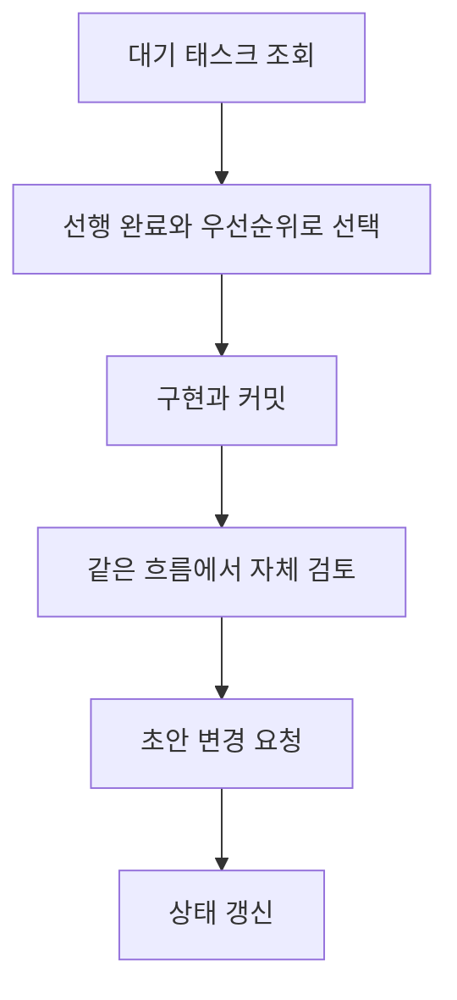
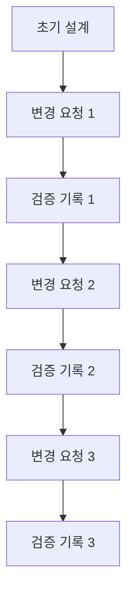
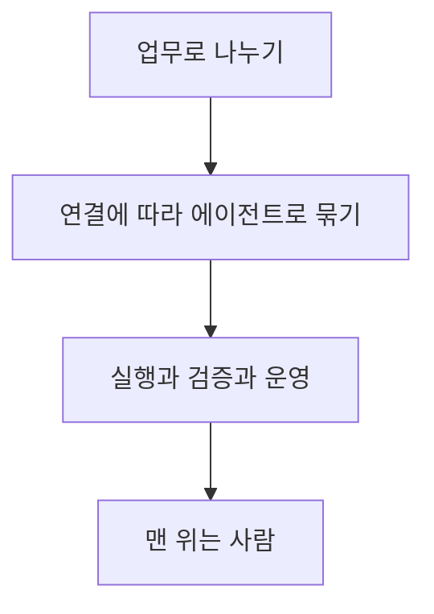
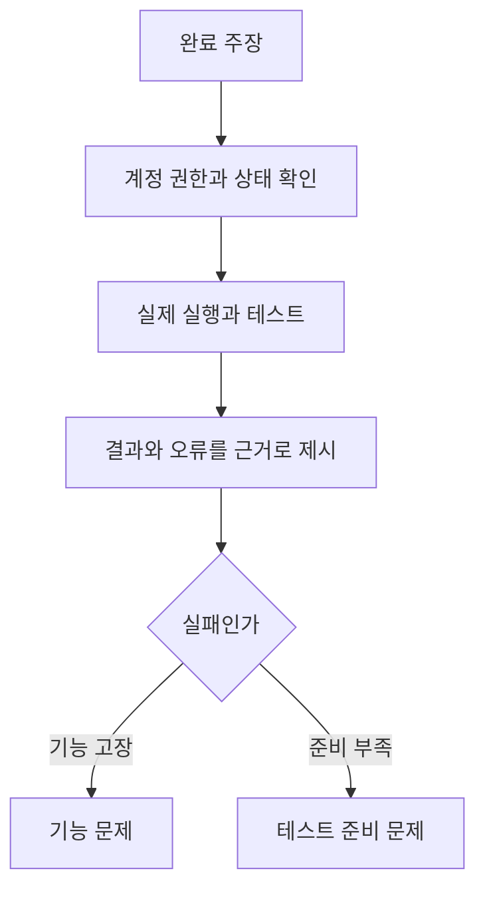

연초에 저는 태스크를 받아 에이전트에게 개발을 맡기고, 변경 요청까지 이어 주는 하네스를 만들어 공개해 두었습니다. [dailyagent](https://github.com/zeno0505/dailyagent)가 그 저장소입니다. 파이프라인은 실제로 끝까지 돌아갔습니다. 다만 병목은 코드를 만드는 속도가 아니라, 그 결과를 사람이 이해하고 검수하는 일이었습니다. 그래서 태스크마다 판단을 반복하는 대신 초기 설계를 먼저 두고, 실행과 검증을 나누며, 사람은 전달자가 아니라 목표와 과정을 보는 쪽으로 남기로 했습니다.

여기서 에이전트는 사람 대신 작업을 이어서 해 주는 AI 프로그램을, 하네스는 그 에이전트가 일하는 규칙과 도구를 묶어 둔 구조를 말합니다.

## 태스크를 바로 변경 요청으로 이은 한계

출발점은 작업량이었습니다. 기존 화면을 새 버전으로 옮기는 일과 신규 기능 개발을 같이 감당하려다 보니, 개발을 자동으로 맡길 수단이 필요해졌습니다. 처음 만든 흐름은 태스크 도구에서 변경 요청까지를 한 번에 잇는 방식이었습니다.

기다리는 상태의 태스크를 가져와, 선행 작업이 끝난 것만 남긴 뒤 우선순위로 하나를 고릅니다. 에이전트는 기준 브랜치를 최신으로 맞추고 작업 브랜치를 만든 다음, 요구사항대로 코드를 고치고 커밋합니다. 같은 흐름 안에서 목적에 맞았는지, 부작용은 없는지를 스스로 검토하고, 원격 저장소에 올린 뒤 초안 변경 요청을 만듭니다. 끝나면 태스크 쪽에 상태와 브랜치, 커밋, 변경 요청 주소를 다시 적습니다. 대기 항목이 없으면, 정해 둔 횟수 안에서 이미 올라온 결과를 다시 검토하게 둘 수도 있었습니다. 계획과 구현과 검토를 세션으로 나눌 수는 있었지만, 그 검토도 같은 자동 파이프라인 안의 일이었습니다.

에이전트에게 넘기는 결과는 대략 이런 형태였습니다. 브랜치명, 커밋, 바꾼 파일, 요약, 그리고 변경 요청 주소입니다. 태스크 본문에 적힌 내용은 데이터로만 보고, 하네스의 지시를 덮지 못하게 했습니다.

완성 자체는 되었습니다. 다만 태스크에 담긴 맥락만으로는 부족한 경우가 많았습니다. 이미지나 재현 영상만 올라가 있거나, 그 화면이 정확히 어디인지, 왜 그렇게 동작해야 하는지 기획 의도가 빠져 있기도 했습니다. 맥락이 부족한 채로 만든 변경 요청은 검수하기 어려웠고, 사람이 다시 조사하고 보완하다 보니 직접 개발하는 일과 크게 다르지 않았습니다.

제 생각엔 진짜 문제는 인지 부하입니다. 에이전트가 짠 코드를 사람이 바로 이해하지 못하는 문제입니다. 파이프라인이 결과를 만들어 주는 것과, 그 결과를 사람이 책임지고 받을 수 있는 것은 다른 일이었습니다.

## 초기 설계를 먼저 두는 이유

그래서 순서를 바꿨습니다. 태스크마다 반복하던 판단을 처음 설계 단계로 모았습니다. 초기 설계에서 작업 단위, 변경 요청 단위, 그리고 그 요청을 어떤 순서로 이을지를 먼저 정합니다. 에이전트는 그 설계를 따라 변경 요청을 하나씩 만들고, 요청마다 검증한 기록을 남깁니다. 검증했다는 말이 아니라, 검증한 기록이 남게 한 겁니다.

먼저 설계하면 판단을 설계 단계로 모을 수 있어, 태스크마다 같은 결정을 반복하지 않아도 됩니다. 최초 설계에 제가 직접 참여했기 때문에, 에이전트가 어떤 작업을 하는지가 머릿속에 남아 있습니다. 나중에 확인하더라도 방향이 어긋나기 어렵고, 「이건 이렇게 하면 안 되는데」 같은 상황을 예전보다 덜 만나게 되었습니다.

설계를 먼저 두는 일과, 제안의 성과를 누가 책임질지는 다른 문제였습니다. 에이전트의 제안대로 사람이 따라도, 그 성과를 아무도 장담할 수 없다는 질문을 만난 적이 있습니다. 근거 없이 그럴듯한 안을 내놓도록 두면, 실행 결과는 아무도 책임질 수 없습니다. 그래서 제안 뒤에 실제로 일어난 일을 기록하고, 숫자로 가릴 수 있는 구조를 갖추려 했습니다. 이 판단은 이후 다른 에이전트 작업 규칙에도, 측정할 수 있는 지표를 먼저 두라는 쪽으로 이어졌습니다.

## 하네스에서 팀과 역할을 나누는 방식

그 뒤에는, 에이전트 팀이 쓸 하네스를 어떻게 구성하고 팀과 에이전트를 어떻게 나눌지를 규칙으로 정리했습니다. 사람이 정해야 하는 사실만 묻고, 코드나 이미 적혀 있는 등록부에서 알 수 있는 것은 다시 묻지 않기로 했습니다. 모르는 값은 지어내지 않습니다.

하네스는 두 층을 나눕니다. 한쪽은 팀이 일하는 방식의 정의입니다. 역할, 지침, 권한, 사람이 확인해야 하는 관문처럼, 쉽게 바뀌면 안 되는 규칙을 둡니다. 다른 한쪽은 실행 기록입니다. 결정과 합의, 다음 에이전트가 읽을 산출물은 여기에 남깁니다. 알림만 오가고 기록이 없으면, 그 합의는 없는 것으로 봅니다.

팀을 만들 때는 먼저 일을 업무 단위로 나눕니다. 각 업무가 무엇을 읽고, 무엇을 쓰며, 시작에 어떤 맥락이 필요한지를 밝힙니다. 그다음 업무마다, 기계가 검증할 일인지, 사람이 관찰하거나 결정해야 하는 일인지를 가립니다. 에이전트로 묶을 때는 한 업무의 출력을 다른 업무가 읽는 강한 연결을 출발점으로 삼습니다. 전문성이 다를 뿐이면 새 에이전트를 만들기보다, 기존 에이전트에 그 능력을 붙입니다. 따로 두는 이유는 독립 실행, 병렬, 맥락 격리, 권한 경계가 필요할 때입니다. 만드는 일과 판정하는 일을 한 주체에 섞지 않습니다.

역할은 실행, 검증, 운영으로 나눕니다. 실행과 검증은 같은 에이전트에 묶지 않습니다. 평가의 맨 위는 사람이고, 자기 자신을 평가하는 관계는 두지 않습니다. 권한은 에이전트가 스스로 부여하지 않고, 요청서를 남겨 사람이 줍니다. 에이전트를 새로 둘지도 사람이 정합니다. 별도 실행 주체가 필요 없으면 만들지 않고, 목표를 숫자로 볼 수 있을 때만 지표를 고르되, 고른 직후부터 확정된 기준으로 쓰지는 않습니다.

처음 하네스가 태스크에서 변경 요청까지를 한 줄로 이었다면, 지금은 그 줄을 놓기 전에 업무와 역할과 관문부터 정하는 쪽에 가깝습니다. 그래야 사람이 모든 코드를 다시 읽지 않고도, 구조로 일을 지휘할 수 있다고 생각했습니다.

## 완료를 실행으로 증명하는 방식

지금 방식을 지탱하는 중심은 완료 증명입니다. 정확도를 높이려면, 에이전트가 스스로 일이 끝났다는 걸 증명하게 해야 한다고 봅니다. 검증 수단이 없으면 에이전트는 「생각한 대로 구현했습니다」라고밖에 말하지 못합니다. 처음 하네스의 자체 검토만으로는, 만드는 쪽과 판정하는 쪽이 아직 충분히 나뉘지 않았습니다.

그래서 직접 실행해서 증명하게 합니다. 테스트 케이스를 돌리기 전에 테스트 계정의 권한과 상태를 확인하고, 그다음 작업을 실제로 실행한 뒤 테스트를 돌립니다. 마지막으로는 결과와 오류를 근거로 내놓게 합니다. 이렇게 해 두면 실패했을 때, 기능이 정말 고장 난 건지 테스트 준비가 덜 된 건지 구분할 수 있습니다. 에이전트가 실행한 내역은, 그 에이전트를 믿을지 판단하는 근거가 됩니다. 그 근거를 읽는 쪽은, 가능하면 구현한 에이전트와 다른 검증 역할이어야 한다고 봅니다.

## 사람에게 남기는 일과 권한

구조를 바꿔도 에이전트 사용량과 컴퓨팅 자원은 유한합니다. 여러 에이전트를 동시에 돌리면 로컬 머신이 멈추기도 했습니다. 인지 부하는 그 가운데서도, 보여 주는 방식을 바꾸면 줄일 여지가 있다고 봅니다. 긴 리포트 하나만 남기기보다 이미지, 문서, 영상처럼 한눈에 들어오는 자료로 보강하는 쪽이 읽기 쉽습니다.

다만 사람이 모든 단계를 볼 필요는 없습니다. 지금은 초기 설계, 큰 결정, 사람이 꼭 확인할 것만 제가 보고, 나머지는 자동화하려고 합니다. 명백한 오류는 에이전트가 고치고 확인까지 한 뒤 기록에 남기고, 기획 맥락이 필요하거나 확인에 품이 많이 드는 일, 개발자가 봐야 하는 일은 사람에게 올립니다. 되돌리기 어려운 실행이나 민감한 경로처럼, 사람이 열어 줘야 하는 관문은 사실에서 찾아 제안하되, 등록은 사람이 합니다.

앞으로 에이전트를 다루는 사람에게는 판단이 세 가지 필요하다고 봅니다. 첫째, 끝났다면 무엇으로 확인했는지 근거를 요구하고 의심하는 일입니다. 둘째, 작업이 목표에 비해 과하거나 흐려지지 않았는지 보는 일입니다. 맥락이 길어질수록 처음 목표가 흐려지기 쉬워서, 사람이 목표를 붙잡고 있어야 한다고 봅니다. 셋째, 이 일을 맡겨도 되는지 판단하고 권한을 나누는 일입니다. 안전하게 다룰 수 있는 범위와 그렇지 않은 범위를 나누지 않으면, 속도만 빠르고 근거 없는 위임이 됩니다.

한 사람이 모든 깊이를 가질 수는 없다고 봅니다. 다만 직군마다, 에이전트에게 맡길 수 있는 일, 올바르게 하려면 검증 수단이 필요한 일, 사람이 해야만 하는 일을 나눌 수는 있다고 생각합니다.

## 프록시와 오케스트레이터

최근 [실용주의 개발](https://www.youtube.com/@pragmatic-dev)의 「[요즘 개발자들이 AI 때문에 진짜 빡치는 순간](https://www.youtube.com/watch?v=wnvu0E4X7iY)」을 보다가, 미트 프록시라는 말을 처음 들었습니다. 영상은 [The Age of the Soft Skill](https://rudyfaile.com/2026/09/24/the-age-of-the-soft-skill/)을 따라가며, 누군가의 질문을 그대로 AI에 붙여 넣고 나온 답을 다시 그대로 돌려주는 사람을 그렇게 부릅니다. AI가 답변한 것을 그대로 중계하는 역할을 하니 이렇게 표현한 것입니다. 묻는 사람은 그 사람의 판단이나 맥락이 궁금해서 물었는데, 돌아오는 것은 본인도 직접 받을 수 있는 AI 답입니다. 그 글은, 틀린 답을 기계에게서 바로 받는 편이, 같은 답을 한참 뒤에 그 사람 이름표만 붙여 받는 것보다 낫다고까지 합니다. AI를 쓰지 말라는 이야기가 아닙니다. 내 시간을 아끼려고 읽는 부담을 상대에게 넘기지 말라는 이야기에 가깝습니다.

A가 B에게 물은 내용을 B가 에이전트에 그대로 붙여 넣고, 받은 답을 다시 A에게 그대로 보내는 예시입니다.

이 영상을 보고 팀에서도 이야기를 나눴습니다. 제가 공감한 부분은, 요즘은 제가 AI와 AI를 잇는 사람 프록시가 된 것 같다는 느낌이었습니다. 팀에서 나온 말 가운데 저는 이 구분이 중요하다고 생각했습니다. 에이전트의 말을 보고 검토해서 남길 것은 남기고 보완할 것은 보완하는 일과, 그 말을 그대로 붙여 다음 에이전트나 사람에게 넘기는 일은 다릅니다. 여러 에이전트가 계획과 구현과 검토를 이어 가더라도, 결정과 역할과 검토 규칙을 사람이 정해 두면 그건 오케스트레이션에 가깝습니다. 반대로 검토하지 않은 AI 출력을 그대로 전달받으면, 읽기 어려운 해석을 상대에게 맡기게 되고 말하는 사람의 판단은 빠집니다.

남이 만든 업무 흐름에 나를 맞추기는 생각보다 어렵습니다. 그래서 오늘 정리한 방식을 그대로 따라 하실 필요는 없다고 봅니다.

다만 역할만은 분명히 하고 싶습니다. 미트 프록시는 에이전트의 말을 그대로 믿고, 다른 에이전트나 다음 작업으로 잇는 전달자입니다. 오케스트레이터는 에이전트가 목표를 올바르게 세웠는지, 그 과정이 타당한지 보고, 꼭 필요한 일을 나누는 쪽입니다. 제 생각엔 사람은 프록시가 아니라 오케스트레이터가 되어야 합니다.

그래서 저는 이렇게 정리하고 싶습니다. AI가 믿을 수 있는 근거를 내놓으며 업무 흐름을 대리할 수 있는 구조를, 사람이 설계하는 일입니다.
