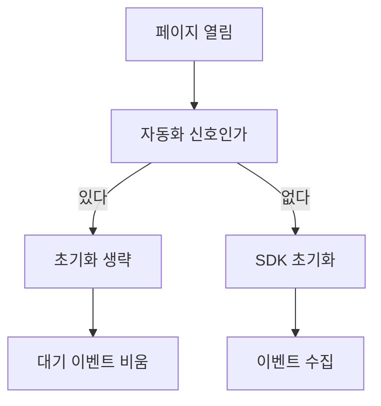

최근 트래픽이 비정상적으로 늘어난 현상을 조사하다가, 그 요청이 서버 부하뿐 아니라 분석 이벤트까지 들어가 있는 걸 확인했습니다. 액세스 로그의 User-Agent는 HeadlessChrome인데, Mixpanel의 브라우저 값은 Chrome으로 적혀 있었습니다. 그래서 사후에 브라우저 값으로 거르지 않고, SDK를 초기화하기 전에 수집을 끄되, 봇 User-Agent 패턴의 최신화는 isbot 패키지에 맡기기로 했습니다.

## 분석 값과 액세스 로그의 어긋남

처음에는 늘어난 요청이 어디서 오는지부터 봤습니다. 액세스 로그의 User-Agent를 같은 계정·같은 구간으로 맞춰 보니, 요청이 HeadlessChrome으로 들어오고 있었습니다. Mixpanel에 쌓인 이벤트 수도 그 계정들과 맞아서, 그 트래픽이 분석 데이터에 실제로 들어온 것도 확인했습니다.

다만 Mixpanel에서 브라우저 값만 보면 Chrome이었습니다. 이미 들어온 이벤트는 계정 단위로 분석에서 빼 달라고 요청했고, 앞으로는 자동화 브라우저에서 수집 자체가 되지 않게 막기로 했습니다.

## 브라우저 이름이 Chrome이 되는 이유

Mixpanel 자바스크립트 SDK는 기본 속성 `$browser`를 `navigator.userAgent`에서 만듭니다. 소스의 `_.info.browser`는 문자열에 `Chrome`이 포함되면 브라우저 이름을 Chrome으로 적습니다. HeadlessChrome이라는 토큰 안에 이미 `Chrome`이 들어 있으므로, 원문이 HeadlessChrome이어도 리포트의 브라우저 값은 Chrome이 됩니다. 브라우저 값만으로 헤드리스 트래픽을 가르려고 하면, 일반 Chrome 조회와 구분이 되지 않습니다.

SDK가 기본적으로 거르는 User-Agent 목록은 Googlebot, bingbot처럼 알려진 크롤러 중심입니다. 공식 문서도 그 목록에 없는 봇은 데이터에 영향을 준다고 적혀 있습니다. HeadlessChrome은 그 목록에 없습니다. 그래서 수집을 끌 기준을 Mixpanel 기본 목록에만 두지 않기로 했습니다.

자동화 여부는 User-Agent만의 문제가 아닙니다. `navigator.webdriver`는 사용자 에이전트가 자동화로 조종되는지를 알리는 표준 속성입니다. MDN 기준으로 Chrome에서는 `--headless` 또는 `--enable-automation`을 쓰면 이 값이 true입니다. isbot은 User-Agent 문자열만 보므로, 수집 가드에는 이 플래그를 같이 두기로 했습니다.



자동화 신호는 `navigator.webdriver`가 true이거나, isbot의 `isBot(userAgent)`이 true인 경우입니다.

## 초기화 전에 두는 수집 가드

자동화로 보이면 Mixpanel SDK의 `init` 자체를 건너뛰기로 했습니다. 꺼진 뒤에도 초기화 전에 쌓아 둔 이벤트가 나중에 나가면 안 되므로, 그때 대기열을 비우고, 이후 식별·추적 호출도 보내지 않습니다. 공식 문서의 `opt_out_tracking()`은 초기화 이후에 쓰는 방법이라, 이 가드에는 쓰지 않았습니다.

봇 User-Agent를 제 정규식으로 직접 들고 있으면, 새 봇이 나올 때마다 목록을 따라가야 합니다. 그래서 User-Agent 판정만 isbot 5.2.2에 맡기고, `navigator.webdriver`는 따로 같이 보기로 했습니다. 패턴 최신화는 패키지 버전을 올려 받습니다. isbot 5.2의 export는 `isBot(ua)`입니다. 아래는 같은 구조로 새로 쓴 예시입니다. 프로젝트 토큰이나 서비스 코드가 아닙니다.

```javascript
import { isBot } from 'isbot';

let trackingDisabled = false;
let ready = false;
const pendingEvents = [];

function isAutomatedBrowser(nav = globalThis.navigator ?? null) {
  if (!nav) return false;
  return nav.webdriver === true || isBot(nav.userAgent);
}

function initAnalytics() {
  if (isAutomatedBrowser()) {
    trackingDisabled = true;
    pendingEvents.length = 0;
    return;
  }
  mixpanel.init('YOUR_PROJECT_TOKEN');
  ready = true;
}

function track(event, payload) {
  if (trackingDisabled) return;
  if (!ready) {
    pendingEvents.push([event, payload]);
    return;
  }
  mixpanel.track(event, payload);
}
```

isbot 5.2.2 기준으로 HeadlessChrome이나 Applebot이 들어 있는 User-Agent는 `isBot`이 true를 돌려 줍니다. 일반 Chrome이나 Safari, 흔한 인앱 브라우저 문자열은 false입니다. 같은 Chrome User-Agent라도 `navigator.webdriver`가 true면 자동화로 봅니다. `navigator`가 없는 환경에서는 자동화로 보지 않습니다. 헤드리스 브라우저에서 페이지를 열어 보니 Mixpanel 요청은 나가지 않았고, 같은 페이지를 일반 브라우저에서 열면 이벤트는 그대로 나갔습니다. User-Agent를 일반 브라우저처럼 바꾸면 isbot은 봇으로 보지 않고, `navigator.webdriver`를 숨기면 이 가드는 지나갈 수 있습니다. isbot 문서도, 사람처럼 위장한 프로그램까지 찾는 도구는 아니라고 적혀 있습니다.

## 요청을 막는 방법과 비교

요청 자체를 앞에서 막는 방법도 검토했습니다. 그러면 분석 이벤트뿐 아니라 서버 부하까지 줄어듭니다. 다만 사람이 자신의 에이전트를 붙여 화면을 자동으로 보게 하는 쓰임까지 막을 수 있습니다. 그 범위를 서비스 정책으로 정하기 전에는, 요청을 막는 방법은 쓰지 않기로 했습니다.

이미 들어온 이벤트를 분석에서 빼는 일도 필요합니다. Mixpanel은 한 번 들어온 이벤트를 삭제하지 못하고, 속성으로 걸러 보는 방식을 안내합니다. 다만 사후 필터는 이미 쌓인 오염을 리포트에서 가릴 뿐이고, 새로 들어오는 이벤트와 사용량까지 막지는 못합니다. 그래서 앞으로의 수집은 초기화 전에 끄고, 이미 들어온 분량은 분석 쪽에서 제외하는 쪽으로 나눴습니다.

봇 목록을 HeadlessChrome, Applebot처럼 직접 정규식으로 고정하는 방법도 있었습니다. 당장의 로그에는 그걸로도 걸립니다. 다만 목록을 제가 쥐고 있으면 최신화를 놓치기 쉽습니다. Mixpanel SDK 기본 목록도 알려진 크롤러 중심이라, 헤드리스 브라우저를 놓친 것과 같은 빈틈이 남을 수 있습니다. 제 생각엔 패턴 갱신은 그 목록을 꾸준히 고치는 패키지에 맡기는 편이 낫습니다.

## 왜 수집 단계에서 끄기로 했는지

분석 도구와 오류 추적 도구는, 자동화된 요청이 들어오면 사용량이 늘고 지표가 흔들릴 수 있습니다. 요청을 막는 정책이 정해지기 전이어도, 자동화 브라우저에서는 추적을 먼저 끄고 보는 편이 낫다고 봤습니다. 봇 User-Agent 판단은 isbot에 맡기고, 패키지가 따라가지 않는 자동화 신호는 `navigator.webdriver`로 보완하기로 했습니다.

다만 User-Agent는 바꾸기 쉽습니다. 1차로 자동화 신호에서 수집을 끈 뒤에도 이상 로그가 다시 보이면, 그 로그의 특징을 재확인해서 2차로 가리기로 했습니다. 다음에 같은 일을 보면, 분석 SDK는 자동화 신호일 때 초기화하지 않는 쪽을 먼저 두려고 합니다.

## 정리

분석 리포트의 브라우저 값이 Chrome이어도, 원문 User-Agent와 자동화 플래그는 다를 수 있습니다. 헤드리스 트래픽은 브라우저 값으로 사후에 가르기보다, 수집이 시작되기 전에 끄는 편이 맞다고 봅니다.

## 참고

- [Mixpanel Default Properties](https://docs.mixpanel.com/docs/data-structure/property-reference/default-properties) — `$browser`, `$mp_raw_user_agent`
- [Mixpanel JavaScript SDK](https://docs.mixpanel.com/docs/tracking-methods/sdks/javascript) — 기본은 추적 켜진 채 `init`
- [Mixpanel Block Unwanted Traffic](https://docs.mixpanel.com/docs/tracking-best-practices/bot-traffic) — SDK 기본 봇 필터와 `$ignore`
- [mixpanel-js `src/utils.js`](https://github.com/mixpanel/mixpanel-js/blob/master/src/utils.js) — `_.info.browser`, `BLOCKED_UA_STRS` / `_.isBlockedUA`
- [MDN: `Navigator.webdriver`](https://developer.mozilla.org/en-US/docs/Web/API/Navigator/webdriver)
- [isbot (npm 5.2.2)](https://www.npmjs.com/package/isbot/v/5.2.2) — `import { isBot } from "isbot"`, `isBot(userAgent)`, 패턴은 패키지 갱신으로 받음
