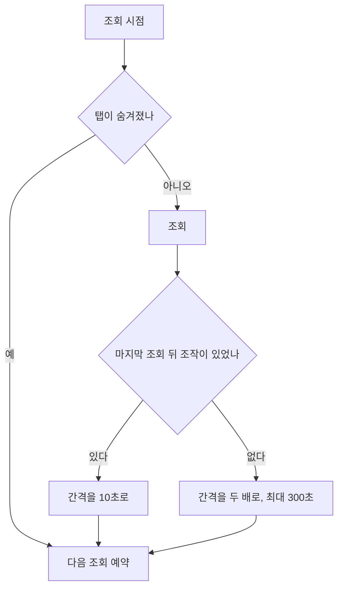

이 글에서는 브라우저에서 주기적으로 서버를 조회하는 화면을, 시간 측정 대신 유저 **조작 표시**{: .key}로 간격을 조절하는 방법을 다룹니다.

## HeadlessChrome 트래픽의 원인인 주기 조회

처음 제보는 정상적인 사용으로 보기 어려운 트래픽이 있다는 것이었습니다. 로그를 따라가 보니 로그인한 유저 계정에서 `HeadlessChrome` User-Agent의 브라우저가 여러 개 떠 있었고, 같은 화면을 반복해서 열고 있었습니다.

트래픽이 몰리면서 요청을 받는 쪽만 부담을 진 것은 아니었습니다. 트래킹을 위해 심어 둔 서비스의 사용량이 소진되는 문제, 데이터 분석에서 자동화 계정의 이벤트가 섞여 오분석이 생기는 문제, 기존에 쓰던 분석용 에이전트가 오진단을 내는 문제가 연달아 나왔습니다. 하나씩 차례로 고쳐 가는 중이고, 대부분은 수정해서 내보냈습니다. 이 가운데 분석 이벤트 쪽은 앞선 글 [자동화 트래픽을 분석 수집 단계에서 끄기](/dev-articles/2026/11/18/turn-off-analytics-at-collection/)에서 다뤘습니다.

이 글은 같은 트래픽이 서버로 보낸 주기 조회 요청만 다룹니다. 그 브라우저들 가운데 일부는 화면을 열어 둔 채로 안 읽은 메시지 수 조회를 10초마다 멈추지 않고 보냈습니다.

여기에 일반 유저의 방치된 탭이 더해집니다. 탭을 몇 시간씩 열어 두고 쓰는 유저도 있어서, 자동화 브라우저만 막는 것으로는 끝나지 않았습니다. 아무도 보지 않는 탭이 같은 조회를 같은 간격으로 보내기 때문입니다.

여러 탭이 만든 다른 증상도 있었습니다. 글 수정 화면을 열어 둔 탭에서, 다른 탭이 계정을 바꾼 뒤 돌아오면 그 화면이 데이터를 다시 조회했고, 쿠키는 이미 바뀐 계정의 것이라 403이 돌아왔습니다. 주기 조회와는 별개의 문제지만, 요청이 로그인한 한 명이 보는 한 탭에서만 나온다는 같은 가정에서 왔습니다.

## 시각을 비교하려다가 부딪힌 탭별 시간 측정 방식

처음 수정은 시각 비교였습니다. 지난 시간을 재서 조회 간격을 늘리는 방식이고, 시각은 `performance.now()`로 쟀습니다. 한 탭 안에서는 문제가 없습니다. 같은 탭이 같은 기준으로 잰 두 값을 빼기 때문입니다.

고민이 시작된 곳은 탭 사이에서 마지막 조회 시각을 나누려는 생각이었습니다. 계정을 바꾸며 여러 탭을 오가는 유저라면 어느 탭이 언제 조회했는지를 `localStorage`에 두고 서로 읽게 하고 싶어지는데, 그 순간 두 시간 측정 방식의 기준이 달라집니다. MDN 기준으로 [`performance.now()`](https://developer.mozilla.org/en-US/docs/Web/API/Performance/now)는 [`timeOrigin`](https://developer.mozilla.org/en-US/docs/Web/API/Performance/timeOrigin)부터 지난 시간이고, window에서 `timeOrigin`은 탐색이 시작된 시점입니다. 반면 [`Date.now()`](https://developer.mozilla.org/en-US/docs/Web/JavaScript/Reference/Global_Objects/Date/now)는 Unix epoch부터 지난 밀리초라 시스템 시각을 따릅니다.

두 탭의 콘솔에서 아래를 거의 동시에 실행해 보면 차이가 보입니다.

```js
console.log({
  dateNow: Date.now(),
  perfNow: performance.now(),
  timeOrigin: performance.timeOrigin,
});
```

같은 브라우저에서 탭 B를 탭 A보다 1.5초쯤 늦게 열고 읽은 값은 이랬습니다.

| | `Date.now()` | `performance.now()` | `timeOrigin + performance.now() - Date.now()` |
|---|---|---|---|
| 탭 A | 1795077419961 | 1575.3 | 0.2 |
| 탭 B | 1795077419961 | 16.9 | 0.3 |

`Date.now()`는 두 탭이 같은 값을 냈고, `performance.now()`는 각 탭이 열린 시점부터 세어서 서로 다른 값이 나왔습니다. 탭 사이에서 시각을 나누려면 `timeOrigin`을 더해 절대 시각으로 맞추거나 `Date.now()`를 써야 합니다. 그런데 MDN은 `Date.now()`가 [시스템 시계 조정](https://developer.mozilla.org/en-US/docs/Web/API/Performance/now#performance.now_vs._date.now)에 영향을 받는다고 적고 있고, `performance.now()`는 [OS가 잠든 동안 흐르지 않는](https://developer.mozilla.org/en-US/docs/Web/API/Performance/now#ticking_during_sleep) 브라우저가 있다고 적고 있습니다. 오래 열려 있는 탭이 대상인 이 문제에서는 어느 쪽을 골라도 따로 따져야 할 것이 남습니다.

## 조작 표시 하나로 바꾼 구조

그래서 시각을 아예 비교하지 않기로 했습니다. 탭마다 `touched`라는 값 하나만 두고, 마지막 조회 뒤에 `pointerdown`이나 `keydown`이 있었는지만 기록합니다. 조회할 때 이 값이 `true`면 간격을 10초로 되돌리고, `false`면 두 배로 늘리되 300초에서 멈춥니다. 탭이 숨겨져 있으면 그 시점의 조회를 건너뜁니다. 숨김 여부는 `document.hidden`으로 봅니다. MDN 기준으로 배경 탭이거나 창이 최소화됐거나 화면이 잠긴 경우가 여기에 해당합니다.



봇 판정은 isbot 5.2.2에 맡겼습니다. User-Agent가 봇이면 첫 조회만 하고 주기 조회는 예약하지 않습니다. 아래는 같은 구조로 새로 쓴 예시입니다.

```js
import { isBot } from 'isbot';

const BASE = 10_000;
const MAX = 300_000;

export function startAutoRefresh(fetchUnread, userAgent = navigator.userAgent) {
  let interval = BASE;
  let touched = false;

  addEventListener('pointerdown', () => { touched = true; });
  addEventListener('keydown', () => { touched = true; });

  async function tick() {
    if (!document.hidden) {
      await fetchUnread();
      interval = touched ? BASE : Math.min(interval * 2, MAX);
      touched = false;
    }
    setTimeout(tick, interval);
  }

  fetchUnread();
  if (!isBot(userAgent)) setTimeout(tick, interval);
}
```

시각을 저장하는 값이 없으니 탭끼리 맞출 시간 측정 기준도 없습니다. `touched`는 그 탭 안에서만 의미가 있는 참과 거짓입니다.

## 간격이 바뀌는 것 확인

이 예시 코드를 Playwright의 가짜 시간(Clock API)으로 돌려서 조회 시각을 찍어 봤습니다. 시작할 때의 첫 조회를 0초로 두었습니다.

- 방치한 탭: 0, 10, 30, 70, 150, 310, 610초에 조회했습니다. 간격으로 보면 10, 20, 40, 80, 160, 300, 300초입니다.
- 100초에 키를 한 번 누른 탭: 예약돼 있던 150초에 조회하고, 그다음부터 160, 180, 220, 300초에 조회했습니다. 간격이 10초로 돌아와 다시 늘어났습니다.
- 숨긴 탭: 숨긴 300초 동안 조회가 0건이었고, 다시 보이게 하자 예약돼 있던 시점에 조회가 재개됐습니다.
- `HeadlessChrome` User-Agent: 0초의 첫 조회 한 번뿐이었습니다.

조작해도 간격은 다음 조회 시점에 돌아옵니다. 위 두 번째 경우처럼 방치가 길었던 탭에서는 조작한 뒤 한동안 이전 간격이 남습니다.

## 탭 사이 공유와 고정 간격을 쓰지 않은 이유

가장 먼저 검토한 것은 탭 사이 공유였습니다. `localStorage`에 마지막 조회 시각을 두면 다른 탭에 `storage` 이벤트가 오고, `BroadcastChannel`을 쓰면 같은 origin의 탭끼리 메시지를 주고받을 수 있습니다. 둘 다 같은 origin의 다른 탭에 알리는 동작이 MDN에 있고, 이걸로 한 탭만 조회하고 나머지는 결과를 받아 쓰는 구조까지 짤 수 있습니다.

그런데 이 구조로 줄어드는 호출이 얼마인지 따져 보니 크지 않았습니다. 숨겨진 탭은 이미 조회하지 않고, 조작 없는 탭은 각자 300초 간격까지 늘어납니다. 공유로 더 줄어드는 경우는 창을 나란히 띄워 둔 탭이 N개일 때, 300초에 N번이 1번이 되는 정도입니다. 반대로 비용은 분명합니다. 앞에서 본 시간 측정 기준을 맞춰야 하고, 공유한 값이 어느 계정의 것인지도 계정 전환 때마다 따로 맞춰야 합니다.

두 번째는 300초 고정 간격입니다. 리뷰에서 나온 제안이었고, 코드는 훨씬 단순해집니다. 다만 여러 사람이 대화하는 방에서는 어느 정도의 실시간성이 필요해서, 지금 조작하고 있는 유저의 알림까지 300초씩 늦어지는 건 받아들이기 어려웠습니다. 그래서 **간격은 늘리되 조작하면 돌아오는 구조를 유지했습니다**. 봇 User-Agent만 첫 조회 뒤에 멈추는 제안은 그대로 받아들였습니다.

## 판단과 비용

저는 시간 측정 기준을 맞추는 일보다 **조작했는지만 보는 구조를 고르는 쪽이 낫다**고 생각했습니다. 시각 비교는 탭 하나 안에서만 쓰면 문제가 없고, 탭끼리 나누려는 순간부터 기준이 어긋납니다. 마지막 조회 뒤 조작이 있었는지는 탭 안에서 참과 거짓으로 끝나서, 나눌 값도 맞출 기준도 없습니다.

치르는 비용은 두 가지입니다. 하나는 앞서 본 대로 조작한 뒤에도 다음 조회 시점까지 이전 간격이 남는다는 점입니다. 다른 하나는 나란히 띄운 탭이 각자 조회한다는 점이고, 이건 공유 구조의 관리 비용보다 작다고 판단했습니다.

재발을 막는 방법은 규칙을 늘리는 쪽이 아닙니다. 코드를 만드는 에이전트의 가드 스킬과 코드 리뷰 봇의 지침에 이 사례를 한 줄씩 쌓아, 요청이 한 사람의 한 탭에서만 나온다는 가정을 개발과 리뷰 단계에서 먼저 의심하게 하려고 합니다.

다음에 주기 조회를 넣을 때는 얼마나 지났는지보다 마지막 조회 뒤에 유저가 뭔가 했는지를 먼저 봅니다.

## 참고

- [MDN Performance: now()](https://developer.mozilla.org/en-US/docs/Web/API/Performance/now)
- [MDN Performance: timeOrigin](https://developer.mozilla.org/en-US/docs/Web/API/Performance/timeOrigin)
- [MDN Date.now()](https://developer.mozilla.org/en-US/docs/Web/JavaScript/Reference/Global_Objects/Date/now)
- [MDN Document: hidden](https://developer.mozilla.org/en-US/docs/Web/API/Document/hidden)
- [MDN Document: visibilityState](https://developer.mozilla.org/en-US/docs/Web/API/Document/visibilityState)
- [MDN Window: storage event](https://developer.mozilla.org/en-US/docs/Web/API/Window/storage_event)
- [MDN BroadcastChannel](https://developer.mozilla.org/en-US/docs/Web/API/BroadcastChannel)
- [MDN Using HTTP cookies](https://developer.mozilla.org/en-US/docs/Web/HTTP/Guides/Cookies)
- [isbot](https://www.npmjs.com/package/isbot)
