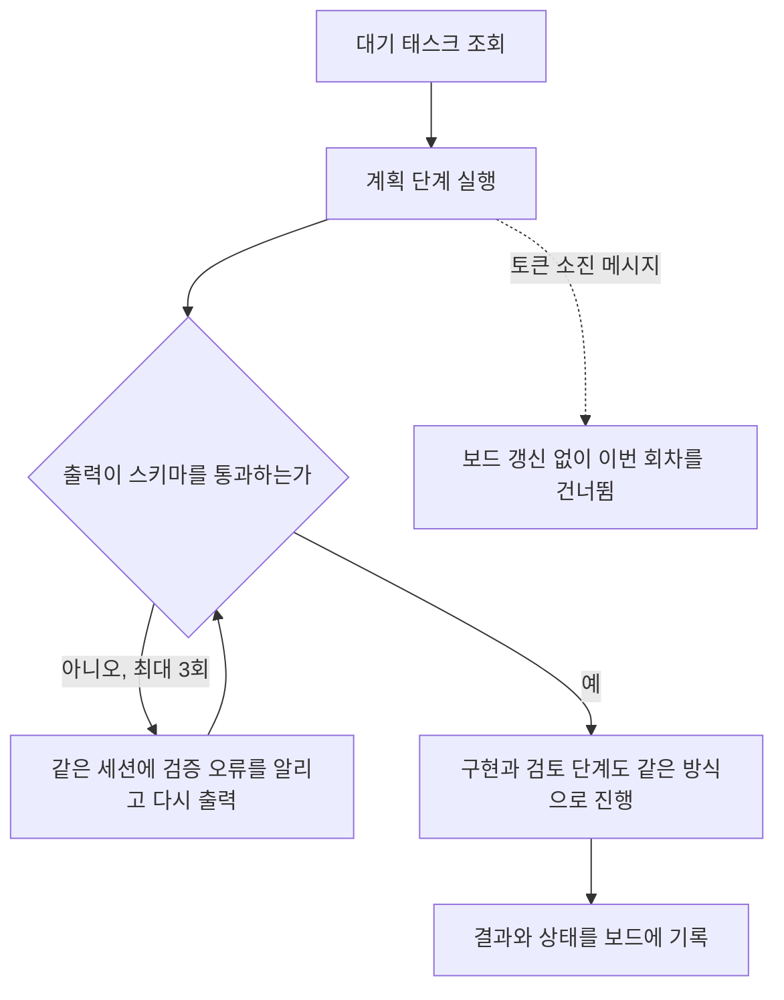
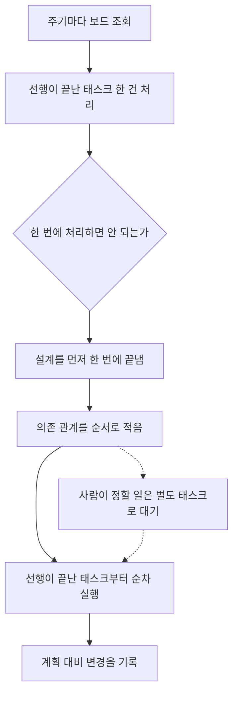

| 순서 | 글 |
|---|---|
| 1 | [Nuxt4를 품는 모노레포에서 경로별 부분배포로 마이그레이션 이어 가기](/dev-articles/2026/11/20/partial-deploy-by-path-in-nuxt4-monorepo/) |
| 2 | 실패한 에이전트 하네스, dailyagent 돌아보기 (이 글) |
| 3 | [QA 부하를 줄이기 위한 테스트 플랫폼 제작기](/dev-articles/2026/11/20/test-platform-to-reduce-qa-load/) |
| 4 | [알지만 여력이 없던 일을 별도 사용량으로 돌리기](/dev-articles/2026/11/20/run-known-but-unstaffed-checks-on-separate-usage/) |
| 5 | [비용 부채를 줄이며 기능 개발을 이어 가는 마이그레이션 자동화 팀 꾸리기](/dev-articles/2026/11/21/migration-automation-team-while-paying-down-cost-debt/) |

dailyagent는 기능으로는 끝까지 돌아갔고, 에이전트가 만든 변경 요청도 병합까지 이어졌습니다. 그런데도 지금은 쓰지 않습니다. 쓰지 않게 된 이유는 **인지 부하**{: .key}였고, 그 이야기는 [사람이 프록시가 아니라 오케스트레이터가 되기](/dev-articles/2026/11/18/be-an-orchestrator-not-a-proxy/)에 정리해 두었습니다. 그래서 이 글은 같은 이유를 다시 풀지 않고, [dailyagent](https://github.com/zeno0505/dailyagent)를 만들고 돌리며 남긴 설계와 동료에게 맡겨 본 경험, 그리고 그 뒤에 얻은 교훈을 회고로 적습니다.

## 한 달 남짓 돌린 결과

노션 태스크 보드에는 80여 개 업무가 있었고, 그중 에이전트가 직접 돌린 업무는 열댓 건이었습니다. 기간은 한 달 남짓이었습니다. 결과가 보드에 남은 실행 가운데 에이전트 커밋이 든 변경 요청은 열 건이었고, 그중 여덟 건이 병합되었습니다. 일의 크기는 UI 컴포넌트 수정, 리팩터링, 관측 코드 추가처럼 범위가 작은 쪽이었습니다.

실제로 일을 해냈다는 점은 분명합니다. 그래서 저는 이 프로젝트를 **기술이 모자라** 실패했다고 정리하지 않습니다. 일은 되었는데 쓰는 사람이 늘지 않았고, 쓰는 저에게도 부담이 남았습니다.

## 스크립트에서 CLI까지 이어진 도입 순서

처음에는 셸 스크립트와 스케줄러로 노션 대기 항목을 읽어 Claude Code에 넘기는 수준이었습니다. 그것을 CLI로 옮기면서 기능이 차례로 붙었습니다.

| 시기 | 붙인 기능 |
|---|---|
| 첫 며칠 | 선행 작업을 먼저 보는 프롬프트, 최소 동작하는 CLI |
| 첫 1주 | 변경 요청 등록, crontab과 launchd 스케줄, Slack 알림, 계획·구현·검토 단계 분리, 여러 워크스페이스 |
| 3주 차 | 대기 항목이 없을 때 `검토 전` 항목 재검토, 계획 모드 |
| 한 달 무렵 | 출력 스키마 검증과 교정, 토큰 소진 시 건너뛰기, Slack 봇 DM 알림 |

기능 목록만 보면 하네스로서 꽤 갖춰진 편입니다. 다만 이 목록에는 어떤 태스크를 에이전트에게 맡길지 가리는 단계가 없습니다.

## 한 번의 실행 안에 둔 안전장치

dailyagent는 한 번 실행할 때 세 단계로 나뉩니다. 보드에서 대기 태스크를 읽는 일과 결과를 보드에 적는 일은 코드가 하고, 에이전트는 가운데 코드 작업만 맡습니다. 전체 흐름은 앞선 글에 그려 두었으니, 여기서는 그 가운데 단계 안쪽만 보겠습니다.



계획, 구현, 검토는 하나의 세션을 이어 가고, 단계마다 모델과 제한 시간을 따로 줄 수 있었습니다. 세션 번호를 받지 못하면 한 번에 끝내는 단일 모드로 되돌아가게 했습니다. 대기 항목이 없을 때는 `검토 전` 상태의 결과를 기본 3회까지 다시 검토하게 두었습니다.

각 단계의 출력은 JSON이고, 그 JSON이 스키마를 통과해야 다음 단계로 넘어갑니다. 에이전트의 출력이 사람이 읽는 글이 아니라 **코드가 읽는 값**이어야, 마지막에 보드를 갱신하는 코드가 흔들리지 않기 때문입니다. 검증에 실패하면 실패한 필드를 같은 세션에 알려 다시 출력하게 하고, 세 번 안에 못 맞추면 결과 없이 돌려보내 호출한 쪽이 실패로 처리합니다.

```ts
export const WorkResultSchema = z.object({
  branch_name: z.string(),
  commits: z.array(z.object({ hash: z.string(), message: z.string() })),
  files_changed: z.array(z.string()),
  summary: z.string(),
  pr_url: z.string().nullable(),
  pr_skipped_reason: z.string().nullable(),
});

// 줄여서 옮긴 재시도 루프
for (let attempt = 0; attempt <= maxZodRetries; attempt++) {
  lastResult = await spawnCli<T>(config, currentOptions);
  const validation = schema.safeParse(lastResult.result);
  if (validation.success) return { ...lastResult, result: validation.data };
  if (attempt === maxZodRetries) break; // 결과 없이 돌려보냄
  // 같은 세션에서 검증 오류를 알리고 다시 출력하게 함
  currentOptions = { ...options, prompt: correctionPrompt, sessionId: lastResult.sessionId };
}
```

태스크 본문은 외부 시스템에서 가져온 입력이라 신뢰하지 않는 데이터로 다뤘습니다. 프롬프트에 넣기 전에 코드 블록 구분자를 이스케이프하고, 프롬프트 안에서도 그 구간을 외부 데이터로 표시해 어떤 지시도 하네스의 지시보다 앞서지 않는다고 못 박았습니다. 브랜치 이름은 셸 명령에 들어가는 값이라, 허용한 문자만 통과시키고 어긋나면 조용히 고쳐 쓰지 않고 오류로 멈춥니다.

```ts
if (!/^[a-zA-Z0-9/_.\-]+$/.test(trimmed)) {
  throw new Error(`유효하지 않은 브랜치명: "${raw}"`);
}
```

토큰 소진은 가장 늦게 붙인 장치입니다. 헤드리스 실행에서는 남은 사용량을 미리 조회할 수 없어서, 실행 중에 나오는 한도 초과 메시지를 패턴으로 감지합니다. 감지하면 보드와 알림을 건드리지 않고 그 회차를 건너뜁니다. 한도 때문에 끊긴 회차는 실패가 아니라 다음 실행에서 다시 집어 올 대기 항목으로 남습니다.

제 생각엔 이 장치들은 모두 같은 질문에서 나왔습니다. 에이전트가 틀렸을 때 그 틀림이 보드에 그대로 기록되지 않게 하려면 코드가 어디까지 막아야 하는가입니다. 이 질문에는 어느 정도 답을 냈습니다. 다만 틀린 결과를 막는 일과, 애초에 에이전트가 풀기 어려운 태스크를 가려내는 일은 다른 문제였습니다.

## 동료에게 맡겨 본 시도

혼자 쓰던 도구를 팀이 쓸 수 있게 하려고, 사용 가이드와 템플릿을 만들어 공유했습니다. 동료에게 써 보고 평가해 달라고 부탁했고, 동료들도 실제로 시도해 보았습니다. 결과는 적응하지 못했다는 것이었습니다.

이유는 **도구의 기능이 아니라** 적응 자체에 드는 비용이었다고 봅니다. dailyagent는 제 보드의 상태 값과 기준 브랜치, 선행 작업 같은 필드를 전제로 움직입니다. 그 구조에 자기 업무를 옮겨 담는 일은, 태스크를 맡기기 전에 이미 리소스를 쓰는 일이었습니다. 도구가 아무리 잘 돌아도, 쓰는 사람의 흐름에 맞지 않으면 번지지 않았습니다.

## 주기 실행에서 설계 우선 실행으로

dailyagent는 정해진 주기마다 보드를 읽고, 선행 작업이 끝난 대기 태스크 하나를 골라 처리했습니다. 동료와 이야기하던 중 "굳이 주기마다 읽어야 할 이유가 있는가, 한 번에 처리하면 안 되는가"라는 질문이 나왔습니다. 그 질문을 따라가 설계를 먼저 한 번에 끝내고, 설계에 적힌 의존 관계 순서대로 순차 처리하는 쪽으로 방향을 바꿨습니다.



지금은 그 구조가 작업 하네스 스킬로 남아 있습니다. 요구사항을 한 번 모은 뒤, 계획 단계에서 태스크를 커밋 하나 크기로 쪼개 선행 태스크를 파일 하나에 적습니다. 계획은 한 번만 만들고, 이미 있으면 덮어쓰지 않습니다. 실행 단계는 선행이 모두 끝난 태스크만 의존 순서대로 하나씩 구현하며, 선행이 끝나지 않은 태스크는 상태를 바꿀 수 없습니다. 사람이 정할 일은 별도 태스크로 떼어 선행 관계로 묶어 두어서, 답이 나올 때까지 뒤의 태스크가 기다립니다.

주기 방식에서는 매번 다음 한 건만 보기 때문에 전체 순서와 범위를 사람이 미리 검토할 자리가 없었습니다. 설계를 먼저 끝내면 그 계획을 사람이 한 번 검토할 수 있고, 실행 뒤에는 실제 변경이 계획과 맞는지를 계획에 비추어 기록할 수 있습니다.

```yaml
tasks:
  - id: T-001
    title: 목록 화면 컴포넌트
    depends_on: []
    status: pending
  - id: T-002
    title: 목록 화면 연동
    depends_on: [T-001]   # T-001이 done일 때만 시작
    status: pending
```

## 분류 없이 모든 태스크를 맡긴 점

돌아보면 dailyagent는 `작업 대기`에 올라온 태스크를 모두 에이전트가 풀 수 있는 일로 가정했습니다. 선행 작업이 끝났는지와 우선순위만 보고 하나를 골랐을 뿐, 이 일을 에이전트에게 맡겨도 되는지는 묻지 않았습니다. 그 뒤에 바꾼 설계 우선 구조도 순서만 다뤘고, 이 질문은 다루지 않았습니다. 맥락이 모자란 태스크도 같은 경로로 흘러갔고, 그 결과를 사람이 다시 조사해 보완해야 했습니다. 맥락이 모자란 채로 흘러간 것이 앞선 글에서 말한 부담으로 이어졌다고 봅니다.

그래서 이후에는 에이전트에게 일을 넘기기 전에 분류를 먼저 두었습니다. 지금 쓰는 방식은 [앞선 글의 「사람에게 남기는 일과 권한」](/dev-articles/2026/11/18/be-an-orchestrator-not-a-proxy/)에 적어 두었고, 여기서는 분류 방법만 짧게 옮깁니다.

## 판단 주체를 나누는 분류

QA가 올린 태스크를 에이전트가 먼저 읽고 네 갈래로 나눕니다.

| 갈래 | 처리 |
|---|---|
| 명백한 오류 | 에이전트가 고치고 확인한 뒤 기록을 남깁니다 |
| 기획 맥락 확인이 필요한 일 | 사람에게 올립니다 |
| 사진·영상이 필요하거나 특정 환경에서만 재현되는 등 확인에 품이 많이 드는 일 | 사람에게 올립니다 |
| 개발자가 봐야 하는 일 | 사람에게 올립니다 |

핵심은 에이전트가 판단할 수 있는 일과 사람이 판단해야 하는 일의 **경계를 먼저 적어** 두는 것입니다. 경계가 있으면 에이전트는 자기 몫만 하고, 사람은 올라온 것만 봅니다.

다만 이 분류 자체도 틀릴 수 있습니다. 그래서 어느 갈래로 보냈는지와 그 근거가 기록으로 남아야, 나중에 그 분류가 얼마나 정확했는지 사람이 채점할 수 있습니다. 판단의 근거를 기록하고 따로 채점하는 구조는 [비즈니스 구조를 개선하는 사용자 AI 서비스 제작기](/dev-articles/2026/11/18/api-spec-in-the-browser/)에서 지침 준수를 채점하는 방식으로 적었습니다. 분류에도 같은 구조가 필요하다고 봅니다.

## 맥락과 분류와 평가를 설계하기

dailyagent를 접으며 남은 교훈은 하나로 모입니다. 맥락이 불충분한 상태의 AI는 절대 원하는 결과를 가져오지 않습니다. 그래서 사람이 판단해야 하는 일과 에이전트가 판단할 수 있는 일을 나누고, 그 판단이 얼마나 정확한 분류였는지 나중에 평가할 수 있는 **하네스 구조**를 설계해야 의도한 대로 동작합니다.

결과를 만드는 파이프라인은 한 달 남짓 만에 갖추었습니다. 설계를 먼저 끝내는 구조는 이미 있었고, 갖추지 못했던 것은 무엇을 맡길지 가리는 단계와, 그 판단이 맞았는지 되짚는 기록이었습니다.
