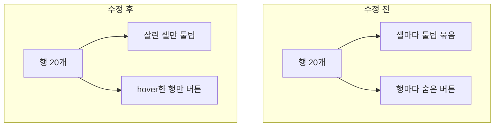

관리자 화면의 테이블은 한 번에 20행만 불러오는데, 그 테이블을 그리는 구간이 열릴 때마다 메인 스레드를 1초 넘게 막고 있었습니다. 행이 많아서가 아니라 셀 하나가 그리는 **컴포넌트 수**{: .key}가 문제였고, 그중 상당수는 화면에 보이지도 않는 것이었습니다. 그래서 말줄임이 실제로 일어난 셀에만 툴팁을 씌우고, 액션 버튼은 마우스가 올라간 행에서만 붙이는 쪽으로 바꿨습니다.

## TanStack Table을 공통 컴포넌트로 감싼 구조

기존에 Nuxt 2에서 작업하던 테이블 컴포넌트가 있었고, 직접 만들어 쓰던 것이었습니다. Nuxt 2와 Nuxt 4가 함께 도는 배경은 앞선 글 [Nuxt4를 품는 모노레포에서 경로별 부분배포로 마이그레이션 이어 가기](/dev-articles/2026/11/20/partial-deploy-by-path-in-nuxt4-monorepo/)에서 다뤘습니다. Nuxt 4로 옮기면서는 TanStack Table을 써 보기로 했습니다. TanStack Table을 고른 이유는 세 가지였습니다. 웹 생태계에서 많이 쓰이는 라이브러리라고 판단했고, 열 너비 조절이나 열 위치 변경 같은 조작을 라이브러리가 안정적으로 지원했습니다. 그리고 코드를 AI가 대신 쓰는 일이 많아서, 많이 쓰이는 라이브러리일수록 학습한 코드가 많아 AI가 더 잘 쓸 것이라고 기대했습니다. 다만 그대로 쓰면 화면마다 사용 방식이 너무 자유로워질 것 같아 공통 컴포넌트로 한 번 감쌌습니다. 셀 하나를 툴팁, 설명, 액션 같은 컴포넌트 여러 겹으로 조립하는 구조는 이때 정해졌습니다. 데이터가 적을 때는 그 겹이 몇 개든 차이가 눈에 띄지 않습니다.

처음에는 이 컴포넌트를 쓰는 화면이 하나도 없었습니다. 그래서 큰 데이터를 그려 볼 기회가 없었고, 대용량 조건은 확인하지 않은 채 컴포넌트가 완성되었습니다. 나중에 이 테이블을 쓰려던 한 화면이 QA에서 사용자가 쓰기에는 너무 느리다는 결과를 받았고, 그 화면은 이 테이블로 옮기지 않고 출시했습니다. 그 뒤 이 테이블을 쓰는 다른 화면에서 모니터링 도구의 컴포넌트 추적으로 같은 문제가 다시 드러났습니다. 이미 출시된 컴포넌트여서 이번에는 테이블 자체를 고치기로 했습니다.

## 20행 테이블에서 길어진 프레임

운영 환경의 긴 프레임(long animation frame) 기록을 보면, 테이블을 그리는 구간이 응답 도착 직후에 길게 이어졌습니다. 같은 목록 API 요청이 전부 `size=20`이었으므로 행 수를 탓하기는 어려웠습니다. 같은 테이블 컴포넌트를 쓰는 다른 화면도 느렸기 때문에, 한 화면의 문제가 아니라 테이블 공통 컴포넌트의 문제라고 판단했습니다.

## 행 가상화·페이지 크기 축소 대신 mount 수 줄이기

행을 줄이는 대안은 행 가상화와 페이지 크기 축소였습니다. 행 가상화는 20행 기준으로는 효과가 작다고 생각해 이번에는 넣지 않았습니다. 페이지 크기는 요청이 이미 전부 20이어서 줄여서 풀 문제라고 생각하지 않았습니다. 그래서 행을 줄이는 대신 **행당 mount 수를 줄이기**로 했습니다.

## 숨겨 둔 UI의 mount 비용

원인은 코드로 세어 보니 분명했습니다. 한 행이 mount하는 컴포넌트는 수백 개였고, 그중 큰 몫이 아래 세 가지였고, 새로 불러올 때는 한 가지가 더 있었습니다.

- 말줄임 여부와 관계없이 모든 셀을 툴팁 묶음(여러 겹의 컴포넌트)으로 감싸고 있었습니다.
- 설명이 없는 셀도 빈 설명 콘텐츠를 하나씩 더 그리고 있었습니다. 설명이 없을 때도 기본값과 병합한 객체가 만들어져서 `v-if="description"`이 늘 참이었습니다. `defu`는 `reduce`의 시작값이 `{}`라서 첫 인자가 `undefined`여도 항상 객체를 돌려줍니다.
- 행 hover 때만 보이는 액션 버튼이 CSS로 숨겨진 채 모든 행에 mount되어 있었습니다.
- 새로 불러올 때마다 셀이 통째로 다시 mount되었습니다. 열 정의가 다시 계산될 때마다 `onClick` 같은 함수를 새로 만드는데, 셀 값을 비교할 때 함수까지 비교해서 데이터가 같아도 다른 값으로 여겼기 때문입니다.

[Vue 문서](https://vuejs.org/guide/essentials/conditional.html#v-if-vs-v-show)는 `v-show`가 조건과 상관없이 항상 렌더링되고 CSS만 바꾼다고 설명합니다. 초기 렌더 비용은 `v-show`가 더 크고, 조건이 바뀔 일이 드물면 `v-if`가 낫다는 설명도 같이 있습니다. 숨겨 둔 액션 버튼은 CSS로 가렸을 뿐이어서 `v-show`와 같은 비용을 20행 곱하기 버튼 수만큼 내고 있었습니다.



## 같은 현상을 일반 예시로 재현하기

사내 코드 대신, 게시글에서 보여 드리기 위해 같은 구조를 가진 작은 예시를 새로 만들었습니다. 툴팁은 컴포넌트 세 겹, 액션 버튼은 툴팁을 감싼 컴포넌트로 흉내 냈고, 20행 12열 테이블에 행마다 버튼 3개를 둡니다.

```js
const eager = (r) => [
  ...cols.map(() => h(Cell, { wrap: true })),            // 모든 셀에 툴팁
  h("div", { style: "display:none" }, actions.map(() => h(Action))), // 숨겨 둔 버튼
];
const lazy = (r) => [
  ...cols.map(() => h(Cell, { wrap: false })),           // 잘린 셀만 wrap
  hovered === r ? h("div", actions.map(() => h(Action))) : null,
];
```

Vue 3.5.46과 Chromium 153에서 각 방식을 15번씩 mount해 중앙값을 냈습니다. CPU를 4배로 늦춘 조건입니다.

| 방식 | 컴포넌트 수 | mount 시간(중앙값) |
|---|---|---|
| 모두 미리 mount | 1,801 | 24.7ms |
| 필요할 때만 mount | 241 | 3.8ms |

한 행에 hover하면 컴포넌트가 18개 늘어 259개가 됩니다. 이 예시는 구조를 줄여 본 것이어서 절대 시간은 실제 화면과 다릅니다. 실제 화면에서 같은 방향으로 줄어든 것은 따로 확인했습니다.

## 실제 테이블의 컴포넌트 수·프레임 비교

실제 테이블에서는 수정 전 브랜치와 수정 후 브랜치를 번갈아 열어 비교했습니다. CPU 4배 제한에서 루트 vnode 트리를 순회해 센 테이블 안 컴포넌트 수는 20행 기준 약 73% 줄었고, 첫 진입에서 테이블을 그리는 프레임은 약 57% 줄었습니다.

## 상호작용 시점에 붙이는 기준과 비용

숨겨 둔 UI도 mount되어 있으면 비용이 든다고 생각해 **화면에 보이는 조건과 mount하는 조건을 같은 것으로 묶기**로 했습니다. 그래서 툴팁은 ResizeObserver로 잘림을 확인한 셀에만 씌우고, 액션 버튼은 행의 `mouseenter`에서 정한 행에만 붙였습니다.

치르는 비용도 있습니다. hover하는 순간 버튼이 mount되고, 툴팁 유무가 바뀌면 요소가 새로 만들어지는 탓에 링크에 있던 키보드 포커스를 새 요소로 옮겨 주는 코드가 필요했습니다. 테이블 공통 컴포넌트를 바꾸는 것이어서 이 테이블을 쓰는 모든 화면이 영향을 받습니다. 다만 숨겨진 버튼은 기존에도 `display: none`이라 키보드로 닿을 수 없었고, 되돌리기는 쉬운 편이라 감수하기로 했습니다.

그래서 규칙은 한 줄입니다. 보이지 않는 UI는 상호작용 시점에 붙이고, 반복되는 컴포넌트라면 공통 컴포넌트에서 한 번에 고칩니다.
