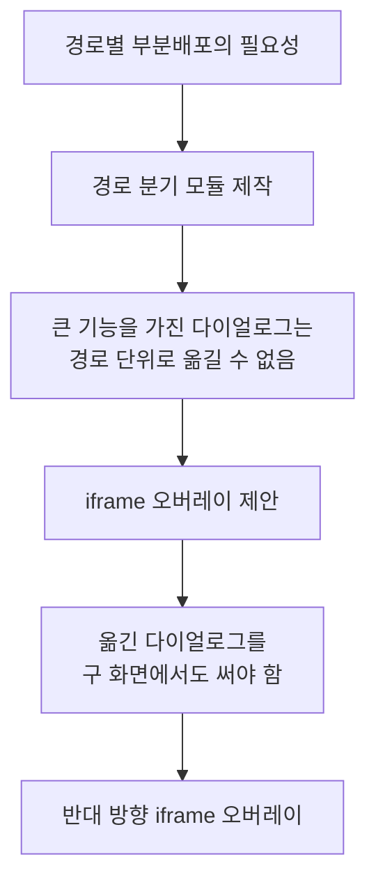
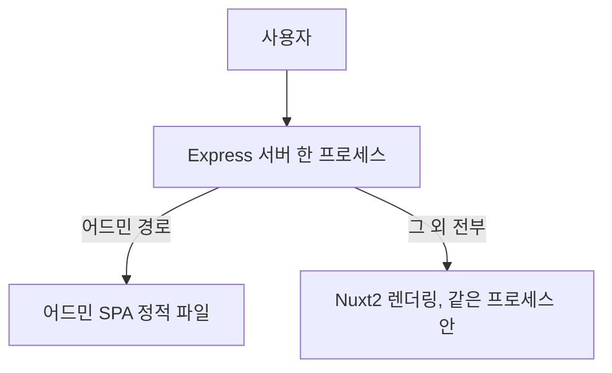
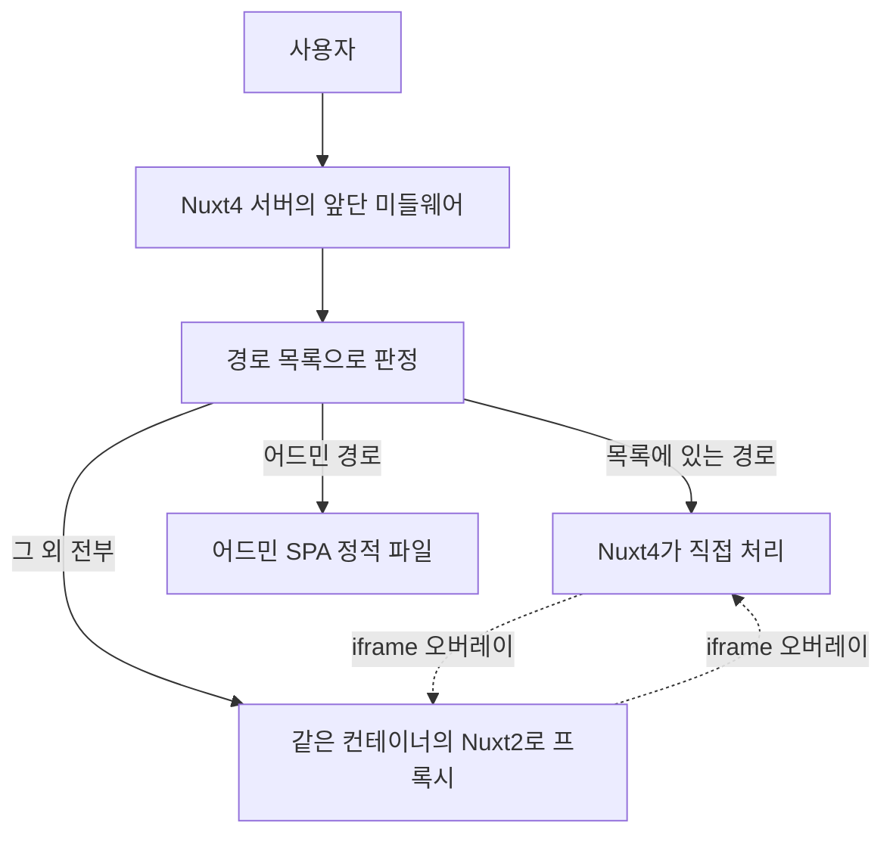
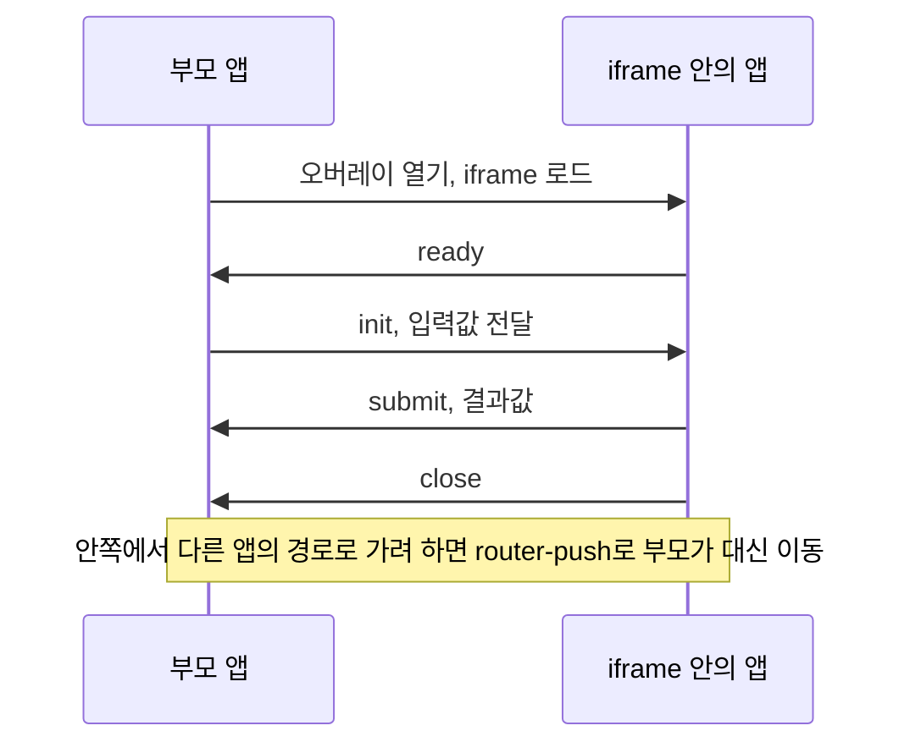

| 순서 | 글 |
|---|---|
| 1 | Nuxt4를 품는 모노레포에서 경로별 부분배포로 마이그레이션 이어 가기 (이 글) |
| 2 | [실패한 에이전트 하네스, dailyagent 돌아보기](/dev-articles/2026/11/20/failed-agent-harness-dailyagent-retrospective/) |
| 3 | [QA 부하를 줄이기 위한 테스트 플랫폼 제작기](/dev-articles/2026/11/20/test-platform-to-reduce-qa-load/) |
| 4 | [알지만 여력이 없던 일을 별도 사용량으로 돌리기](/dev-articles/2026/11/20/run-known-but-unstaffed-checks-on-separate-usage/) |
| 5 | 마이그레이션 자동화 팀 꾸리기 (예정) |

주간회의에서 기능 개발에 적극적인 팀원이 마이그레이션 속도가 기능 개발 속도를 따라가지 못한다고 짚었습니다. 맞는 말이었습니다. 신규 기능은 Nuxt2에 계속 쌓이는데, Nuxt4는 별도 브랜치에서 일부 인원이 옮기는 구조였기 때문입니다. 그래서 저는 Nuxt4를 다 옮긴 뒤 한 번에 내보내는 대신, 옮겨진 경로부터 운영에 내보내는 구조를 제안했습니다. 그 결과가 Nuxt4를 품는 모노레포와 경로별 부분배포입니다. 이 글은 그 구조의 동작 원리와, 경로 단위로 나누면 풀리지 않는 다이얼로그를 iframe으로 빌려 쓰며 치른 비용을 정리합니다.

## 기능 개발 속도를 따라가지 못한 별도 브랜치 마이그레이션

당시 개발은 Nuxt2에서 이어졌고, Nuxt4는 별도 브랜치에서 소수 인원이 옮기고 있었습니다. 신규 기능을 빠르게 만들던 시기라 Nuxt2에 들어가는 변경이 빠르게 쌓였습니다. 그 변경 가운데 이미 Nuxt4로 옮긴 화면에 해당하는 것은 Nuxt4에 다시 반영해야 했고, 어느 변경을 반영했는지 추적하기도 어려웠습니다. 노션 목록, TODO 주석, 슬랙 채널 같은 추적 방법을 두고 논의가 오갔고, 저는 저장소를 폴더별로 나눠 받아 Nuxt2와 Nuxt4를 따로 열어 두고 작업했습니다.

이 구조에서는 옮기는 속도를 올려도 마지막에 한 번에 내보내야 한다는 점이 그대로였습니다. 옮긴 화면이 운영에 나가지 못하니, 옮길수록 다시 반영할 변경만 늘었습니다.

## 옮긴 경로부터 먼저 내보낸다는 아이디어

이전 회사에서 Express로 경로마다 다른 프로세스에 요청을 나눠 보낸 경험이 있었습니다. 그 경험에서, 일부 경로라도 마이그레이션된 상태로 내보낼 수 있으면 병목이 풀린다고 봤습니다. 주말에 그 방식을 실험해 보고, 이어진 주간회의에서 시연하며 가능성을 설명했습니다.

제 생각엔 핵심은 배포 단위를 앱에서 경로로 내리는 것이었습니다. 앱 전체가 준비될 때까지 기다리는 대신, 준비된 경로를 Nuxt4가 받고 나머지는 기존 앱이 받으면 됩니다. 그러면 마이그레이션과 기능 개발이 같은 운영 환경에서 함께 갈 수 있고, 이관 한 건의 QA 범위도 경로 단위로 정해집니다.

전체 흐름을 먼저 그려 두면 아래와 같습니다.



## Express 앞단에서 Nuxt4 앞단으로의 전환

원래 앞단은 Express 서버 한 프로세스였습니다. 어드민 SPA 같은 정적 앱은 경로로 나눠 정적 파일로 내고, 나머지는 같은 프로세스 안에서 Nuxt2가 직접 렌더링했습니다. Nuxt4가 들어갈 자리가 없는 구조였습니다.



처음 떠올린 방법은 이전 경험 그대로였습니다. Express를 앞단에 두고, 이관된 경로만 Nuxt4 프로세스로 보내는 방식입니다. 이 방법은 쓰지 않기로 했습니다. 동료가 어차피 언젠가는 전부 Nuxt4로 옮길 것이니 Nuxt4가 기존 앱을 품는 쪽이 낫다고 제안했고, Nuxt4의 서버 엔진인 Nitro가 앞단 역할을 할 수 있다면 Express는 마이그레이션이 끝나면 걷어낼 중간 장치가 되기 때문입니다. 저도 그 말에 동의해서, 경로 판정을 Nuxt4 서버 미들웨어로 옮기고 Express 서버를 지웠습니다.

앱을 인스턴스로 나누는 방법도 따져 봤습니다. 다만 나누면 어드민 정적 파일의 경로 분기까지 인프라 쪽에서 처리해야 했습니다. 인프라 담당과 논의해, 마이그레이션 기간에는 인스턴스를 나누지 않고 한 컨테이너 안에서 Nuxt4가 Nuxt2를 품는 구조로 가기로 정리했습니다.



## 한 저장소에 세 앱을 두는 모노레포 구조

모노레포라고 해도 Nuxt4와 레거시 앱을 나란히 놓는 구조는 아닙니다. 저장소 루트가 Nuxt4 앱이고, Nuxt2와 어드민은 legacy 아래에 그대로 있습니다. 이미 있던 코드를 하위 폴더로 내리고 그 위에 Nuxt4를 얹은 형태라서, 「Nuxt4를 품는 모노레포」라고 부릅니다.

```text
/                  Nuxt4 앱, 앞단 서버
├─ layers/         Nuxt4 전용 레이어
├─ packages/       앱 공용 패키지, 경로 목록 포함
├─ legacy/front/   Nuxt2
└─ legacy/admin/   Vite + Vue2 어드민
```

공유되는 것은 packages 아래에 있는 경로 판정, API 타입, 다국어, 오류 수집, 환경 변수입니다. UI는 공유하지 않습니다. layers의 UI는 Nuxt4 전용이고, 레거시는 자체 Vue2 UI 패키지를 씁니다. 그래서 같은 화면이라도 이관 전후에 컴포넌트가 두 벌 존재합니다.

의존성은 pnpm 워크스페이스의 카탈로그로 나눴습니다. pnpm 문서는 기본 카탈로그와 이름 붙인 카탈로그를 함께 둘 수 있다고 안내하고, 큰 저장소가 의존성 버전을 단계적으로 올릴 때 쓸 수 있다고 설명합니다. 루트는 기본 카탈로그를 따르고, 레거시 앱은 이름 붙인 카탈로그에서 버전을 받습니다.

```yaml
# pnpm-workspace.yaml
packages:
  - legacy/*
  - packages/*

catalog:            # 루트 Nuxt4 앱의 기본 버전
  nuxt: ^4.0.0
  vue: ^3.5.0

catalogs:
  legacy:           # 레거시 앱 전용 버전
    nuxt: ^2.18.0
    vue: ^2.7.0
```

레거시 앱의 package.json은 이름 붙인 카탈로그를 이렇게 가리킵니다.

```json
{
  "dependencies": {
    "nuxt": "catalog:legacy",
    "vue": "catalog:legacy"
  }
}
```

빌드는 한 이미지 안에서 세 앱을 모두 하고, 실행은 같은 컨테이너에서 Nuxt4와 Nuxt2 두 프로세스를 띄웁니다. 어드민은 별도 프로세스 없이 Nuxt4가 빌드 결과를 정적으로 냅니다. 그래서 앱별로 따로 배포하지 않고, 배포 단위는 하나이며 어느 경로를 어느 앱이 받을지만 경로 목록이 정합니다.

## 경로 목록 하나로 갈리는 요청

경로 판정은 목록 하나에서 끝납니다. 아래는 같은 구조를 일반 예시로 새로 쓴 코드입니다. 목록에 있는 경로는 새 앱이 받고, 어드민 경로는 정적 파일이며, 어느 목록에도 없으면 전부 구 앱으로 갑니다. 기본값이 구 앱이라는 점이 중요합니다. 경로를 하나도 넘기지 않은 상태가 곧 기존 서비스 그대로의 상태입니다.

```ts
import { pathToRegexp } from "path-to-regexp";

export type Target = "new" | "old" | "old-admin";

const isNewAppPath = createPathMatcher([
  "/feature-a{/*path}",
  "!/feature-a/not-ready-yet{/*path}", // 코드는 병합됐지만 아직 구 앱이 받습니다
  "/overlay/upload-panel",             // 구 앱이 오버레이로 빌려 쓰는 새 앱 화면
  "/api{/*path}",
]);
const isOldAdminPath = createPathMatcher(["/admin{/*path}"]);

export function getTarget(path: string): Target {
  if (isNewAppPath(path)) return "new";
  if (isOldAdminPath(path)) return "old-admin";
  return "old"; // 목록에 없으면 전부 구 앱
}

function createPathMatcher(patterns: string[]) {
  const pos = patterns.filter((p) => !p.startsWith("!"));
  const neg = patterns.filter((p) => p.startsWith("!")).map((p) => p.slice(1));
  const posRe = pathToRegexp(pos).regexp;
  const negRe = neg.length ? pathToRegexp(neg).regexp : null;
  return (path: string) => {
    const p = path.replace(/\?.*$/, "");
    return posRe.test(p) && !(negRe && negRe.test(p));
  };
}
```

경로 패턴은 path-to-regexp 문법입니다. 문서 기준으로 중괄호는 경로의 선택 부분이고 별표는 여러 구간에 걸쳐 일치하는 와일드카드라서, `/feature-a{/*path}`는 `/feature-a`와 그 아래 전부에 일치합니다. 앞의 느낌표는 라이브러리 문법이 아니라 제가 둔 제외 표시이고, 위 코드가 직접 걸러 냅니다.

앞단 서버 미들웨어는 이 판정 결과에 따라 요청을 그대로 처리하거나 구 앱으로 넘깁니다.

```ts
// server/middleware/routing.ts
export default defineEventHandler((event) => {
  if (getTarget(event.path) !== "old") return; // 새 앱이 그대로 처리합니다

  const { oldAppBaseURL } = useRuntimeConfig();
  return proxyRequest(event, new URL(event.path, oldAppBaseURL).toString());
});
```

h3 문서에 따르면 `proxyRequest`는 들어온 요청을 대상 URL로 넘기고, 요청 본문은 버퍼에 담지 않고 스트림으로 흘려보내며, Cookie와 Authorization 헤더를 그대로 전달합니다. 문서는 이것을 같은 신뢰 범위 안의 리버스 프록시에는 맞는 동작이라고 설명합니다. 같은 컨테이너의 Nuxt2로 넘기는 이 구조가 그 경우입니다. 사용자에게는 오리진이 하나이고 두 앱이 같은 쿠키를 받으므로, 로그인 상태는 두 앱이 각자 API로 확인하기만 하면 이어집니다.

앱 경계를 넘는 이동은 SPA 이동이 아니라 문서 전체 이동입니다. 세 앱의 클라이언트 라우터가 모두 같은 경로 목록을 읽고, 이동하려는 경로를 다른 앱이 가지고 있으면 문서를 통째로 새로 불러옵니다.

## 화면 한 건을 넘기는 작업 순서와 롤백

화면 한 건을 넘기는 일은 코드 병합과 공개를 따로 둡니다. 새 앱에 화면 코드를 먼저 병합해 두고, 경로 목록에 한 줄을 넣는 순간에 트래픽이 넘어갑니다. 하위 경로가 여럿인 영역은 준비된 것부터 넘기고 나머지는 제외 패턴으로 보류했다가, 준비되면 제외 한 줄을 지웠습니다. 이관할 때도 구 앱의 페이지는 지우지 않고 남겨 둡니다.

운영 순서는 아래로 정리했습니다.

1. 이관할 화면을 새 앱에서 먼저 개발합니다.
2. 경로 연결을 끊은 상태로 develop에 병합합니다. 페이지는 목록에서 빼 두고, 오버레이는 구 구현을 그대로 씁니다.
3. 그 화면에 신규 기능을 만들어야 하면 다시 새 앱에 연결해서 개발합니다.
4. 마이그레이션과 신규 기능을 함께 QA합니다.

롤백 방법은 목록에서 경로를 빼서 배포하는 것뿐입니다. 구 앱의 페이지가 남아 있어서 되살릴 코드가 따로 없고, 그 경로는 이전 버전 화면으로 나갑니다. 저는 이 점을 이 구조의 가장 큰 장점으로 봅니다. 이관이 틀렸을 때 되돌리는 비용이 한 줄이어서, 이관 자체를 부담 없이 내보낼 수 있기 때문입니다.

## 옮기기 어려운 다이얼로그를 빌려 쓰는 iframe 오버레이

경로 단위로 나누면 풀리지 않는 것이 있습니다. 여러 화면이 함께 쓰는 다이얼로그와 드로어입니다. 어드민 표에서 여는 상세 드로어는 쓰는 페이지가 수십 개였습니다. 이 드로어가 옮겨지기 전에는 그 페이지들을 옮길 수 없었습니다. 드로어를 여는 아이콘을 숨기는 안도 있었고, 새 탭으로 여는 안도 따져 봤습니다. 하지만 새 탭으로 열어도 신구 웹에서 같은 컴포넌트를 두 벌 관리해야 하는 점은 같았습니다.

그래서 구 앱이 가진 구현을 iframe으로 띄워 쓰기로 했습니다. 옮기기 어려운 다이얼로그는 옮기지 않고 빌려 쓰는 쪽입니다. 구조는 단순합니다. 호스트는 화면 전체를 덮는 투명한 iframe만 두고, 다이얼로그 모양은 iframe 안의 앱이 직접 그립니다. 닫을지 말지의 판단도 안쪽 앱이 하고, 호스트는 닫기 메시지를 받아 iframe을 걷습니다.

이 방법은 한 방향이 아닙니다. 처음에는 Nuxt4 화면이 구 앱의 드로어와 다이얼로그를 빌렸고, 이후 이관을 마친 다이얼로그를 구 화면이 Nuxt4에서 빌리는 반대 방향도 추가했습니다. 어느 쪽 구현을 쓸지는 아래 기준으로 정합니다.

| 상황 | 쓰는 구현 | 이유 |
|---|---|---|
| 이미 Nuxt4로 옮긴 오버레이를 구 화면에서 써야 할 때 | Nuxt4 구현 | 옮긴 구현을 하나로 유지합니다 |
| 새 화면에서 쓰지만 옮기면 QA 비용이 크거나 기능이 방대한 오버레이 | Nuxt2 구현 | 이관 비용을 미루고 검증된 구현을 재사용합니다 |

작성 패널 하나는 두 기준 사이를 실제로 오갔습니다. 이관 전에는 구 앱의 구현을 새 화면이 빌렸고, 이관을 마친 뒤에는 같은 경로를 Nuxt4가 가져가면서 구 화면이 Nuxt4 구현을 빌리게 되었습니다.

호스트와 iframe 안의 앱은 같은 오리진의 postMessage로 대화합니다. 메시지 종류에는 접두사를 붙이고, 접두사가 다른 메시지는 버립니다.



MDN은 메시지를 받는 쪽이 `origin`과 필요하면 `source`로 보낸 쪽을 확인해야 하고, 보내는 쪽은 `*` 대신 정확한 `targetOrigin`을 써야 한다고 안내합니다. 같은 오리진이라 `targetOrigin`에는 `location.origin`을 씁니다. 또 메시지 값은 구조화 복제로 전달되는데, MDN의 지원 목록에 `File`과 `Blob`이 있어서 변환 없이 넘길 수 있습니다. 아래는 호스트 쪽 수신 처리를 같은 구조로 새로 쓴 예시입니다.

```ts
function handleMessage(e: MessageEvent) {
  if (e.origin !== window.location.origin) return;
  if (e.source !== frame.value?.contentWindow) return;

  const data = e.data;
  if (typeof data?.type !== "string" || !data.type.startsWith("overlay:")) return;

  switch (data.type) {
    case "overlay:ready":
      ready.value = true; // 이때 iframe을 보이게 하고 로딩 표시를 끕니다
      stopLoading();
      if (props.payload !== undefined) {
        frame.value?.contentWindow?.postMessage(
          { type: "overlay:init", payload: props.payload },
          window.location.origin,
        );
      }
      break;
    case "overlay:submit":
      emit("submit", data.payload);
      break;
    case "overlay:close":
      open.value = false;
      emit("close");
      break;
    case "overlay:router-push":
      // 같은 오리진 경로만 받습니다
      if (typeof data.url === "string" && data.url.startsWith("/")) router.push(data.url);
      break;
  }
}
useEventListener(window, "message", handleMessage);
```

열 때는 시간 제한을 둡니다. 정해 둔 시간 안에 `ready`가 오지 않으면 iframe을 닫고 오류를 알립니다. 로딩 표시는 바로 띄우지 않고 조금 늦춰서, 짧게 끝나는 로드에서 깜빡임이 생기지 않게 했습니다.

## 로그인 다이얼로그를 빌려 쓰게 된 사례

로그인 다이얼로그는 이 방식이 필요해서 들어간 사례입니다. 새 앱의 한 화면에서 유저가 로그인해야 하는 동작이 생겼는데, 로그인 다이얼로그는 아직 옮겨지지 않은 상태였습니다. 로그인과 가입은 단계와 분기가 많고, 소셜 로그인처럼 외부 서비스로 이동하는 흐름이 있어서 옮기는 비용이 컸습니다. 그래서 새 앱에서도 실서비스에서 검증된 기존 다이얼로그를 iframe으로 띄워 쓰기로 하고 작업을 시작했습니다. 소셜 로그인과 다국어 변경이 URL을 바꿀 수 있다는 점을 중점 검수 항목으로 잡았습니다.

작업을 시작한 뒤, 이관이 덜 된 새 구현이 한때 화면에 노출되는 일이 있었습니다. 그 일로 구현을 하나로 모아야 한다는 쪽이 더 분명해졌습니다. 새 구현은 지우고 기존 다이얼로그 하나만 남겨, QA를 거쳐 반영했습니다.

개발할 때 신경 쓸 점도 하나 생겼습니다. 경로별 부분배포 환경에서 새 앱만 띄우면 로그인 창이 열리지 않을 수 있습니다. 그래서 개발 중에는 켜고 끄는 환경 변수를 켜서 구 앱까지 함께 띄웁니다.

## 첫 열림 지연과 후속 개선

iframe은 열 때마다 앱 하나를 통째로 받습니다. 작성 패널을 이 방식으로 열자 처음 열 때 수 초의 지연이 보였습니다. 이관이 끝날 때까지 이 지연을 유저가 계속 감수하게 두는 건 맞지 않다고 봤습니다. 그래서 세 가지를 바꿨습니다.

- 다국어 캐시를 늘려 첫 열림에서 주고받는 통신을 줄였습니다.
- 숨은 대기 iframe을 미리 만들어 두었습니다. 부모의 하이드레이션이 끝나 한가해진 시점에 준비하고, 다른 오버레이가 열려 있는 동안에는 준비를 미룹니다. 한 번 쓴 대기 iframe은 닫힌 뒤 다시 씁니다.
- 대기 iframe을 만들 조건을 두었습니다. 앱 웹뷰, 터치가 주 입력인 기기, 데이터 절약 모드, 메모리가 낮은 기기에서는 만들지 않습니다. 새 앱 화면에서 넘어온 경우에는 잠시 머문 뒤에 준비합니다.

그 결과 첫 열림은 거의 즉시로 바뀌었습니다. 대기 iframe의 비용을 재고 조건을 정한 과정은 [숨은 iframe preload는 기기 조건을 보고 켠다](/dev-articles/2026/11/05/prework-when-to-connect/)에 있습니다. iframe을 걷을 때 안쪽 Vue 정리 훅이 돌지 않아 부모 창에 건 관측기가 남는 문제는 [부모 창에 건 리스너는 pagehide에서 푼다](/dev-articles/2026/11/10/close-with-record/)에서 다뤘습니다.

## 구조가 치르는 비용과 한계

이 구조는 공짜가 아닙니다. 치르는 비용은 아래와 같습니다.

- 부분배포 단위는 경로입니다. 한 페이지 안의 컴포넌트 단위로는 나눌 수 없어서, 댓글처럼 여러 화면이 쓰는 컴포넌트를 두 벌로 관리하는 문제는 경로 목록으로 풀리지 않습니다.
- 앱 경계를 넘는 이동은 문서 전체 이동입니다. SPA 이동처럼 매끄럽지 않습니다.
- UI가 두 벌입니다. 같은 화면의 구 컴포넌트와 새 컴포넌트가 이관이 끝날 때까지 함께 있습니다.
- iframe은 성능 면에서 좋은 패턴이 아닙니다. 앱을 통째로 받는 비용을 대기 iframe으로 가렸을 뿐, 없앤 것은 아닙니다.
- 마이그레이션 기간에 한정된 구조입니다. 이관이 끝나면 걷어내는 것이 전제입니다.

## 이 구조를 고른 판단 근거

저는 마이그레이션을 빨리 끝내는 일보다, 끝난 단위부터 내보낼 수 있게 하는 일이 먼저라고 판단했습니다. 속도를 올려서 따라잡는 방법은 기능 개발이 빨라질수록 다시 밀리고, 그 사이 옮긴 화면은 운영에 나가지 못합니다. 반면 경로 단위로 내보낼 수 있으면 마이그레이션이 기능 개발을 막지도 따라가지도 않고 옆에서 함께 진행됩니다.

경로 목록 하나에 모든 분기를 모은 것도 같은 이유입니다. 분기가 한곳에 있으면 지금 어느 경로를 어느 앱이 받는지를 한 파일에서 읽을 수 있고, 롤백도 그 파일의 한 줄을 지우는 일로 끝납니다. iframe 오버레이는 이 구조에서 경로로 나눌 수 없는 부분만 메우는 보조 수단입니다. 그래서 오버레이가 있으면 여러 화면이 함께 쓰는 컴포넌트에 막히지 않고 이관 순서를 정할 수 있습니다.

다음에 큰 마이그레이션을 맡으면, 다 옮긴 뒤 내보내는 계획보다 옮긴 단위부터 내보낼 수 있는 구조를 먼저 만들려고 합니다.
