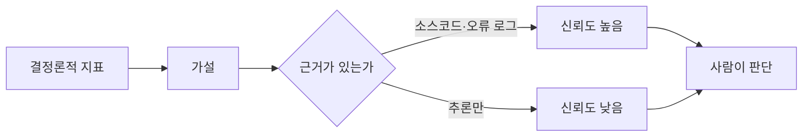
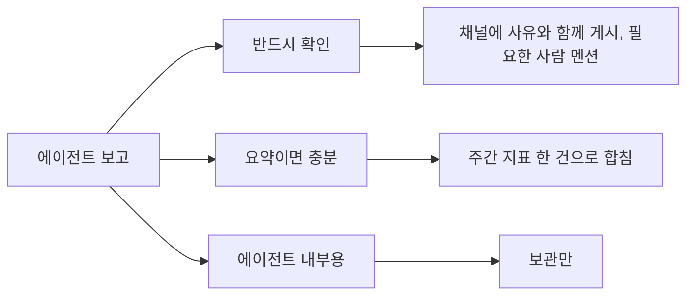
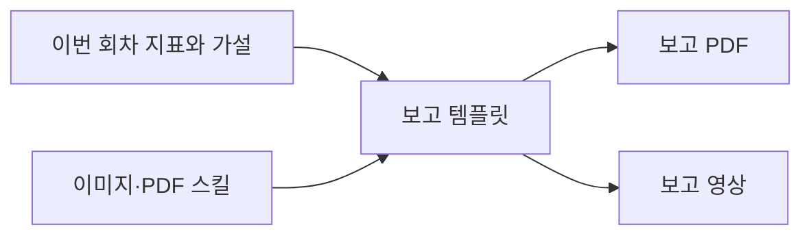

| 순서 | 글 |
|---|---|
| 1 | [Nuxt4를 품는 모노레포에서 경로별 부분배포로 마이그레이션 이어 가기](/dev-articles/2026/11/20/partial-deploy-by-path-in-nuxt4-monorepo/) |
| 2 | [실패한 에이전트 하네스, dailyagent 돌아보기](/dev-articles/2026/11/20/failed-agent-harness-dailyagent-retrospective/) |
| 3 | [QA 부하를 줄이기 위한 테스트 플랫폼 제작기](/dev-articles/2026/11/20/test-platform-to-reduce-qa-load/) |
| 4 | 알지만 여력이 없던 일을 별도 사용량으로 돌리기 (이 글) |
| 5 | [비용 부채를 줄이며 기능 개발을 이어 가는 마이그레이션 자동화 팀 꾸리기](/dev-articles/2026/11/21/migration-automation-team-while-paying-down-cost-debt/) |

아침에 헬스장으로 이동하는 중이나 출퇴근 중에 폰을 열어 에이전트 보고를 확인합니다. 보고는 제가 움직이기 전에 이미 올라와 있고, 저는 이동하는 동안 사람이 봐야 할 것만 골라 둡니다. 이 장면은 **보고가 틀릴 수 있다는 전제에서 시작해야 성립한다**{: .key}고 저는 봅니다. 틀린 보고를 맞는 보고처럼 읽게 되면, 폰으로 보는 시간이 오히려 잘못된 확신을 쌓는 시간이 되기 때문입니다.

## 별도 사용량으로 돌린 점검 3종

오류 모니터링, 접근성, 검색 최적화는 필요하다는 걸 알고 있었지만 기능 개발에 밀려 정기적으로 보지 못하던 일이었습니다. 저는 회사에서 지원하는 Cursor 플랜으로 기능 개발에 에이전트를 쓰다가 사용량이 모자란 경험을 했습니다. 그러다 우연히 Grok Bot을 알게 되었고, 확인해 보니 Grok Bot은 Cursor 플랜과 별도로 사용량이 집계되어 개발에 쓰는 사용량과 겹치지 않았습니다. 그래서 Cursor 플랜의 사용량은 기능 개발에 그대로 두고, 점검은 Grok Bot에 맡기기로 했습니다.

| 점검 | 주기 | 산출물 |
|---|---|---|
| 오류 모니터링(Sentry) | 매일 아침 | 이슈 최대 3건을 분석해 원인과 수정안을 이슈로 등록 |
| 접근성(axe-core) | 주 1회 | impact별 위반 노드 수와 변화 |
| 검색 최적화 | 배포 뒤 주 1회 | 구조화 데이터·메타 태그 점검 결과 |

세 점검의 보고는 한 채널에 모았습니다. 접근성은 [3편](/dev-articles/2026/11/20/test-platform-to-reduce-qa-load/)의 테스트 도구가 화면을 접근성 트리로 읽기 때문에 더 중요해졌습니다. 이름이 없는 버튼은 사람에게도 도구에게도 구별되지 않습니다.

## 휴먼 아웃더 루프(human-out-of-the-loop)가 어려운 이유

사람이 루프에서 빠지려면 에이전트가 사람이 원하는 행동 안에 머물러야 합니다. 에이전트는 그 범위를 벗어납니다. 같은 지시를 줘도 출력이 달라지는 비결정론 때문입니다. 비결정론적인 에이전트에 목적이 이뤄지길 기대하는 일은 불특정한 대상이 원하는 대로 움직이길 비는 일에 가깝다고 저는 판단했습니다. 지시문을 다듬는 건 비는 말을 더 정교하게 쓰는 일이고, 벗어났을 때 알아채는 구조는 만들어 주지 않습니다.

그래서 에이전트가 벗어나지 않게 만들겠다는 목표를 버리고, 벗어났을 때 사람이 알아챌 수 있는 보고 구조를 만들었습니다. 관측 에이전트는 세 가지를 지킵니다. 수치는 결정론적 지표에서 가져오고, 결과는 가설로 사람에게 제시하고, 추론에 기댄 결과에는 확신도를 붙입니다.



## 결정론적 지표(deterministic metrics)와 axe-core 집계

접근성 점검에서 숫자는 에이전트가 세지 않습니다. Playwright에서 `@axe-core/playwright`를 돌리는 **스크립트가 impact별 위반 노드 수를 합산하고, 에이전트는 그 JSON을 읽어 해석만 합니다**. 에이전트가 페이지를 직접 보고 위반을 센다면 같은 페이지에서도 회차마다 숫자가 달라질 수 있고, 그러면 지난 회차와 비교하는 일이 의미를 잃는다고 생각했습니다.

```js
import { readFileSync, writeFileSync } from 'node:fs';
import { chromium } from 'playwright';
import { AxeBuilder } from '@axe-core/playwright';

const urls = JSON.parse(readFileSync('urls.json', 'utf8'));
const impacts = ['critical', 'serious', 'moderate', 'minor'];
const byImpact = Object.fromEntries(impacts.map((i) => [i, 0]));

const browser = await chromium.launch();
const context = await browser.newContext(); // AxeBuilder는 newContext()로 만든 page를 요구합니다.
const page = await context.newPage();

for (const url of urls) {
  await page.goto(url);
  const { violations } = await new AxeBuilder({ page }).analyze();
  for (const v of violations) byImpact[v.impact] += v.nodes.length;
}
await browser.close();

writeFileSync('a11y-summary.json', JSON.stringify({ urlCount: urls.length, byImpact }, null, 2));
```

`impact`는 axe-core 결과의 위반마다 `minor`, `moderate`, `serious`, `critical` 중 하나로 들어 있고, 위반마다 `nodes` 배열에 문제가 된 요소가 담깁니다. 점수를 비교하려면 `urls.json`도 고정해야 합니다. URL 목록이 늘어난 회차는 같은 점수라도 의미가 달라지기 때문에 보고에 「기준 변경」으로 따로 적고, 해결로 세지 않습니다.

## 가설(hypothesis)과 확신도(confidence) 표기

에이전트가 내놓는 결과는 사실이 아니라 가설로 보고합니다. 항목마다 어떤 근거로 그렇게 말하는지(`evidence_type`)와 확신도(`confidence`)가 붙고, 이 표기는 지금 실제 보고에 적용되어 있습니다.

```json
{
  "hypothesis": "아이콘 버튼에 접근 가능한 이름이 없어 button-name 위반이 납니다",
  "evidence_type": "source_code",
  "evidence": "IconButton.vue의 button 요소에 aria-label과 텍스트가 모두 없음",
  "confidence": "high"
}
```

| 근거 유형 | 확신도 |
|---|---|
| 제품 저장소의 소스코드를 읽고 확인 | 높음 |
| 오류 로그를 읽고 확인 | 높음 |
| 근거 없이 추론 | 낮음 |

확신도가 필요했던 사례가 검색 최적화 점검의 오진입니다. 에이전트는 조직 구조화 데이터(`Organization` JSON-LD)가 홈 밖의 여러 페이지에 없다는 것을 블로커로 세었고, 이 항목은 3주 동안 최우선 액션에 올라 있었습니다. 그런데 이 영역을 담당했던 동료에게 물어보니, 조직 정보는 홈에 한 번만 두면 된다는 답이 돌아왔습니다. Google 문서는 이 정보를 [홈페이지나 조직을 설명하는 한 페이지에 두기를 권장](https://developers.google.com/search/docs/appearance/structured-data/organization)합니다. 에이전트의 규칙은 공식 요구가 아니라 추정이었습니다.

이 일 뒤로 합의한 기준은 공식 문서가 요구하는 것만 블로커로 세는 것입니다. 에이전트가 문서 근거 없이 규칙을 세웠다면 그 항목은 낮은 확신도로 표시됩니다. 그래서 **사람은 확신도를 보고 어디까지 믿고 읽을지 정할 수 있습니다**.

## 보고 58건 중 3건: 읽히는 보고로 바꾸기

에이전트 보고가 읽기 어렵다고 짚은 사람은 CTO님이었습니다. 보고가 너무 길고 잦아서 정작 읽히지 않는다는 이야기였습니다. 지난 4주 동안 올라온 에이전트 글 58건을 분류해 보니 **반드시 봐야 할 것은 3건**이었습니다. 나머지는 요약이면 충분하거나 에이전트 내부용이었습니다.



반드시 볼 것만 채널에 올리고, 사유를 앞에 붙여 한두 줄로 씁니다. 나머지 지표는 주간 보고 한 건으로 모았습니다.

보고의 형식도 바꿨습니다. 에이전트가 매번 보고서 모양을 새로 짜면 결과가 들쭉날쭉하고, 레이아웃을 정하는 데 토큰도 씁니다. 그래서 이미지와 PDF를 만드는 스킬을 먼저 만들고, 보고마다 쓸 템플릿을 정해 두었습니다. 에이전트는 템플릿의 빈칸에 이번 회차의 지표와 가설만 채웁니다. 같은 템플릿으로 슬라이드 PDF를 뽑고, 같은 내용을 짧은 영상으로도 렌더링합니다. 모양이 고정되니 회차끼리 비교하기 쉬워졌고, 에이전트는 내용에만 토큰을 씁니다.



바꾼 보고를 다시 본 CTO님은 가독성이 더 괜찮아졌다고 했습니다. 문제를 짚었던 사람에게서 나아졌다는 답을 들은 것으로 이 개선을 확인했습니다.

## 제거한 에이전트 2건: QA와 정적 분석

실험하는 동안 에이전트 둘을 제거했습니다.

| 에이전트 | 맡은 역할 | 제거한 이유 |
|---|---|---|
| QA | 내부 테스트 서버에 접속해 E2E 테스트 케이스를 작성하고 실행 | 외부 클라우드에서 도는 에이전트가 내부 테스트 서버에 접근하는 것은 보안 정책상 승인받기 어려움. Grok Bot 클라우드 환경에 개발 빌드를 직접 띄우기에는 스펙이 부족함 |
| 정적 분석 | 웹 프론트엔드 코드를 주기적으로 정적 스캔해 문제 후보를 보고 | 이미 쓰던 코드 리뷰 도구(CodeRabbit)와 역할이 겹치고, 그 도구보다 나은 점의 근거가 부족함 |

QA 에이전트는 테스트할 서버에 닿지 못하는 것이 결정적이었습니다. 내부 테스트 서버를 외부에 여는 것은 보안 정책상 승인받기 어려웠고, 그렇다고 Grok Bot 클라우드 환경 안에서 개발 빌드를 띄우기에는 머신 스펙이 모자랐습니다. 테스트 대상에 접근할 길이 없으니 남겨 둘 이유가 없었습니다.

정적 분석 에이전트는 돌아가기는 했지만, 이미 쓰고 있던 코드 리뷰 도구가 하는 일과 겹쳤습니다. 그 도구보다 무엇을 더 잘 찾는지 근거를 대지 못해서 실용성이 없다고 판단했습니다.

점검을 늘리는 일만큼 제거하는 기준도 필요했습니다. 점검 대상에 닿지 못하거나 기존 도구가 이미 하는 일이면, 사용량만 쓰고 보고만 늘립니다.

## 사내망 접근 미허용과 최소 권한

에이전트에게는 사내망 접근을 주지 않기로 했습니다. 에이전트는 비결정론적이고 웹 페이지와 이슈 본문 같은 외부 입력을 읽기 때문에, 사람이 원하는 행동에서 벗어났을 때 닿는 범위를 처음부터 좁혀 두는 쪽이 안전하다고 생각했습니다. 최소 권한 원칙을 그대로 적용한 결정입니다. 그래서 점검 대상은 공개된 URL과 읽기 권한의 저장소로 한정했고, 내부망에서만 보이는 환경은 에이전트의 점검 범위에 넣지 않았습니다.

## 사용량 한도와 휘발성 머신

별도 사용량도 한도가 있습니다. 추론을 많이 쓰는 다른 작업이 같은 사용량을 쓴 시기에 한도가 차서 점검이 며칠 멈춘 적이 있습니다. 이 이야기는 5편에서 다룹니다. 에이전트가 쓰는 머신은 휘발성이라고 보고, 오래 둘 것은 저장소에 둡니다. 놓친 루틴은 다음 회차에 다시 실행되게 해 두었습니다.

여력이 없어서 못 하던 점검을 에이전트에게 맡길 수는 있었습니다. 그 점검을 폰으로 읽어도 되는 보고로 만든 것은 지표를 스크립트로 고정하고 결과를 가설과 확신도로 바꾼 구조였습니다.

## 참고

- [@axe-core/playwright README](https://github.com/dequelabs/axe-core-npm/blob/develop/packages/playwright/README.md)
- [axe-core API 문서: Results Object](https://github.com/dequelabs/axe-core/blob/develop/doc/API.md)
- [Organization structured data, Google Search Central](https://developers.google.com/search/docs/appearance/structured-data/organization)
