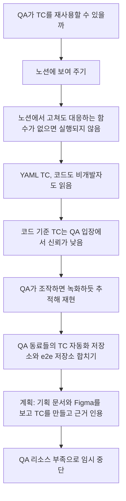
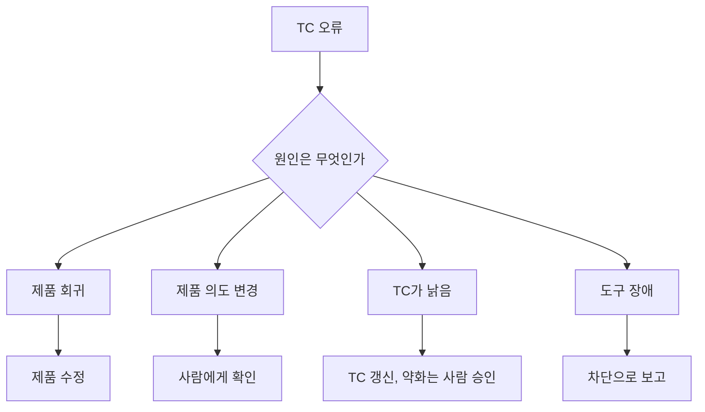
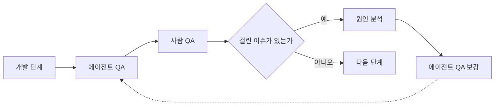

| 순서 | 글 |
|---|---|
| 1 | [Nuxt4를 품는 모노레포에서 경로별 부분배포로 마이그레이션 이어 가기](/dev-articles/2026/11/20/partial-deploy-by-path-in-nuxt4-monorepo/) |
| 2 | [실패한 에이전트 하네스, dailyagent 돌아보기](/dev-articles/2026/11/20/failed-agent-harness-dailyagent-retrospective/) |
| 3 | QA 부하를 줄이기 위한 테스트 플랫폼 제작기 (이 글) |
| 4 | [알지만 여력이 없던 일을 별도 사용량으로 돌리기](/dev-articles/2026/11/20/run-known-but-unstaffed-checks-on-separate-usage/) |
| 5 | [비용 부채를 줄이며 기능 개발을 이어 가는 마이그레이션 자동화 팀 꾸리기](/dev-articles/2026/11/21/migration-automation-team-while-paying-down-cost-debt/) |

에이전트 덕분에 개발은 쉬워졌는데, 버그도 그만큼 늘었습니다. 버그가 늘면 QA가 봐야 할 것도 늘어납니다. 그 부담을 줄이려고 테스트 도구를 만들었고, 기능보다 먼저 「통과」를 믿을 수 있게 만드는 데 시간을 썼습니다.

## 에이전트 개발에서 테스트 정확도가 중요한 이유

에이전트의 품질이 올라서 개발 생산성도 올랐습니다. 다만 저는 **테스트의 정확도**{: .key}가 함께 오르지 않으면 그 생산성이 실제로는 오르지 않는다고 봅니다. 기획서대로 기능이 올바르게 동작하는지 보장하지 못하면 만든 속도가 곧 쓸 수 있는 속도가 되지 않고, 기능을 하나 얹을 때마다 기존 기능이 깨지는 회귀가 생기는지도 알 수 없기 때문입니다.

개발이 쉬워지면 만드는 양이 늘고, 버그도 그만큼 늘어납니다. 그 버그를 근본적으로 없애려면 에이전트가 자기가 만든 작업의 신뢰도를 스스로 보장할 수 있어야 한다고 판단했습니다. 그래서 에이전트가 서비스를 직접 쓰게 만들기로 했습니다. 화면을 열고 사용자처럼 조작해 보면서 자기 작업이 맞는지 확인하게 하는 것입니다.

이 방식은 에이전트가 내리는 판정이 맞을 때만 성립합니다. 에이전트가 서비스를 쓰고 「통과」라고 보고했는데 그 통과가 틀렸다면, 에이전트는 틀린 작업을 맞다고 말하게 되고 사람은 그 보고를 다시 확인해야 합니다. 그래서 저는 기능을 넓히기 전에 판정을 믿을 수 있게 만드는 일을 먼저 했습니다.

판정이 틀리는 모습은 이랬습니다. 삭제한 댓글이 화면에서 분명히 사라졌는데도, 「이 댓글이 보이지 않는다」는 판정은 계속 실패했습니다. 화면을 열어 보면 목록은 한 줄 줄어 있었습니다. 더 곤란한 쪽은 반대 판정이었습니다. 같은 원인으로 「이 댓글이 보인다」는 판정이 화면에 없는 댓글에도 통과하고 있었습니다.

## SSR 페이로드(`__NUXT_DATA__`)를 읽은 텍스트 판정

Nuxt는 서버에서 렌더할 때 `useFetch`나 `useAsyncData`로 받은 데이터를 페이로드로 직렬화해 HTML 안의 `<script id="__NUXT_DATA__">`에 싣습니다. 클라이언트는 그 데이터를 다시 요청하는 대신 재사용합니다. 실측해 보니 제 글자 판정이 집은 요소는 목록의 항목이 아니라 이 스크립트 요소였습니다. 목록 응답이 거기에 그대로 실려 있으니, 화면에서 항목을 지워도 문서 안에는 글자가 남습니다.

차이는 DOM 프로퍼티 하나로 재현됩니다. MDN에 따르면 `textContent`는 `script`와 `style`을 포함한 모든 요소의 내용을 가져오고, `innerText`는 사람이 읽는 요소만 보여 주며 숨겨진 요소의 글자는 돌려주지 않습니다. 아래 페이지에서 항목을 지운 뒤 두 값을 비교해 보면 됩니다.

```html
<ul id="comments">
  <li>첫 번째 댓글</li>
  <li id="target">지울 댓글</li>
</ul>
<script id="__NUXT_DATA__" type="application/json">["첫 번째 댓글","지울 댓글"]</script>
```

```js
const has = () => ({
  textContent: document.body.textContent.includes('지울 댓글'),
  innerText: document.body.innerText.includes('지울 댓글'),
});
console.log(has());                       // { textContent: true,  innerText: true }
document.getElementById('target').remove();
console.log(has());                       // { textContent: true,  innerText: false }
```

항목을 지운 뒤에도 `textContent`는 여전히 `true`입니다. 문서 전체에서 글자를 찾는 판정이라면 「보이지 않는다」는 영원히 참이 되지 않고, 「보인다」는 화면에 없는 글자에도 통과합니다. 실제로 같은 TC 안에서 「보인다」가 통과시킨 답글을, 바로 뒤의 순서 판정이 화면에 없다고 보고하면서 이 결함이 드러났습니다.

그래서 글자 판정은 **접근성 스냅샷에서** 읽도록 바꿨습니다. agent-browser의 `snapshot`은 페이지를 접근성 트리 텍스트로 돌려줍니다. 판정이 문서 전체가 아니라 이 트리를 읽게 한 것입니다.

1편에서 경로를 하나씩 Nuxt4로 넘기는 구조를 만들었는데, 이 결함은 그 구조 위에서 화면이 Nuxt4로 넘어간 뒤 판정이 실패하면서 처음 드러났습니다.

## 노션 TC에서 YAML TC로 바뀐 과정

출발은 제가 작성한 TC를 QA가 재사용할 수 있지 않을까 하는 생각이었습니다. QA가 보려면 노션에 보여 줘야 한다고 생각했는데, 실제로 동작하는 코드와 **노션이 따로 있으면** 문제가 생깁니다. 노션에서 TC를 「이렇게 동작해야 한다」로 고쳐도 코드 쪽에 대응하는 함수가 없으면 그 TC는 올바르게 동작하지 않습니다. 그래서 실행도 되고 QA도 읽을 수 있는 TC가 필요했고, YAML이 맞는 대안이라고 판단했습니다. 코드로도 읽을 수 있고 비개발자도 읽을 수 있기 때문입니다. 노션의 TC를 YAML로 옮기는 변환 스킬, YAML을 실행하는 러너, 실행 결과를 노션에 올리는 동기화 스킬로 이어지는 흐름을 만들었습니다.

그런데 병목은 다른 곳에 있었습니다. 에이전트가 쓴 TC는 QA 입장에서 신뢰성이 떨어졌습니다. 그 TC는 코드 베이스를 기준으로 만들기 때문입니다. 한 QA 동료는 QA가 제품을 절대 믿으면 안 되는 조직이고, 자기들이 구축한 TC와 기획 문서만 정답으로 본다고 했습니다. 제품 코드에서 뽑은 TC는 제품이 하는 대로를 기준으로 삼으니, QA가 이 에이전트를 온전히 신뢰할 수 없다는 말이 맞다고 생각했습니다.

그래서 QA가 하는 행동을 직접 브라우저에서 조작하면, 그 조작을 녹화하듯 추적해 그대로 재현할 수 있는 구조가 필요하다고 판단했습니다. 이 방향을 따라가면서 TC 도구가 플랫폼 쪽으로 점점 커졌습니다.

그 뒤에 QA 동료들이 만든 TC 자동화 저장소와 e2e 저장소를 합치면 어떻겠느냐는 의견이 나왔습니다. 처음에는 두 저장소를 아예 따로 둘 생각이었습니다. 다만 QA의 리소스를 줄이고 생산성을 올리려면 어떻게든 합쳐서, 자동화한 검증을 QA가 믿을 수 있는 구조를 만들어야 한다고 생각을 바꿨습니다.

그 구조에서는 에이전트가 코드가 아니라 기획 문서와 디자인을 보고 TC를 만들도록 계획했습니다. 기획 문서는 노션, 디자인은 Figma입니다. TC를 만들 때 기획 문서의 어떤 구절을 참조했고 Figma의 어떤 노드를 보고 만들었는지 근거를 댈 수 있게 하는 구조입니다. TC에는 출처 필드가 있어서, 그 필드에 기획 문서의 구절과 Figma의 노드를 적게 하는 계획입니다.



이 계획들은 QA 리소스가 부족해서 지금은 임시로 멈춰 있습니다.

## TC 표본 3건의 실행 결과

변환 스킬과 러너를 처음 시험하려고 노션 TC 12건 가운데 3건을 변환해 돌려 봤습니다. 세 건 모두 사람 단계 없이 끝까지 실행됐습니다. 그런데 원문의 기대 결과를 온전히 판정한 것은 한 건뿐이었고, 그것도 원문을 화면에 맞게 고친 뒤였습니다.

스텝을 세어 보니 준비와 정리가 76%였습니다. 그래서 준비와 정리를 **공용 모듈** 두 개로 묶자 TC 하나를 손으로 쓰는 분량이 짧아졌습니다. 변환하는 동안 원문이 화면과 어긋난 곳도 여러 군데 나왔습니다. 변환이 명세 검수 역할도 했습니다.

이 표본에서 얻은 결론은 속도보다 구분이었습니다. 끝까지 도는 것과 맞게 판정하는 것은 다른 문제였습니다. 도는 것은 금방 되는데, 판정이 맞는지는 돌려 봐서는 알 수 없었습니다.

## 사전조건·setup·cleanup을 갖춘 자가완결 TC

TC 한 스텝에는 사람이 읽는 문장과 러너가 실행하는 명령을 나란히 둡니다. 사람은 `desc`와 `then`만 읽어도 에이전트 없이 같은 스텝을 재현할 수 있고, 러너는 `run`과 `check`를 실행합니다.

저는 TC가 **자가완결적이어야** 결과가 늘 보장된다고 판단했습니다. 그래서 TC마다 자기 선행 조건을 두고, 실행을 준비, 검증, 마무리 세 단계로 나눴습니다. 준비 단계에서는 해당 페이지로 이동하고 TC를 실행하는 데 필요한 조건을 맞춥니다. 없는 데이터나 조건은 시드로 만들거나, 모든 TC가 공유해서 쓰는 공통 모듈로 만듭니다. 검증 단계는 그렇게 맞춘 조건 위에서 판정만 합니다. 마무리 단계에서는 그 TC가 만든 데이터를 정리해서, 데이터 오염이 후속 TC로 번지지 않게 합니다. 준비와 정리가 스텝의 대부분을 차지하는 것은 이 구조의 비용이고, 공통 모듈이 그 비용을 줄입니다. 아래는 이 형식을 일반화해 새로 쓴 예시입니다.

```yaml
id: TC-DEMO-001
title: 댓글을 지우면 목록에서 사라진다
accounts:
  writer: { role: member }
vars:
  text: "demo-{{run_id}}"
preconditions:
  - 로그인한 회원이 쓴 댓글이 한 건 있다
setup:                                  # 준비: 조건을 이 TC가 스스로 맞춘다
  - use: auth/login
    with: { as: writer }
  - use: seed/post                      # 없는 데이터는 시드가 만든다
    with: { author: writer, save_as: post_id }
  - use: comment/create                 # 공통 모듈
    with: { post: "{{post_id}}", text: "{{text}}" }
  - run: go "/posts/{{post_id}}"
steps:                                  # 검증
  - desc: 목록에 준비한 댓글이 보이는지 확인한다
    then: 목록에 방금 만든 댓글이 보인다
    check: see-in "댓글 목록" "{{text}}"
  - desc: 내 댓글의 삭제를 누르고 확인한다
    run: click role=button name="삭제" in="{{text}}"
    then: 목록에서 그 댓글이 사라진다
    check: not-see-in "댓글 목록" "{{text}}"
cleanup:                                # 마무리: 이 TC가 만든 데이터를 치운다
  - use: comment/delete-if-exists
    with: { text: "{{text}}" }
```

동사의 계약은 한 파일에만 두었습니다. 형식 문서의 동사 표는 그 파일에서 생성하고, 러너도 같은 파일로 검증합니다. 실행 전에는 `--dry`로 형식과 참조를 정적으로 검사합니다. 화면은 열지 않습니다.

```text
$ e2e run --dry demo/TC-DEMO-001.yaml
✗ steps[1].check: 알 수 없는 동사 'not-see-intext'
✗ vars: {{run_id}} 를 풀 수 없음
✗ cleanup[0].use: 모듈 'comment/delete-if-exists' 를 찾을 수 없음
exit 1
```

이 출력은 설명을 위한 예시입니다. TC는 출처가 된 원문 문장 목록도 품고, 스텝마다 어느 줄에서 왔는지를 적습니다. 대응표에서 비어 있는 행이 곧 누락이라서, `--dry`가 이것도 브라우저 없이 집합 뺄셈으로 검사합니다.

## TC 정본 후보와 사용하지 않은 이유

TC의 정본은 YAML 하나입니다. 노션은 QA가 읽고 쓰기 편하지만, 노션에서 고친 문장은 대응하는 코드가 없으면 실행되지 않아서 QA가 읽는 입구로만 두었습니다. HTML 체크리스트는 사람만 읽는 형태라 정본에서 뺐고, 앱을 정본 저장소로 삼는 안도 쓰지 않았습니다. 나머지는 모두 그 YAML을 읽거나 만드는 입구입니다.

저장소 경계는 두 번 뒤집었습니다. 러너를 에이전트 플러그인 안에 두려던 결정은 며칠 만에 되돌렸습니다. 러너는 **순수 Node 스크립트**이고 에이전트 없이 터미널에서 돌리려는 동료가 실제로 있었는데, 사내에는 패키지로 떼어 낼 저장소도 없었기 때문입니다. TC를 제품 저장소 안에 두는 안은 관측으로 접었습니다. 화면 변경과 TC가 같은 커밋에 담긴 사례가 한 번도 없었고, 그 디렉터리를 참조하는 제품 코드도 CI도 없었습니다. 「같은 변경 안에 있어야 함께 고쳐진다」는 근거는 기대였을 뿐 관측이 아니었습니다.

자산 저장소는 PR 없이 곧바로 반영합니다. TC가 한 줄씩 자주 바뀌어서 리뷰의 무게가 맞지 않았고, 그 자리를 `--dry`와 실제 실행이라는 검증기가 맡습니다. 다만 PR 없는 저장소 안에 관문을 두면 오타 한 줄로 관문이 사라지므로, 실행을 허용하는 호스트 목록은 저장소 밖 홈 디렉터리 설정에 두고, 옛 설정이 저장소에 남아 있으면 러너가 실행을 거부하게 했습니다.

공유한 직후에는 동료 한 명이 구조를 짧게 요약해 줬고, 제가 확인해 보니 정확했습니다.

## 오통과(false pass)가 생기는 경로

통과가 틀리는 모양은 하나가 아니었습니다. 같은 부류가 여러 모양으로 나왔고, 공통점은 판정이 화면의 실제 상태를 반영하지 못한다는 점입니다. 대부분은 통과가 틀렸고, 하나는 실패가 틀렸습니다.

| 원인 | 보인 증상 | 고친 방법 |
|---|---|---|
| 글자 판정이 스크립트 요소까지 읽음 | 지운 항목이 계속 보이고, 없는 항목이 통과 | 접근성 스냅샷에서 읽기 |
| 접두 일치 | 「고정」 판정이 「고정 취소」에도 통과 | 정확 일치와 정적 감사 |
| 도구 장애를 화면 판정 실패로 보고 | 글자가 없다는 보고가 실제로는 도구의 멈춤 | 「차단」 판정을 따로 두고 도구 상태부터 확인 |
| 아무것도 연결하지 않은 TC | 검증한 것이 없는데 「부분 통과」로 표시 | 「미구현」 판정을 따로 둠 |
| 조작 전에도 이미 통과하는 판정 | 상태 변화를 재는 TC가 아무것도 못 잼 | 조작 전 스냅샷에 판정을 다시 대 봄 |

「미구현」 판정은 구현 전에 쓴 TC를 저장소에 정식으로 들이기로 하면서 필요해졌습니다. 그 TC들은 정의상 전부 아직 연결되지 않은 상태인데, 그대로 두면 연결되지 않은 TC가 늘수록 거짓 「부분 통과」가 늘어납니다. 도구가 스스로 거짓 신호를 내는 문제라서, 판정 코드와 종료 코드를 따로 만들어 「미실행」과도 구분했습니다.

## 도구 장애를 제품 버그로 오진한 사례

정리 단계가 실패한 TC를 조사하다가 하루를 제품과 테스트 계정을 의심하는 데 썼습니다. 로그인이 안 되는 것은 계정이 잠겼다는 뜻으로 읽었고, 글자가 보이지 않는다는 보고는 화면에 정말 없다는 뜻으로 읽었습니다. 원인은 둘 다 제품이 아니라 도구였습니다. 글자 판정 동사 하나만 고정된 제한 시간이 지나면 프로세스를 죽였고, 러너는 그 침묵을 「글자가 없다」로 옮겨 적고 있었습니다.

같은 원인이 다른 동사에서 터졌을 때는 오히려 정직하게 보고됐고, 그 실행은 정리까지 정상으로 끝났습니다. 차이는 어느 동사에서 터졌느냐뿐이었습니다. 같은 부류는 그 뒤로도 여러 번 나왔고, 그때마다 근본 원인이라고 적은 진단이 나중에 뒤집혔습니다.

그래서 판정에 「차단」을 따로 두었습니다. 도구가 멈춘 것은 화면 준비가 어긋났다는 뜻이지 판정이 틀렸다는 뜻이 아니므로, 실패와 섞지 않고 사람에게 보고합니다. 글자 판정은 제한 시간으로 끊지 않고 조회를 반복하게 바꿨습니다. 저는 이 일에서 원인을 실측하기 전에 기전부터 단정하면 진단이 몇 번이고 뒤집힌다는 것을 배웠고, 실패로 보고하기 전에 도구가 살아 있는지부터 확인하는 단계를 러너에 넣었습니다.

## 통과 결과를 다시 확인하는 3단계 감사

가장 큰 문제는 아무것도 재지 못한 채 통과하는 판정이 여러 번 나왔는데, 그때마다 자동 관문이 아니라 **사람이 읽다가** 잡았다는 점입니다. 그중 상당수는 오통과를 잡으려고 만든 도구 안에서 나왔습니다. 판정을 믿으려면 판정을 의심하는 장치가 따로 필요했습니다.

감사는 세 층으로 나눴습니다. 1층은 같은 화면의 라벨 가운데 접두 관계인 쌍을 정적으로 찾습니다. 2층은 상태 전이를 재는 TC에서 전이 전후의 라벨을 짝지어 서로 구분되는지 봅니다. 3층은 조작하기 전의 스냅샷에 판정을 다시 대 보고, 이미 통과하면 그 판정은 아무것도 재지 못한 것으로 봅니다.

```js
// 접두 일치: 이름의 앞부분만 맞아도 통과합니다
const matchPrefix = (label, want) => label.startsWith(want);
const matchExact = (label, want) => label === want;
matchPrefix('고정 취소', '고정'); // true
matchExact('고정 취소', '고정');  // false

// 1층: 접두 관계인 라벨 쌍
const ambiguousPairs = (labels) =>
  labels.flatMap((a) => labels.filter((b) => b !== a && b.startsWith(a)).map((b) => [a, b]));
ambiguousPairs(['고정', '고정 취소', '삭제']); // [['고정', '고정 취소']]

// 3층: 조작 전 화면에서도 통과하면 아무것도 재지 못한 판정입니다
const isVacuous = (check, snapshotBefore) => check(snapshotBefore) === true;
const checkPinned = (snap) => snap.some((l) => l.startsWith('고정'));
isVacuous(checkPinned, ['고정', '삭제']); // true
```

고정을 눌렀는지 확인하려는 판정이 「고정」으로 시작하는 라벨을 찾으면, 누르기 전의 「고정」 버튼에서도 통과합니다. 3층은 이 한 줄 질문으로 잡습니다. 이 판정은 조작하기 전에는 실패했는가. 기존 TC를 1층으로 훑자 후보가 118건 나왔습니다.

판정할 수 없는 항목도 따로 세었습니다. 도구가 판정할 수 없는 것, 예를 들어 애니메이션이나 체감 속도는 판정 불가로 분류하고, 할 수 있는데 아직 하지 않은 것과 구분합니다. 판정 불가는 판정을 바꾸지 않지만 개수와 목록은 출력합니다. 자동화율도 하나의 숫자로 말하지 않고, 실행한 항목과 판정까지 한 항목과 판정 불가 항목을 따로 말합니다.

## 접근성 트리에 이름이 없는 버튼 문제

접근성 트리로 화면을 읽는 판정은 제품의 접근성 결함에 그대로 걸렸습니다. 이름이 붙지 않은 아이콘 버튼은 접근성 트리에서도 구별되지 않습니다. 제 TC는 그 결함을 피하려고 만든 동사에 기대고 있었습니다. 제품 쪽에서 버튼과 영역에 이름을 붙이자 TC가 깨졌고, 모호성을 피하려던 동사들은 거의 필요 없어졌습니다. 개선이 테스트를 깬 것이 아니라 테스트가 결함에 기대고 있었던 것입니다.

앱 개발 동료에게서 화면을 직접 클릭하느냐는 질문을 받았습니다. 접근성 트리로 읽기 때문에 클릭하지 않고, 이름 없는 UI는 인식하지 못하는 버그로 나타납니다. 저는 그것을 스크린 리더 사용자도 쓰지 못한다는 반증으로 보고 제품 결함으로 다룹니다. 이름을 붙일 수 없는 사례는 결함 목록으로 넘겼습니다. 앱 쪽 동료의 답도 기억에 남았습니다. 개발자가 테스트 과정을 직접 쓰면 자체 QA와 다를 바 없어서 일부러 쓰지 않았다는 말이었고, 저작 부담이 개발자에게 있으면 쓰이지 않는다는 지적으로 받아들였습니다.

TC에서 오류가 났을 때 무엇을 고칠지도 같은 문제였습니다. 원인이 넷으로 갈리는데 고칠 곳이 다릅니다. 제품을 고치게 만드는 판정은 「실패」 하나로 좁히고, 도구 장애는 실패가 아니라 차단으로 보고합니다. 판정을 약하게 만드는 TC 수정은 사람이 승인하게 했습니다. 이 조건 없이 자동으로 고치는 에이전트를 붙이면, 오통과가 곧 변경 요청이라는 산출물이 됩니다.



## 브라우저 드라이버로 agent-browser를 고른 이유

agent-browser를 고른 이유는 **문제가 났을 때**의 모습에 있었습니다. Playwright도 에이전트가 쓸 수 있었지만, 기본 테스트 러너는 테스트가 실패하면 브라우저를 닫습니다. 남는 것은 실패 시점의 정적 스냅샷뿐이라, 에이전트가 그 브라우저에 다시 붙어 상태를 살펴볼 수는 없습니다. agent-browser는 브라우저가 테스트 실행과 따로 살아 있어서, 문제가 나도 에이전트가 오류가 난 상태의 세션을 그 자리에서 잡을 수 있었습니다. 그 상태를 코드와 대조하면 제품 문제인지, 데이터 문제인지, 러너 문제인지를 가리기가 쉬웠습니다.

접근성 이름이 없는 버튼은 이름으로 찾는 로케이터로는 어떤 드라이버를 쓰더라도 찾을 수 없습니다. 그래서 드라이버를 바꾸기 전에 제품 쪽에 이름을 붙이는 일을 먼저 했습니다. agent-browser를 유지하면서, 마우스를 올려야만 닿는 자리가 몇 곳을 넘으면 다시 따지기로 조건을 문서에 적어 두었습니다.

## 커버리지보다 판정 신뢰를 먼저 둔 이유

저는 QA 부하를 줄이는 도구가 통과를 **한 번이라도 틀리게** 내면 부하가 줄지 않고 오히려 늘어난다고 판단했습니다. 통과를 믿지 못하면 QA는 도구가 통과시킨 것을 다시 확인해야 하기 때문입니다. 에이전트가 서비스를 직접 쓰며 자기 작업을 보장하는 구조에서는 판정이 곧 보장이라서, 통과가 틀리면 보장도 틀립니다. 그래서 기능을 넓히는 일보다 판정이 무엇을 읽는지부터 확인하는 일을 앞에 두었습니다.

비용도 있었습니다. 작업 하네스 스킬로 일을 쪼개 관리했고 태스크가 400건을 넘었는데, 기능을 더하는 일만큼 판정이 틀리는 자리를 찾는 일이 계속 나왔습니다. 판정기와 동사가 늘면서 코드도 커져 800줄을 넘는 파일이 23개가 되었고, 에이전트가 읽을 때마다 부담이 되어 파일을 나눠야 했습니다. 얻은 것은 통과라는 말이 무엇을 읽었는지 설명할 수 있게 된 점입니다.

## QA용 화면을 임시 중단한 결정

QA가 믿을 수 있는 구조를 구상하면서, 저는 사람이 수행하는 기간과 기계가 수행하는 기간이 한동안 **겹쳐야 한다고** 생각했습니다. QA가 에이전트를 곧바로 신뢰하기는 어렵기 때문에, 에이전트가 대신 승인하는 것이 아니라 QA가 승인할 수 있는 화면이 필요하다고 판단했습니다. 스펙을 검수하고 결과를 기록하는 화면의 목업을 만들어 QA에게 검토를 부탁했습니다.

QA 담당자는 회사 업무로 리소스가 꽉 차 있어서 이 도구를 써 볼 여유가 없었습니다. [2편](/dev-articles/2026/11/20/failed-agent-harness-dailyagent-retrospective/)에서 동료가 dailyagent에 적응하지 못한 것과 같은 모양이었습니다. 남의 워크플로를 바꾸는 일은 도구가 아무리 잘 돌아도 어렵습니다. 그래서 QA가 평소 쓰는 도구를 물어봤고 TestRail을 쓴다는 답을 들었습니다. 퇴사한 QA 동료가 남긴 테스트 도구의 화면과 똑같은 모양으로 Electron 프로그램을 만들어 드렸습니다. 그래도 쓰이지 못한 채 흐지부지되었습니다. QA 쪽과 이야기한 끝에, 리소스가 부족한 지금은 QA와 관련된 이 작업들을 임시로 멈추고 QA에게 여유가 생기면 다시 논의하기로 했습니다.

전제를 바꿨습니다. QA의 워크플로를 바꾸는 대신, QA가 봐야 할 이슈 자체를 줄이기로 했습니다. 지금은 개발 단계에서 에이전트 QA가 먼저 돌고, 그다음에 사람 QA가 봅니다. 사람 QA에서 걸린 이슈는 원인을 분석해서 에이전트 QA를 보강하는 데 씁니다.



이 순서에서는 누구의 워크플로도 바뀌지 않습니다. 그런데도 사람 QA에서 걸린 것이 곧 에이전트 QA가 놓친 것이 되므로, 품질을 높이고 지속적으로 개선할 수 있습니다. 개발 단계의 에이전트 QA는 에이전트가 서비스를 직접 쓰며 자기 작업을 보장하는 단계입니다. 이 순환은 에이전트 QA의 통과를 믿을 수 있을 때만 성립합니다. 사람 QA에서 걸린 이슈가 오통과 때문인지, 아예 덮지 못한 영역 때문인지를 가를 수 있어야 보강할 곳이 정해지기 때문입니다.

다음에 부하를 줄이는 도구를 만들 때는 쓰는 사람에게 워크플로를 바꿔 달라고 요청하지 않는 쪽에서 시작하려고 합니다.

QA 부하를 줄이는 일은 QA의 도구를 바꾸는 일이 아니라, 이슈가 QA 앞에 닿기 전에 먼저 걸러 내는 일로 다시 정했습니다.

## 참고

- [Node: textContent property, MDN](https://developer.mozilla.org/en-US/docs/Web/API/Node/textContent)
- [HTMLElement: innerText property, MDN](https://developer.mozilla.org/en-US/docs/Web/API/HTMLElement/innerText)
- [Data Fetching, Nuxt 문서](https://nuxt.com/docs/4.x/getting-started/data-fetching)
- [useAsyncData, Nuxt 문서](https://nuxt.com/docs/4.x/api/composables/use-async-data)
- [agent-browser README](https://github.com/vercel-labs/agent-browser)
