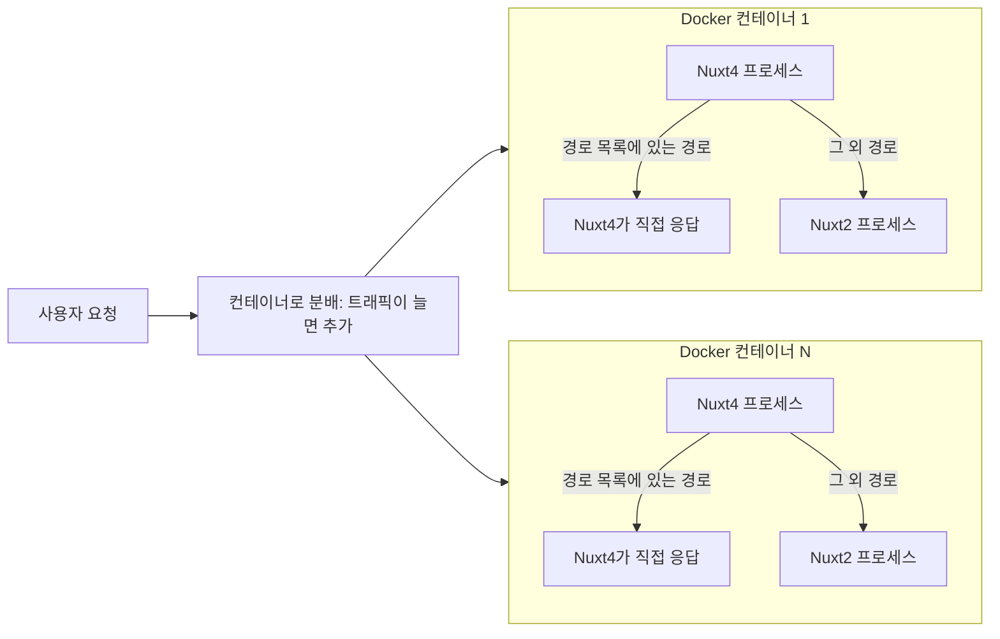
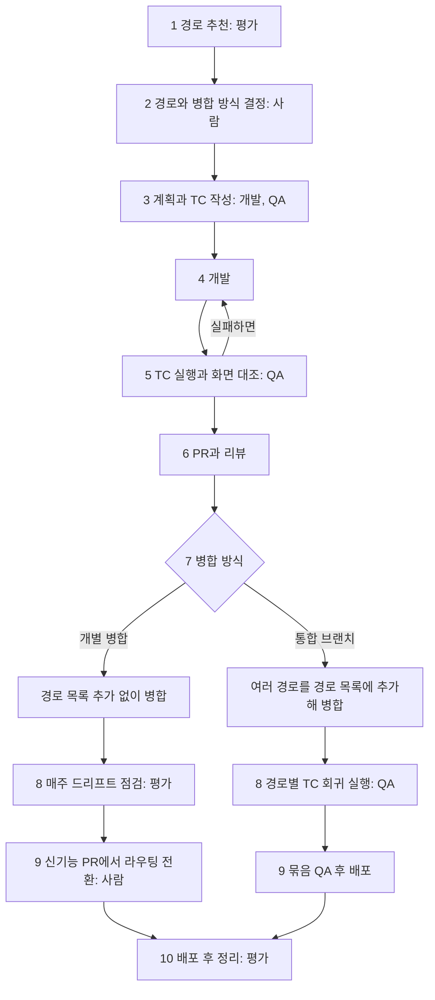
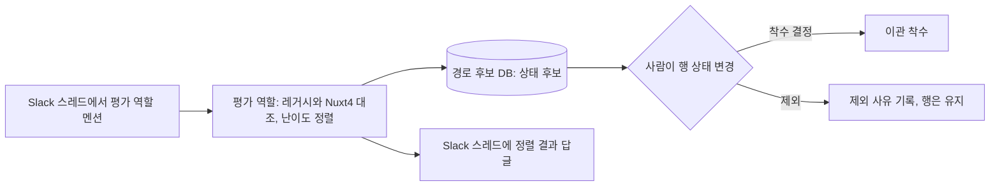

| 순서 | 글 |
|---|---|
| 1 | [Nuxt4를 품는 모노레포에서 경로별 부분배포로 마이그레이션 이어 가기](/dev-articles/2026/11/20/partial-deploy-by-path-in-nuxt4-monorepo/) |
| 2 | [실패한 에이전트 하네스, dailyagent 돌아보기](/dev-articles/2026/11/20/failed-agent-harness-dailyagent-retrospective/) |
| 3 | [QA 부하를 줄이기 위한 테스트 플랫폼 제작기](/dev-articles/2026/11/20/test-platform-to-reduce-qa-load/) |
| 4 | [알지만 여력이 없던 일을 별도 사용량으로 돌리기](/dev-articles/2026/11/20/run-known-but-unstaffed-checks-on-separate-usage/) |
| 5 | 비용 부채를 줄이며 기능 개발을 이어 가는 마이그레이션 자동화 팀 꾸리기 (이 글) |

이전에 Nuxt4와 Nuxt2를 동시에 띄우는 [경로별 부분배포](/dev-articles/2026/11/20/partial-deploy-by-path-in-nuxt4-monorepo/) 구조를 만들었습니다. 경로별로 마이그레이션된 코드를 배포할 수 있게 되면서, 기능 개발을 이어 가는 동시에 마이그레이션할 코드 자체는 줄여 나갈 수 있게 되었습니다. 대신 한 컨테이너 안에 Nuxt 프로세스를 2개 띄우는 구조가 되어 트래픽에 취약하고, 서버 비용도 더 나오는 문제가 생겼습니다. 그래서 최대한 빠르게 마이그레이션을 끝내는 것이 프론트엔드 팀의 과제가 되었고, 마이그레이션 자동화 팀은 이 과제를 기능 개발과 함께 풀려고 만들었습니다.

## Grok Bot으로 에이전트 팀을 꾸린 배경

기능 개발과 마이그레이션을 같이 감당하다 보니, 개발의 일부를 자동으로 맡길 수단이 먼저 필요했습니다. 태스크에서 변경 요청까지를 한 줄로 잇는 첫 시도는 인지 부하 때문에 접었고, 그 과정은 [2편](/dev-articles/2026/11/20/failed-agent-harness-dailyagent-retrospective/)과 [사람이 프록시가 아니라 오케스트레이터가 되기](/dev-articles/2026/11/18/be-an-orchestrator-not-a-proxy/)에 적었습니다.

그다음 참고가 된 것은 [4편](/dev-articles/2026/11/20/run-known-but-unstaffed-checks-on-separate-usage/)의 점검 에이전트였습니다. Grok Bot으로 에이전트를 돌리면 폰으로 보고를 받고 사람이 봐야 할 것만 고를 수 있고, 개발과 따로 집계되는 사용량으로 돌릴 수 있었습니다. 그래서 마이그레이션 팀도 같은 구조로 시작했습니다. 역할마다 에이전트를 하나씩 두고, Grok Bot에서 돌리면서 모바일로 관리하는 계획이었습니다.

## 한 컨테이너에 Nuxt 프로세스 2개를 띄우는 구조와 비용 부채

경로별 부분배포에서는 인스턴스를 나누지 않습니다. 한 컨테이너 안에서 Nuxt4 프로세스가 요청을 먼저 받고, 경로 목록에 있는 경로는 직접 처리하고, 나머지는 같은 컨테이너의 Nuxt2 프로세스로 프록시합니다. 지금은 트래픽이 늘어나면 컨테이너 수를 늘려서 처리합니다. 그래서 컨테이너가 하나 늘 때마다 Nuxt 프로세스도 두 개씩 늘고, 아직 옮기지 못한 경로의 요청은 두 프로세스를 모두 거칩니다.



레거시 앱의 Nuxt2 프로세스는 그 앱의 경로를 모두 옮겨야 걷어낼 수 있습니다. 경로 하나를 옮겨서는 줄어드는 것이 없고, 앱 하나가 끝나는 시점마다 줄어듭니다. 저는 이 비용을 **컴퓨팅 비용**{: .key} 부채라고 부릅니다. 이자처럼 기간에 비례해 쌓이고, 갚는 시점이 앱 단위로 오기 때문입니다.

한편 기능 개발은 멈추지 않습니다. 아직 옮기지 못한 경로에 기능이 들어오면 레거시 화면 코드가 바뀌어서 그 경로를 옮기는 작업이 낡고, 이미 옮긴 경로에 들어오면 Nuxt4에서 바로 개발됩니다.

그래서 마이그레이션은 많이 옮기는 일이 아니라, 앱 하나를 끝내기까지의 기간을 줄이는 일에 가깝다고 생각했습니다. 옮기는 순서도 기능 개발 계획과 맞아야 합니다. 새 기능이 닿을 경로가 아직 레거시 화면이면, 그 기능은 두 번 만들어집니다.

## 팀의 목표: 두 프로세스 운영 기간 단축과 기능 개발 병행

**팀의 목표는 이 두 부담을 같이 푸는 것입니다**. 하나만 풀면 다른 쪽이 더 나빠지기 때문입니다. 옮기는 속도만 올리면 사람 확인이 밀리고, 기능 개발을 멈추고 옮기면 요청이 쌓입니다. 그래서 목표를 세 가지로 나눠 두고, 이후 설계 결정마다 이 셋으로 판단했습니다.

| 목표 | 팀이 택한 장치 |
|---|---|
| 앱 하나를 끝내기까지의 기간 단축 | 평가·개발·QA 역할 분리, 경로 단위 병렬 작업 |
| 기능 개발을 막지 않기 | 병합 방식 2종, 매주 드리프트 점검, 신기능에 맞춘 경로 선정 |
| 사람이 병목이 되지 않기 | 레거시에서 기계로 뽑는 검증 분모, 보호 경로 관문, 확인 요청 비용 낮추기 |

## 평가·개발·QA 역할 분리

일을 세 역할로 나눴습니다.

| 역할 | 하는 일 | 하지 않는 일 |
|---|---|---|
| 평가 | 후보 경로 제안과 난이도 평가, 드리프트 점검, 운영 중 문제를 지침 개정 이슈로 올리기, 배포 후 정리 | 착수 결정, 이관 코드 |
| 개발 | 경로별 계획, Nuxt2에서 Nuxt4로 다시 쓰기, PR | 병합, 테스트 서버 데이터 생성 |
| QA | 레거시에서 검증 항목 추출, TC 작성, 이관 결과에서 TC 실행과 화면 대조 | 개발 구현을 보고 TC 쓰기 |

실행과 검증은 한 역할에 묶지 않았고, 시작은 사람이 정합니다. 어느 경로를 어떤 병합 방식으로 갈지 사람이 정하지 않으면 착수하지 않습니다. 합의는 채팅이 아니라 장부 저장소에 남깁니다. 이 원칙의 이유는 [사람이 프록시가 아니라 오케스트레이터가 되기](/dev-articles/2026/11/18/be-an-orchestrator-not-a-proxy/)에 있습니다.

테스트 서버 데이터는 QA 역할 몫으로 정했습니다. 테스트 DB라서 QA 역할은 데이터를 만들고 고치고 지우는 일을 사람에게 묻지 않고 하고, 성공한 방법은 시드로 e2e 저장소에 올려 다른 경로가 재사용하게 합니다. 개발 역할은 읽기 전용이고 필요한 데이터는 QA 역할에게 요청합니다. 주문과 결제 같은 경로에서 데이터를 누가 만드는지를 매번 다시 묻던 일이 첫 운영 주간에 반복되어서 정한 규칙입니다.

## 경로 하나를 옮기는 10단계와 병합 방식 2종

경로 하나가 PR이 되기까지는 10단계입니다. 병합 방식에 따라 뒤쪽 단계가 갈립니다.



개별 병합은 이관한 경로를 경로 목록에 추가하지 않은 채 develop 브랜치에 병합합니다. 병합한 뒤에도 그 경로의 요청은 계속 Nuxt2로 프록시됩니다. 경로 목록은 어느 경로를 Nuxt4가 직접 처리할지 정하는 목록이고, [1편](/dev-articles/2026/11/20/partial-deploy-by-path-in-nuxt4-monorepo/)에서 다뤘습니다. 그 경로를 경로 목록에 추가해 Nuxt4로 라우팅을 전환하는 일은 그 경로에 신기능을 개발하는 PR에서 합니다. 전환 전까지 Nuxt2 쪽 코드에 생긴 변경은 평가 역할이 금요일마다 찾고, 개발 역할이 후속 PR로 반영합니다. 사람 QA는 라우팅을 전환하는 신기능 PR에서 한 번 합니다. 통합 브랜치는 여러 경로를 한 브랜치에 모으고, 경로 목록에도 추가한 상태로 한 번에 병합합니다. 병합 전에 QA 역할이 경로별 TC를 회귀 실행합니다. 묶음 전체의 QA는 그 묶음을 맡은 팀이 책임집니다.

레거시 앱의 Nuxt2 프로세스를 걷어내려면 그 앱의 모든 경로가 경로 목록에 올라가 Nuxt4로 라우팅되어야 합니다. 개별 병합은 라우팅 전환을 그 경로의 신기능 PR까지 미루고, 통합 브랜치는 병합과 함께 묶음 단위로 전환합니다. 그래서 **병합 방식을 착수 전에 사람이 고르게 했습니다**.

경로를 고르는 기준은 중간에 바꿨습니다. 처음에는 조회 위주이고 위험이 낮은 화면부터 골랐습니다. 기계 QA를 시험하기에 안전했기 때문입니다. 지금은 신기능 추가에 맞춰 대응하는 쪽으로 바뀌었습니다. 동료가 신기능을 붙일 영역을 알려 주면, 평가 역할이 그 아래 경로를 난이도가 낮은 순으로 정렬해 후보로 올립니다. 난이도는 레거시 고유 코드량, 쓰기를 포함한 API 수, 결제 여부, Nuxt4 초안 유무로 매깁니다. 기능이 닿을 경로를 먼저 옮기면 그 경로에는 레거시 화면에 쌓이는 변경이 없어지고, 앞에서 말한 두 번 만들어지는 기능도 줄어듭니다.

후보를 올려 달라는 요청은 Slack 스레드에서 평가 역할을 멘션하는 것으로 시작합니다. 아래는 실제 스레드를 바탕으로 경로 이름과 사람 이름을 바꾼 예시입니다.


평가 역할은 Slack에 답만 남기지 않고, 경로마다 Notion의 경로 후보 DB에 행을 하나씩 만듭니다. 행에는 경로, 난이도 순번으로 시작하는 제안 사유, 상태가 들어가고, 새 행의 상태는 「후보」입니다. 착수 여부는 Slack 답글이 아니라 이 행의 상태로 정합니다. 사람이 상태를 「착수 결정」으로 바꾼 경로만 진행하고, 빼야 할 경로는 「제외」로 바꾸고 제외 사유를 적습니다. 행은 지우지 않기 때문에 결정을 되돌릴 때도 상태만 바꾸면 됩니다.



대화는 Slack에서 하고 결정은 DB 행에 남깁니다. 스레드는 시간이 지나면 묻히지만, DB는 상태별로 걸러서 어느 경로가 후보이고 어느 경로가 착수됐는지 한눈에 볼 수 있기 때문입니다.

## 레거시 템플릿에서 뽑는 분모와 독립 TC

사람 QA를 기다리는 시간이 길어지면 두 프로세스 운영 기간도 같이 늘어납니다. 그래서 QA 역할이 사람 QA 앞에서 걸러 낼 수 있어야 했고, 그러려면 무엇을 덮어야 하는지부터 사람의 말이 아니라 코드에서 정해야 했습니다. 에이전트 QA가 먼저 돌고 사람 QA가 그다음에 보는 순환은 [3편](/dev-articles/2026/11/20/test-platform-to-reduce-qa-load/)의 구조를 그대로 쓰고, **이관 화면에서는 그 분모를 레거시 코드에서 뽑습니다**.

### 분모 추출

레거시 Vue 템플릿에서 이벤트, 조건, 반복을 정규식으로 뽑아 항목마다 id를 붙입니다. 이벤트는 `v-on:click`과 줄임 표기인 `@click`이 모두 Vue 문서에 있는 문법이고, 조건은 `v-if`, `v-else-if`, `v-show`, 반복은 `v-for`입니다. 조건에 쓰인 값이 모두 TC 입력으로 고정되는 값이면 분기가 입력만으로 정해지는 항목(S)이고, 서버 응답에 갈래가 달려 있으면 테스트 서버에서 데이터를 만들어 관측해야 하는 항목(V)으로 분류합니다.

```js
import { readFileSync } from 'node:fs'
import { createHash } from 'node:crypto'

const [file, ...fixed] = process.argv.slice(2)
const src = readFileSync(file, 'utf8')
const tpl = src.match(/<template>([\s\S]*)<\/template>/)[1]
const offset = src.slice(0, src.indexOf(tpl)).split('\n').length - 1

const patterns = [
  { kind: 'event', re: /(?:@|v-on:)([\w.-]+)="([^"]*)"/g },
  { kind: 'branch', re: /v-(?:if|else-if|show)="([^"]*)"/g },
  { kind: 'loop', re: /v-for="([^"]*)"/g },
]

const items = []
for (const { kind, re } of patterns) {
  for (const m of tpl.matchAll(re)) {
    const line = tpl.slice(0, m.index).split('\n').length + offset
    const expr = m[m.length - 1]
    const tokens = expr.match(/[A-Za-z_$][\w$]*/g) ?? []
    const fromInput = tokens.every((t) => fixed.includes(t))
    const cls = kind === 'branch' ? (fromInput ? 'S' : 'V') : '-'
    items.push({ id: `${kind}@${line}`, kind, expr, cls })
  }
}
items.sort((a, b) => a.id.localeCompare(b.id, 'en', { numeric: true }))

const out = JSON.stringify({ file, denominator: items.length, items }, null, 2)
console.log(out)
console.error('sha256', createHash('sha256').update(out).digest('hex'))
```

같은 입력으로 두 번 돌리면 출력의 sha256이 같아야 한다는 조건을 걸어 두었습니다. 사람이 손으로 항목을 줄이는 일을 막으려는 장치입니다. 틀렸으면 결과를 고치지 않고 스크립트를 고쳐서 다시 뽑습니다. 위 예시는 템플릿만 보고, 실제로는 조건 값의 출처를 스크립트 쪽에서 따라가는 단계를 하나 더 둡니다.

분모는 서버 응답에 달린 항목(V)을 뺀 나머지이고, 커버율은 TC가 덮은 항목을 분모로 나눈 값입니다.

```js
export function coverage(items, tcs) {
  const covered = new Set(tcs.flatMap((tc) => tc.covers))
  const base = items.filter((i) => i.cls !== 'V')
  const hit = base.filter((i) => covered.has(i.id))
  return { base: base.length, hit: hit.length, missing: base.filter((i) => !covered.has(i.id)).map((i) => i.id) }
}
```

### 레거시만 보고 쓰는 TC

TC는 레거시 코드와 기준 서버의 관찰만 보고 쓰고, 개발 역할의 구현은 보지 않습니다. 구현을 보고 쓴 TC는 구현이 가진 오해를 그대로 따라가기 때문입니다. 기대값에는 출처를 남깁니다. 기대값을 도구나 에이전트가 만들었다면 재료가 된 레거시 커밋과, 만든 도구나 스킬의 커밋이 둘 다 있어야 합니다.

```yaml
- check: 멤버십 탭에 멤버십 회원만 보인다
  target: legacy
  derived_from:
    code: legacy-app@<commit>
    method:
      tool: extract@<commit>
  via: run   # 기준 서버에서 실행해 확인한 기대값
```

TC가 변별력이 있는지는 분기를 일부러 뒤집은 빌드에서 TC가 실패하는지로 봅니다. 판정 자체를 믿을 수 있는지는 3편의 판정 구조에 맡깁니다.

### 브라우저 커버리지 API를 쓰지 않은 이유

Playwright의 Coverage API는 페이지에서 쓰인 JavaScript와 CSS의 범위를 알려 주고, Chromium 계열 브라우저에서만 지원합니다. 저는 세고 싶은 단위가 달랐습니다. 필요한 것은 실행된 JS 범위가 아니라 템플릿에 적힌 이벤트와 조건 하나하나였고, 그 목록이 분모였습니다. 그래서 세는 단위를 소스에서 직접 뽑기로 했습니다.

QA 역할이 놓친 차이도 분모 밖에서 나왔습니다. 로딩 스켈레톤이나 hover처럼 일부러 만들지 않으면 화면에 나오지 않는 상태입니다. 그래서 로딩, 빈 상태, hover와 focus, 다이얼로그가 열린 직후는 화면 대조의 필수 점검으로 올렸습니다.

## 병목이 사람의 확인으로 옮겨 간 뒤: 보호 경로와 확인 요청

처음 운영한 한 주 동안 PR은 빨리 나왔습니다. 사람이 곁에 있으면 개발 역할과 QA 역할의 왕복이 분 단위로 돌았습니다. 그런데 일이 멈춘 이유를 자주 생긴 순으로 세어 보니 맨 위는 모델이 아니라 사람 입력이었습니다. 새 세션이 열려서 다시 멘션해 달라는 요청이 걸려 있거나, 확인 요청이 담당자 멘션 없이 올라가 스레드 아래로 밀리는 경우였습니다. 이관이 빨라진 만큼 병목이 사람의 확인으로 옮겨 간 것이라고 저는 봤습니다.

그래서 사람 관문은 풀지 않고, **사람이 답하는 비용을 낮추는 쪽으로 고쳤습니다**. 관문은 세 곳입니다. 시작은 사람이 정하고, 공통 경로를 건드리는 변경은 사람이 리뷰하고, Nuxt4로의 라우팅 전환도 사람이 합니다. 공통 경로 밖은 자동 리뷰 도구인 CodeRabbit이 맡습니다. 공통 경로 관문은 변경 파일 목록으로 확인합니다.

```bash
#!/usr/bin/env bash
set -euo pipefail

base="${1:-origin/main}"
protected='^(common/ui/|apps/|app-config/)'

hits=$(git diff --name-only "$base"...HEAD | grep -E "$protected" || true)
if [ -n "$hits" ]; then
  echo "사람 리뷰 필수: 공통 경로를 변경했습니다"
  echo "$hits"
  exit 1
fi
```

확인 요청은 사람이 한 줄로 답할 수 있게 씁니다. 왜 묻는지, 추천이 무엇인지, 답이 없으면 무엇이 멈추는지를 같이 적어서, 사람은 「추천대로」 한 줄만 쓰면 됩니다. 실제로 결정 요청은 대부분 그 한 줄로 끝났습니다. 반대로 에이전트는 무응답을 합의로 읽지 않고, 명시한 답만 합의로 기록합니다. 한 스레드에서 질문이 둘인데 답이 하나만 오면, 답이 없는 쪽은 아직 묻는 상태입니다.

멘션이 묻히는 문제는 다시 알림으로 풀었습니다. 에이전트의 확인 요청에 답이 없고 그 아래로 글이 쌓였을 때만 다시 알립니다. 요청이 마지막 글이면 보내지 않고, 평일 업무 시간에만 보냅니다.

```js
const WORK_HOURS = [9, 20]

export function shouldRemind(thread, now = new Date()) {
  const last = thread.at(-1)
  const ask = thread.findLast((m) => m.from === 'agent' && m.needsAnswer)
  if (!ask || ask.answered) return false
  if (last === ask) return false
  const day = now.getDay()
  const hour = now.getHours()
  const open = day >= 1 && day <= 5 && hour >= WORK_HOURS[0] && hour < WORK_HOURS[1]
  return open
}
```

같은 질문이 경로마다 반복되는 일은 상시 결정 파일로 줄였습니다. 「앞으로도」 적용하는 결정을 파일 하나에 모아 두고, 에이전트가 묻기 전에 먼저 읽습니다.

```yaml
- id: SD-001
  rule: 공통 레이아웃이 레거시와 다른 점은 고치지 않고 PR 설명에 적는다
  applies_to: all-paths
  source: 결정 스레드
```

사내망 작업 때문에 새 세션이 필요하면 에이전트가 같은 스레드에 새 세션을 직접 이어 띄웁니다. 사람이 다시 멘션해 주지 않아도 되고, 같은 스레드에서 이어 띄우는 횟수에는 한도를 두었습니다.

## 사내망, AI 사용량 계정, 저장소로 나눈 운영 구조

### 사내망 접근이 정한 실행 위치

처음 계획은 Grok Bot에 역할별 에이전트를 두는 것이었습니다. 이 계획을 접게 한 결정타는 Grok Bot에서 사내망에 접근할 수 없다는 점이었습니다. QA 역할은 테스트 서버에 접속해 TC를 실행해야 하는데, 외부 클라우드에서 도는 에이전트는 내부 테스트 서버에 닿지 못합니다. [4편](/dev-articles/2026/11/20/run-known-but-unstaffed-checks-on-separate-usage/)에서 QA 에이전트를 제거한 이유와 같은 제약입니다.

그래서 이관 팀은 사내에 있는 Mac mini에서 Claude 세션으로 돌리고, 일은 Slack 스레드의 멘션으로 받습니다. 점검 에이전트와 달리 이관 팀은 테스트 서버에 직접 닿아야 일이 되기 때문에, 접근 대상을 테스트 서버로 한정하고 개발 역할은 읽기 전용으로 두었습니다.

### 에이전트마다 분리한 AI 사용량 계정

[4편](/dev-articles/2026/11/20/run-known-but-unstaffed-checks-on-separate-usage/)에서 말한 한도 소진의 원인은 추론을 많이 쓰는 작업이 같은 사용량 계정에 걸려 있었던 것입니다. 한 계정을 여럿이 나눠 쓰면 앞선 작업이 뒤의 작업을 멈춥니다. 그래서 사용량이 차면 멈춰도 되는 에이전트와 계속 돌아야 하는 에이전트를 나누고, Claude나 Codex 같은 AI 사용량 계정을 따로 붙였습니다.

Sentry 관측이나 SEO 분석처럼 주기적으로 도는 에이전트는 한 회차도 멈추지 않고 실행되어야 하지만, 일의 대부분이 스크립트라서 사용량을 거의 쓰지 않습니다. 이관 팀은 추론이 많이 필요해서 사용량이 높은 대신, 사용량이 다 차면 멈춰도 됩니다. 계속 돌아야 하는 점검 에이전트가 사용량이 큰 이관 팀과 같은 계정에 묶여 있으면, 이관 팀이 한도를 채우는 순간 점검까지 멈춥니다.

```yaml
agents:
  - name: weekly-drift-check
    usage_account: account-a
    pause_ok: true    # 한 회차를 놓쳐도 다음 회차가 따라잡음
  - name: path-dev
    usage_account: account-b
    pause_ok: false   # 사람이 답을 기다림
```

### 바뀌는 요인과 바뀌지 않는 기록

이 팀은 운영하는 동안 실행 환경을 여러 번 바꿨습니다. Grok Bot에서 Mac mini로 머신을 옮겼고, 에이전트마다 Claude나 Codex 같은 사용량 계정을 따로 붙였습니다. 이렇게 바꾸면서 확인한 것은 에이전트 스킬, 기록을 저장할 저장 공간, 에이전트가 돌 머신, AI 모델이 모두 바뀔 수 있는 요인이라는 점입니다. 시대의 흐름에 따라, 그리고 사람들이 하네스를 개선하면서 점차 바뀌어 가는 것들이고, 지금 고른 것도 언제든 다른 것으로 바뀔 수 있습니다.

반면에 바뀌지 않는 것도 있습니다.

| 바뀔 수 있는 요인 | 바뀌지 않는 기록 |
|---|---|
| 에이전트 스킬 | 무엇을 마이그레이션하고 있었는지 |
| 기록을 저장할 저장 공간 | 어디까지 진행했고 어떻게 진행하고 있는지 |
| 에이전트가 돌 머신 | 그때 왜 그런 결정을 내렸는지 |
| AI 모델 | 그 결정이 그 당시에 합당했다는 증거 |
| | 그 판단을 에이전트가 추론 없이 정할 수 있는지, 추론에 기댄다면 그 추론의 확신도 |

마지막 항목이 특히 중요합니다. 같은 판단이라도 레거시 템플릿에서 분모를 뽑는 일처럼 스크립트로 정해지는 것은 모델이 바뀌어도 결과가 같습니다. 반대로 경로의 난이도를 매기는 일처럼 추론에 기대는 판단은 모델이 바뀌면 결과도 달라질 수 있습니다. 그래서 판단을 기록할 때는 결정 내용과 이유만이 아니라, **결정론적으로 정한 것인지와 추론이라면 얼마나 확신했는지를 같이 남깁니다**. 다음에 다른 모델이 같은 기록을 읽을 때, 그대로 따를 판단과 다시 검토할 판단을 이 값으로 가릅니다.

```yaml
decision:
  what: "/account 하위 경로를 난이도 낮은 순으로 후보에 올림"
  why: "신기능을 붙일 영역이라 먼저 옮기면 레거시 화면 변경이 쌓이지 않음"
  evidence: "레거시 고유 코드량, 쓰기 포함 API 수, 결제 여부, Nuxt4 초안 유무 비교 결과"
  deterministic: false   # 순위 자체는 추론
  confidence: medium     # 호출량 조회 없이 정적 분석만으로 정렬
```

그래서 스킬이나 저장 공간, 에이전트가 돌아갈 머신, 모델은 모두 바뀔 수 있는 요인으로 보고, 이 요인들이 바뀌어도 그대로 이어 갈 수 있는 가변적인 하네스를 구축하는 것이 중요하다고 생각했습니다. 그래서 하네스 프레임워크를 만들었습니다.

## 지금 진행 중인 시점의 정리

이관은 지금 진행 중입니다. Nuxt2 프로세스를 걷어내는 순간은 앱 단위로 하나씩 오기 때문에, 두 프로세스 운영의 비용은 앱이 끝날 때마다 줄어듭니다. 팀은 그 순간까지 걸리는 기간을 줄이는 데 맞춰져 있습니다.

운영하면서 확인한 것은 두 가지입니다. 옮기는 일은 에이전트가 빠르게 처리하고, 그만큼 **병목이 사람의 확인으로 옮겨 간다**는 것입니다. 그리고 기능 개발은 멈추지 않으니, 경로를 고르는 기준이 위험이 낮은 화면에서 기능이 닿을 경로로 바뀌었다는 것입니다.

그래서 이관을 자동화할 때는 처리량을 올리기 전에 병목이 어디로 옮겨 가는지부터 보려고 합니다. 사람 관문은 풀지 않고, 사람이 한 번 답하는 비용부터 줄이는 순서로 갑니다.
