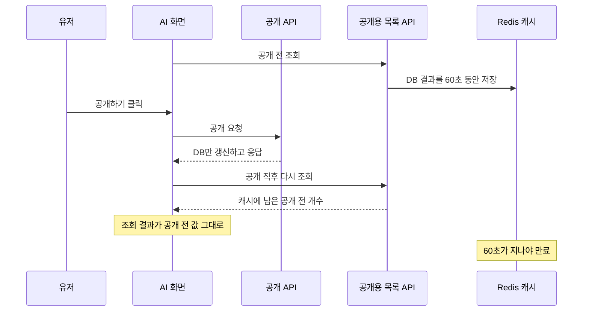

새로고침하면 맞게 나오는데, 새로고침하기 전에는 왜 틀리게 나올까요? 유저가 AI 화면에서 게시 항목을 공개했는데도, 같은 화면에 보이는 공개된 게시 항목 수 조회 결과는 공개 전 값에 머물러 있었고 그 값으로 그리는 진행 안내도 바뀌지 않았습니다. 원인은 AI 화면에 조회 결과를 가져다주는 에이전트의 **관측 도구**{: .key}가 방문자에게 보여 주는 공개 화면용 읽기 API를 그대로 쓰고 있었고, 그 API의 60초 캐시가 쓰기 쪽 어디에서도 비워지지 않는다는 것이었습니다.

## 공개 직후 갱신되지 않는 AI 화면의 조회 결과

이 화면에서 AI는 게시 항목을 초안까지만 만듭니다. 게시 항목은 한 번 공개하면 유형을 바꿀 수 없고, 방문자가 이용하기 시작하면 가격과 기간이 잠깁니다. AI가 정한 값이 틀렸을 때 사람도 되돌릴 수 없으니, 공개는 유저가 「공개하기」 버튼을 눌러서 하고 화면 코드가 공개 API를 직접 부르도록 했습니다. 공개 API는 AI가 부를 수 있는 도구 목록에도 넣지 않았습니다.

공개 요청이 끝나면 AI 화면은 조회 결과를 한 번 다시 받아 오고, 그때 에이전트의 관측 도구가 「방문자가 볼 수 있는 게시 항목 수」를 읽습니다. 화면의 진행 안내와 다음 목표도 이 조회 결과로 정해집니다. 문제는 PO가 직접 진행한 테스트에서 올라왔습니다. 보고 원문은 「새로고침해야 3/5로 반영(포스트 공개 때는 바로 반영됨)」이었습니다. 처음에는 에이전트 턴 로그로 원인을 찾으려 했는데, 공개는 AI 턴이 아니라 화면에서 처리되기 때문에 로그만으로는 판정할 수 없었습니다. 그래서 코드와 테스트 서버 실측으로 원인을 확인했습니다.



캐시 키는 유저 하나 단위라서, 공개 전 1분 안에 누군가 같은 유저의 목록을 한 번이라도 읽었다면 공개 직후의 조회는 **공개 전 값을 그대로 받고, AI 화면은 그 값으로 한 번 그려진 뒤 멈춥니다**. 사람은 새로고침으로 넘어가지만, AI 화면은 쓰기 직후 한 번 읽은 값으로 다음 안내까지 정합니다.

## 쓰기 경로에 무효화가 없는 60초 Redis TTL

공개용 목록 API는 PHP 서버에 있고, 공개된 게시 항목 목록을 Redis에 read-through 방식으로 캐시합니다. 처음에는 60초짜리 `setex`로 들어갔고, 나중에 캐시 어댑터 방식으로 바꿀 때도 TTL 60초만 그대로 유지됐습니다. [Redis 문서](https://redis.io/docs/latest/commands/expire/)는 만료 시간이 지난 키는 자동으로 지워진다고 설명하는데, 이 캐시는 그 만료 말고는 값이 바뀌는 경로가 없습니다.

저장소 전체에서 이 캐시 키를 참조하는 곳은 읽기 함수 하나뿐이었습니다. 공개, 공개 범위 변경, 삭제는 모두 DB만 갱신하고, 캐시가 읽기 라이브러리 안에 있어서 쓰기 쪽 컨트롤러는 이 캐시가 있는지도 모릅니다. 그래서 **공개한 게시 항목은 최대 1분 늦게 목록에 나타나고, 삭제한 게시 항목은 최대 1분 동안 목록에 남습니다**. 다른 종류의 게시물은 공개하자마자 반영된 것도 같은 이유로 설명됩니다. 다른 종류의 공개용 목록에는 이런 캐시가 없었습니다.

## 약 66초로 잰 이유: 15초 간격 폴링

지연은 테스트 서버에 로그인한 헤드리스 브라우저에서 `fetch`를 직접 실행해서 쟀습니다. 브라우저 캐시가 섞이지 않도록 `cache: "no-store"`와 타임스탬프 쿼리를 붙였고, 공개용 목록을 한 번 읽어 서버 캐시를 채운 뒤 1초 뒤에 공개하고, 그다음부터 15초 남짓 간격으로 다시 읽었습니다.

| 공개 후 | 공개용 목록에 새 게시 항목이 있는가 |
|---|---|
| +0초 | 없음 |
| +16초 | 없음 |
| +19초 | 없음 |
| +34초 | 없음 |
| +49초 | 없음 |
| +65초 | 있음 |

공개 시각부터 처음 보인 시각까지를 그대로 빼면 약 66초가 나옵니다. 다만 마지막으로 안 보인 시점이 +49초, 처음 보인 시점이 +65초이고, 캐시를 채운 읽기가 공개 1초 전이었으니 캐시는 늦어도 공개 후 59초쯤 만료됩니다. 그래서 **66초는 15초 측정 간격과 초 단위 절사가 만든 상한값이고, 실제 반영은 공개 후 49~65초 사이였습니다**. TTL을 넘겨서 캐시가 남아 있던 것은 아닙니다.

## 공개용 목록 API를 조회 경로로 고른 설계 의도

공개용 목록을 조회 경로로 쓴 건 실수가 아니라 일부러 고른 설계였습니다. 관리용 API는 초안과 비공개를 포함하고, 공개용 API는 공개된 것만 셉니다. 그래서 공개용 API의 총개수가 곧 「방문자가 볼 수 있는 것」이라고 생각해, 이 게시 항목을 포함한 여러 종류의 공개 조회를 공개용 API로 통일했습니다. 관리용 총개수(만들어 둔 것)와 공개용 총개수(방문자가 볼 수 있는 것)를 함께 들고 있어야 「쉰 개를 만드셨는데 방문자는 하나도 못 봅니다」 같은 말을 할 수 있기 때문입니다.

다만 그 설계를 정할 때 공개용 API의 캐시는 고려하지 않았습니다. 제 생각엔 이 건의 핵심은 값의 뜻이 아니라 신선도 쪽에 있습니다. **사람용 읽기 API는 값의 뜻과 함께 얼마나 늦게 맞아져도 되는지도 사람 기준으로 정해져 있습니다**. 방문자는 새 게시 항목이 1분 늦게 보여도 알아채기 어렵고, 이상하면 새로고침합니다. 반면 AI 화면의 조회는 공개 응답을 받자마자 읽고, 그 값으로 진행 안내와 다음 목표를 정합니다. 같은 조회 결과를 읽는 브리핑과 추천 규칙도 최대 1분 동안 공개 전 값으로 판단할 수 있는 구조였습니다.

## TTL 캐시와 쓰기 직후 조회를 재현한 예시

사내 코드 대신, 게시글에서 보여 드리기 위해 같은 구조를 가진 작은 예시를 새로 만들었습니다. 읽기 쪽에만 TTL 캐시가 있고 쓰기 쪽은 DB만 바꾸는 구조이고, 시계는 테스트용 가짜 시계입니다.

```js
// repro.mjs
let now = 0                                   // 테스트용 가짜 시계(초)
const db = { publishedItems: 2 }
const cache = new Map()                       // key -> { value, expiresAt }

function readPublicCount(userId) {            // 사람(방문자)용 읽기 API
  const hit = cache.get(userId)
  if (hit && hit.expiresAt > now) return hit.value
  const value = db.publishedItems
  cache.set(userId, { value, expiresAt: now + 60 }) // TTL 60초
  return value
}

function publishItem() {                      // 쓰기 API: DB만 갱신
  db.publishedItems += 1
}

readPublicCount('u1')                         // 공개 직전에 한 번 읽어 캐시가 채워짐
now = 1
publishItem()
for (const t of [1, 17, 20, 35, 50, 66]) {    // 15초 남짓 간격으로 다시 읽기
  now = t
  console.log(`+${t - 1}s`, readPublicCount('u1') === 3)
}
```

`node repro.mjs`로 돌리면 테스트 서버에서 잰 것과 같은 모양이 나옵니다.

```text
+0s false
+16s false
+19s false
+34s false
+49s false
+65s true
```

AI 화면 쪽 수정은 조회가 읽는 경로만 바꾸는 작은 변경입니다. 같은 예시 구조로 옮기면 아래와 같습니다.

```ts
// 바꾸기 전: 캐시를 타는 공개용 목록의 길이로 센다
const before = (await api.get('/items/public', { userId })).items.length

// 바꾼 뒤: 캐시 없는 관리용 목록을 공개용과 같은 조건으로 걸러 총개수만 받는다
const after = (await api.get('/manage/items', {
  draft: false,
  visibility: 'public',
  limit: 1,
})).totalCount
```

관리용 목록은 DB를 바로 조회하고 캐시를 거치지 않습니다. 조건을 「초안 아님, 공개 범위 public」으로 맞췄기 때문에 세는 값의 뜻은 공개용 목록과 같습니다.

## 서버 무효화·폴링 연장·관리 목록 교체 비교

| 방법 | 얻는 것 | 치르는 비용 | 판단 |
|---|---|---|---|
| 쓰기 경로에서 서버 캐시 무효화 | 공개 화면과 AI 화면이 모두 공개 직후에 맞아짐 | 백엔드 저장소의 캐시라 웹에서 임의로 무효화할 방법이 마땅치 않음 | 쓰지 않음. 웹 인원만 투입된 프로젝트라 역할 경계상 한계가 있었음 |
| 조회 폴링을 TTL보다 길게 연장 | 서버 변경이 필요 없음 | 폴링을 늘려도 캐시가 만료되는 최대 60초는 줄지 않고, 그동안 AI 화면의 조회 결과는 공개 전 값으로 남음 | - |
| 조회 경로를 캐시 없는 관리용 목록으로 교체 | 공개 직후 바로 맞아짐, 웹 코드만 바꾸면 됨 | 공개용 목록에만 있는 필드는 읽을 수 없음 | 채택 |

서버 캐시를 쓰기 경로에서 비우면 공개 화면과 AI 화면이 한 번에 맞아집니다. 다만 그 캐시는 백엔드 저장소 쪽 캐싱이라 웹 입장에서 임의로 무효화할 방법이 마땅치 않았고, 이 프로젝트에는 웹 인원만 우선 투입되어 있어서 서버 캐싱 무효화를 제가 임의로 하는 데에는 역할 경계상 한계가 있었습니다. 그래서 **웹에서 바꿀 수 있는 조회의 읽기 경로를, DB를 바로 조회하는 관리용 목록으로 옮겼습니다**.

읽기 경로를 바꿀 수 없는 환경이라면 다른 선택지도 생각해 볼 수 있습니다. 쓰기 API가 성공 응답을 준 값은 조회 결과로 그대로 믿는 도구 계약을 세우는 방법이 있고, 읽기 응답에 캐시에 담긴 시각이나 남은 TTL 같은 힌트를 같이 돌려줘서 AI 화면 쪽이 오래된 값임을 알 수 있게 하는 방법도 있습니다.

## 관리용 목록으로 옮긴 뒤의 확인과 남긴 공개용 목록

바꾼 뒤에는 네 가지를 확인했습니다. 단위 테스트에서 조회가 관리용 목록 경로와 공개 조건으로 요청하는지 확인했고, 테스트 서버에 다시 배포한 뒤 공개 직후 관리용 목록은 6에서 7로 바로 늘고 공개용 목록은 6에 머무는 것, 삭제 직후 관리용 목록이 바로 6으로 돌아오는 것을 실측했습니다. 실제 화면이 새 경로로 요청하는지도 네트워크에서 확인했습니다. 마지막으로 에이전트가 화면을 직접 조작해 PO의 시나리오를 다시 돌렸고, 새로고침 없이 진행 안내가 2/4에서 3/5로 바뀌고 다음 목표 안내가 바로 나왔습니다.

공개용 목록을 전부 걷어 낸 건 아닙니다. 이미 운영을 시작한 유저가 다음 단계로 올라가는지 판단하는 관문은 공개용 목록에만 있는 신청 기간 필드를 읽어야 합니다. 이 관문은 운영을 시작하기 전 유저에게는 적용되지 않기 때문에, **이 관문만은 공개용 목록에 그대로 남기기로 했습니다**. 그래서 이미 운영 중인 유저의 다음 단계 판단은 지금도 최대 1분 늦을 수 있습니다.

## 역할 경계를 나누는 팀 구조의 한계

이번 건은 원인을 알고 나서도 가장 근본적인 해결인 서버 캐시 무효화로는 가지 못했습니다. 이런 문제를 알고 있는데도 팀의 리소스 문제로 해결하지 못하는 게, 역할별로 경계를 나누는 팀 구조의 한계라고 생각합니다. 그래서 프로덕트 엔지니어나 프로덕트 메이커라는 직군이 생기는 것 같습니다.

유저가 보는 AI 화면의 조회 결과를 사람용 읽기 API에서 가져올 때는, 값의 뜻과 함께 쓰기 직후에 얼마나 늦게 맞아지는지도 같이 확인하려고 합니다.
